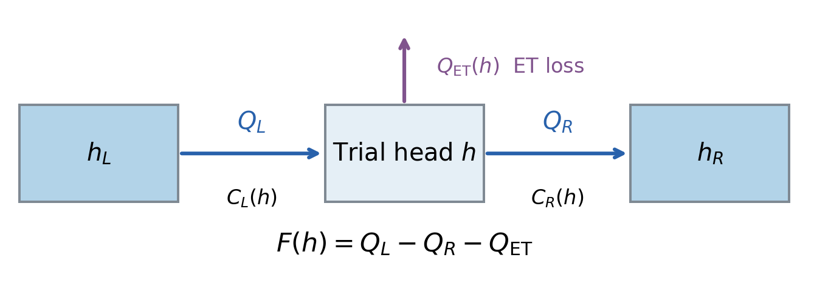

### Write the central-cell water balance

With conductance defined, we can express the flows on the left and right of the central cell. Let $h_L$ and $h_R$ be the specified boundary heads, and $h$ the central head, all in metres. Let $C_L(h)$ and $C_R(h)$ be the connection conductances in m²/s. Positive flow points to the right in both connections:

$$
Q_L(h)=-C_L(h)(h-h_L)=C_L(h)(h_L-h),
$$

$$
Q_R(h)=-C_R(h)(h_R-h)=C_R(h)(h-h_R).
$$

Both discharges are in m³/s. A positive $Q_L$ enters the central cell; a positive $Q_R$ leaves it. A negative value means that the flow is opposite to the arrow. It is a possible flow direction, not a calculation error.

*The arrows define the positive flow directions. They do not prescribe which direction the calculated groundwater flow must take.*

We also allow **evapotranspiration (ET)** to remove groundwater from the central cell. Define $Q_{\mathrm{ET}}(h)$ as the positive ET loss in m³/s. For steady flow without recharge or other sources and sinks, define

$$
F(h)=Q_L(h)-Q_R(h)-Q_{\mathrm{ET}}(h).
$$

**$F(h)$ is the flow residual: the remaining water-balance error at the trial head $h$.** It has units of m³/s. A positive residual means that inflows exceed outflows; a negative residual means that outflows exceed inflows. It is not an additional physical flow through a boundary.

For example, if $Q_L=0.5$ L/s, $Q_R=0.3$ L/s, and $Q_{\mathrm{ET}}=0.1$ L/s, the residual is $0.1$ L/s. These flows do not satisfy a steady-state balance. We must revise the trial head and recalculate the flows.

The balanced head, denoted $h^*$, satisfies

$$
F(h^*)=0.
$$

Zero residual does not mean that all flows are zero. Substantial inflow and outflow can balance one another.

#### Where does the nonlinearity come from?

In a confined aquifer with fixed saturated thickness and no head-dependent change of the boundary relation, the conductances can remain constant. The balance is then linear in the unknown head, even if conductivity differs strongly between cells.

For a wet unconfined cell below the aquifer top,

$$
b=h-z_b,
$$

where $b$ is saturated thickness and $z_b$ is bottom elevation, both in metres. Changing the unknown head now changes both the conductance and the head differences. Products such as $C_L(h)(h_L-h)$ therefore need not be linear in $h$, although $K$ remains constant.

A steep gradient alone does not make Darcy's law nonlinear. Here, the changing saturated thickness is the cause. Head-dependent boundary conditions can introduce another source of nonlinearity when their applicable relationship changes with head.

The thickness relation above applies while the cell is wet and the water table is below the top. The interactive teaching models with a finite aquifer top limit saturated thickness to the physical aquifer thickness. The historical examples in Mehl (2006) use the uncapped relation; these different assumptions are identified in the example settings.
