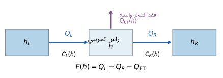

### كتابة الموازنة المائية للخلية المركزية

بعد تعريف المواصلة، نكتب تصريفي الوصلتين. $h_L$ و$h_R$ رأسان حديان محددان، و$h$ الرأس المركزي، وكلها بالمتر. و$C_L(h)$ و$C_R(h)$ مواصلتان بوحدة m²/s. نختار الاتجاه إلى اليمين موجباً في الوصلتين:

$$
Q_L(h)=-C_L(h)(h-h_L)=C_L(h)(h_L-h),
$$

$$
Q_R(h)=-C_R(h)(h_R-h)=C_R(h)(h-h_R).
$$

التصاريف بوحدة m³/s. يدخل $Q_L$ الموجب إلى الخلية المركزية، ويخرج منها $Q_R$ الموجب. القيمة السالبة تعني جرياناً عكس السهم؛ وهي اتجاه فيزيائي ممكن وليست خطأً حسابياً.

*تحدد الأسهم الاتجاهات الموجبة، ولا تفرض اتجاه الجريان الناتج من الحساب.*

نسمح أيضاً بأن يزيل **التبخر والنتح (evapotranspiration, ET)** ماءً من الخلية المركزية. نرمز إلى الفقد الموجب بسببه بـ$Q_{\mathrm{ET}}(h)$، بوحدة m³/s. للجريان المستقر دون تغذية أو مصادر أو مصارف أخرى:

$$
F(h)=Q_L(h)-Q_R(h)-Q_{\mathrm{ET}}(h).
$$

**$F(h)$ هو متبقي التصريف: عدم الاتزان المائي الباقي عند الرأس التجريبي $h$.** وحدته m³/s. المتبقي الموجب يعني أن الداخل أكبر من الخارج، والسالب يعني العكس. وهو ليس تصريفاً فيزيائياً إضافياً عبر أحد الحدود.

إذا كان $Q_L=0.5$ L/s و$Q_R=0.3$ L/s و$Q_{\mathrm{ET}}=0.1$ L/s، فإن المتبقي $0.1$ L/s. لا تحقق هذه التصاريف موازنة مستقرة؛ ولذلك ينبغي تعديل الرأس التجريبي وإعادة حسابها.

يحقق الرأس المتزن $h^*$:

$$
F(h^*)=0.
$$

لا يعني المتبقي الصفري أن جميع التصاريف صفر. فقد تتوازن تصاريف داخلة وخارجة كبيرة.

#### من أين تأتي اللاخطية؟

في خزان محصور بسمك مشبع ثابت، ومن دون تغير في العلاقة الحدية المطبقة تبعاً للرأس، يمكن أن تبقى المواصلات ثابتة. تكون الموازنة حينئذ خطية في الرأس المجهول حتى مع فروق كبيرة في الموصلية بين الخلايا.

لخلية غير محصورة وغير جافة، ويقع سطح الماء فيها تحت سقف الخزان:

$$
b=h-z_b,
$$

$b$ السمك المشبع و$z_b$ منسوب القاع، وكلاهما بالمتر. يغيّر الرأس المجهول كلاً من المواصلة وفروق الرأس؛ ولذلك قد تكون حدود مثل $C_L(h)(h_L-h)$ غير خطية في $h$، رغم ثبات $K$.

التدرج الكبير لا يجعل قانون دارسي غير خطي بذاته. السبب هنا هو تغير السمك المشبع. وقد تنشأ اللاخطية أيضاً من الشروط الحدية إذا تغيرت العلاقة المطبقة مع الرأس.

ينطبق تعبير السمك السابق ما دامت الخلية غير جافة وسطح الماء تحت السقف. في النماذج التعليمية ذات السقف المحدود، لا يتجاوز السمك المشبع السمك الفيزيائي. أما أمثلة Mehl (2006) الأصلية فتستخدم العلاقة دون حد علوي؛ ويُوضَّح هذا الاختلاف في الإعدادات.
