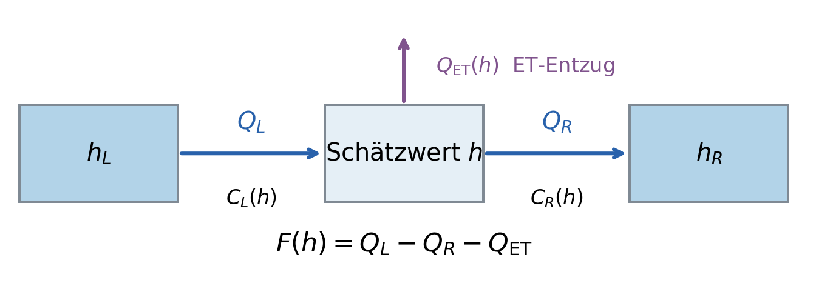

### Die Wasserbilanz der mittleren Zelle

Mit den Leitwerten können wir die Volumenströme links und rechts der mittleren Zelle ausdrücken. $h_L$ und $h_R$ sind die vorgegebenen Randhöhen, $h$ ist die Höhe in der Mitte (jeweils in m). Die Leitwerte der Verbindungen heißen $C_L(h)$ und $C_R(h)$ (in m²/s). Für beide Verbindungen legen wir die positive Strömungsrichtung nach rechts fest. Damit gilt

$$
Q_L(h)=-C_L(h)(h-h_L)=C_L(h)(h_L-h),
$$

$$
Q_R(h)=-C_R(h)(h_R-h)=C_R(h)(h-h_R).
$$

Beide Volumenströme haben die Einheit m³/s. Ein positives $Q_L$ strömt in die mittlere Zelle ein, ein positives $Q_R$ aus ihr aus. Ein negativer Wert zeigt eine Strömung entgegen der eingezeichneten Pfeilrichtung an.

*Die Pfeile legen die positiven Zählrichtungen fest. Die tatsächliche Strömungsrichtung ergibt sich aus den berechneten hydraulischen Höhen.*

Durch **Evapotranspiration (ET)** kann der mittleren Zelle zusätzlich Grundwasser entzogen werden. $Q_{\mathrm{ET}}(h)$ bezeichnet diesen Entzug als positiven Volumenstrom in m³/s. Für die stationäre Strömung ohne Grundwasserneubildung und ohne weitere Quellen oder Senken setzen wir

$$
F(h)=Q_L(h)-Q_R(h)-Q_{\mathrm{ET}}(h).
$$

**$F(h)$ ist das Bilanzresiduum. Es gibt den verbleibenden Fehler der Wasserbilanz für den eingesetzten Schätzwert $h$ an.** Seine Einheit ist m³/s. Ein positives Residuum bedeutet, dass mehr Wasser zu- als abströmt. Ein negatives Residuum bedeutet, dass die Abflüsse überwiegen. $F$ beschreibt somit keinen zusätzlichen Volumenstrom über den Zellrand.

Beispielsweise liefern $Q_L=0{,}5$ L/s, $Q_R=0{,}3$ L/s und $Q_{\mathrm{ET}}=0{,}1$ L/s ein Residuum von $0{,}1$ L/s. Mit diesen Werten ist die stationäre Wasserbilanz noch nicht erfüllt. Wir müssen den Schätzwert für die Höhe verbessern und die Volumenströme erneut berechnen.

Für die gesuchte Höhe $h^*$ gilt

$$
F(h^*)=0.
$$

Auch große Zu- und Abflüsse können sich ausgleichen und ein Residuum von null ergeben.

#### Woher kommt die Nichtlinearität?

In einem gespannten Grundwasserleiter mit konstanter gesättigter Mächtigkeit können die Leitwerte konstant bleiben. Gilt außerdem für die Randbedingungen durchgehend dieselbe lineare Beziehung, ist die Bilanz linear in der unbekannten Höhe. Das gilt auch bei stark unterschiedlichen hydraulischen Leitfähigkeiten in benachbarten Zellen.

Für eine wasserführende, ungespannte Zelle mit einem Grundwasserspiegel unter der Oberkante des Grundwasserleiters gilt

$$
b=h-z_b,
$$

Dabei ist $b$ die gesättigte Mächtigkeit und $z_b$ die Höhenlage der Sohle, jeweils in Metern. Ändert sich die unbekannte Höhe, ändern sich nun sowohl der Leitwert als auch die Höhendifferenz. Produkte wie $C_L(h)(h_L-h)$ können deshalb nichtlinear von $h$ abhängen, obwohl $K$ konstant ist.

Ein großes hydraulisches Gefälle allein macht das Darcy-Gesetz nicht nichtlinear. In diesem Beispiel entsteht die Nichtlinearität durch die veränderliche gesättigte Mächtigkeit. Auch höhenabhängige Randbedingungen können Nichtlinearität verursachen, etwa wenn ab einer Schwellenhöhe eine andere Beziehung gilt.

Die angegebene Beziehung für $b$ gilt, solange die Zelle Wasser führt und der Grundwasserspiegel unter der Oberkante liegt. In den interaktiven Modellen mit vorgegebener Oberkante ist die gesättigte Mächtigkeit auf die tatsächliche Mächtigkeit des Grundwasserleiters begrenzt. Die Originalbeispiele von Mehl (2006) verwenden die Beziehung ohne diese Begrenzung. Die jeweiligen Annahmen sind bei den Einstellungen angegeben.
