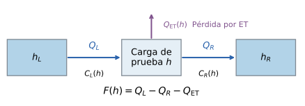

### Escribir el balance de agua de la celda central

Una vez definida la conductancia, expresamos los caudales a izquierda y derecha. $h_L$ y $h_R$ son las cargas de contorno prescritas y $h$ la carga central, todas en metros. $C_L(h)$ y $C_R(h)$ son las conductancias de las conexiones, en m²/s. En ambas conexiones el sentido positivo es hacia la derecha:

$$
Q_L(h)=-C_L(h)(h-h_L)=C_L(h)(h_L-h),
$$

$$
Q_R(h)=-C_R(h)(h_R-h)=C_R(h)(h-h_R).
$$

Ambos caudales se expresan en m³/s. Un $Q_L$ positivo entra en la celda central; un $Q_R$ positivo sale de ella. Un valor negativo indica flujo contrario a la flecha. Es un sentido posible del flujo, no un error de cálculo.

*Las flechas definen los sentidos positivos. No imponen el sentido del flujo subterráneo calculado.*

También permitimos la extracción de agua de la celda central por **evapotranspiración (ET)**. Definimos $Q_{\mathrm{ET}}(h)$ como la pérdida positiva por ET, en m³/s. Para flujo estacionario sin recarga ni otras fuentes o sumideros:

$$
F(h)=Q_L(h)-Q_R(h)-Q_{\mathrm{ET}}(h).
$$

**$F(h)$ es el residuo de caudal: el desequilibrio de agua que queda para la carga de prueba $h$.** Sus unidades son m³/s. Un residuo positivo indica que las entradas superan a las salidas; uno negativo, que las salidas superan a las entradas. No representa un flujo físico adicional a través de un contorno.

Por ejemplo, si $Q_L=0.5$ L/s, $Q_R=0.3$ L/s y $Q_{\mathrm{ET}}=0.1$ L/s, el residuo es $0.1$ L/s. Estos caudales no satisfacen el balance estacionario. Debemos revisar la carga estimada y recalcularlos.

La carga de equilibrio, $h^*$, satisface:

$$
F(h^*)=0.
$$

Un residuo nulo no significa que todos los caudales sean nulos. Pueden compensarse entradas y salidas considerables.

#### ¿De dónde procede la no linealidad?

En un acuífero confinado con espesor saturado fijo y sin cambios de la relación de contorno dependientes de la carga, las conductancias pueden permanecer constantes. El balance es entonces lineal respecto a la carga desconocida, incluso con fuertes contrastes de conductividad entre celdas.

Para una celda libre con agua y con nivel freático por debajo del techo:

$$
b=h-z_b,
$$

$b$ es el espesor saturado y $z_b$ la cota de la base, ambos en metros. Al cambiar la carga desconocida, cambian tanto la conductancia como las diferencias de carga. Por ello, productos como $C_L(h)(h_L-h)$ pueden ser no lineales en $h$, aunque $K$ sea constante.

Un gradiente elevado no convierte por sí solo la ley de Darcy en una relación no lineal. Aquí la causa es el espesor saturado variable. Las condiciones de contorno dependientes de la carga pueden introducir otra no linealidad cuando la relación aplicable cambia con la carga.

La relación de espesor anterior se aplica mientras la celda tenga agua y el nivel freático esté bajo el techo. Los modelos docentes con techo finito limitan el espesor saturado al espesor físico del acuífero. Los ejemplos históricos de Mehl (2006) utilizan la relación sin límite superior; esta diferencia se indica en sus ajustes.
