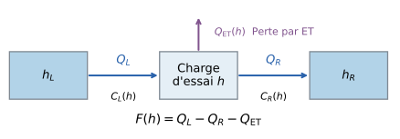

### Écrire le bilan en eau de la maille centrale

La conductance étant définie, nous pouvons exprimer les débits à gauche et à droite de la maille centrale. $h_L$ et $h_R$ sont les charges imposées aux limites, et $h$ la charge centrale, toutes en mètres. $C_L(h)$ et $C_R(h)$ sont les conductances des connexions, en m²/s. Dans les deux connexions, le sens positif est orienté vers la droite :

$$
Q_L(h)=-C_L(h)(h-h_L)=C_L(h)(h_L-h),
$$

$$
Q_R(h)=-C_R(h)(h_R-h)=C_R(h)(h-h_R).
$$

Les deux débits s'expriment en m³/s. Un $Q_L$ positif entre dans la maille centrale ; un $Q_R$ positif en sort. Une valeur négative indique un écoulement opposé à la flèche. C'est un sens d'écoulement possible, et non une erreur de calcul.

*Les flèches définissent les sens positifs. Elles n'imposent pas le sens que doit prendre l'écoulement calculé.*

Nous autorisons aussi l'**évapotranspiration (ET)** à prélever de l'eau dans la maille centrale. $Q_{\mathrm{ET}}(h)$ désigne cette perte positive, en m³/s. Pour un écoulement permanent sans recharge ni autres sources ou prélèvements, nous définissons :

$$
F(h)=Q_L(h)-Q_R(h)-Q_{\mathrm{ET}}(h).
$$

**$F(h)$ est le résidu de débit : le déséquilibre du bilan en eau qui subsiste à la charge d'essai $h$.** Il s'exprime en m³/s. Un résidu positif indique que les entrées dépassent les sorties ; un résidu négatif indique l'inverse. Il ne s'agit pas d'un débit physique supplémentaire à travers une limite.

Par exemple, si $Q_L=0.5$ L/s, $Q_R=0.3$ L/s et $Q_{\mathrm{ET}}=0.1$ L/s, le résidu vaut 0,1 L/s. Ces débits ne satisfont pas un bilan en régime permanent. Il faut réviser la charge d'essai et recalculer les débits.

La charge d'équilibre, notée $h^*$, satisfait :

$$
F(h^*)=0.
$$

Un résidu nul ne signifie pas que tous les débits sont nuls. Des entrées et sorties importantes peuvent se compenser.

#### D'où vient la non-linéarité ?

Dans un aquifère captif dont l'épaisseur saturée est fixe, sans changement de la relation aux limites dépendant de la charge, les conductances peuvent rester constantes. Le bilan est alors linéaire par rapport à la charge inconnue, même si la conductivité varie fortement entre les mailles.

Pour une maille en eau dont la surface libre se situe sous le toit de l'aquifère :

$$
b=h-z_b,
$$

$b$ est l'épaisseur saturée et $z_b$ la cote du fond, toutes deux en mètres. Une modification de la charge inconnue change désormais à la fois les conductances et les différences de charge. Des produits tels que $C_L(h)(h_L-h)$ peuvent donc être non linéaires en $h$, même si $K$ reste constant.

Un gradient élevé ne suffit pas à rendre la loi de Darcy non linéaire. Ici, c'est la variation de l'épaisseur saturée qui est en cause. Les conditions aux limites dépendant de la charge peuvent ajouter une autre source de non-linéarité lorsque la relation applicable change avec la charge.

La relation d'épaisseur ci-dessus s'applique tant que la maille reste en eau et que la surface libre est sous le toit. Les modèles pédagogiques interactifs dotés d'un toit fini limitent l'épaisseur saturée à l'épaisseur physique de l'aquifère. Les exemples originaux de Mehl (2006) utilisent la relation sans plafonnement ; ces hypothèses différentes sont signalées dans les paramètres des exemples.
