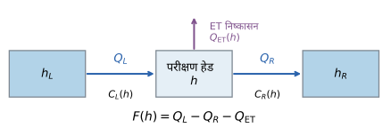

### केंद्रीय सेल का जल संतुलन

अब केंद्रीय सेल के दोनों ओर प्रवाह दर लिखें। $h_L$ और $h_R$ निर्दिष्ट सीमा हेड तथा $h$ केंद्रीय हेड हैं; सभी मीटर में हैं। $C_L(h)$ और $C_R(h)$ के कंडक्टेंस की इकाई m²/s है। दोनों संपर्कों के लिए दाईं ओर धनात्मक दिशा लें:

$$
Q_L(h)=-C_L(h)(h-h_L)=C_L(h)(h_L-h),
$$

$$
Q_R(h)=-C_R(h)(h_R-h)=C_R(h)(h-h_R).
$$

प्रवाह दरों की इकाई m³/s है। धनात्मक $Q_L$ केंद्रीय सेल में प्रवेश करती है और धनात्मक $Q_R$ उससे बाहर निकलती है। ऋणात्मक मान तीर की विपरीत दिशा में प्रवाह दर्शाता है; यह संभव भौतिक दिशा है, गणना की त्रुटि नहीं।

*तीर केवल धनात्मक दिशा निर्धारित करते हैं; वे गणना से प्राप्त वास्तविक प्रवाह दिशा को बाध्य नहीं करते।*

केंद्रीय सेल से **वाष्पोत्सर्जन (evapotranspiration, ET)** द्वारा जल निष्कासन भी होने दें। $Q_{\mathrm{ET}}(h)$ धनात्मक ET हानि है, जिसकी इकाई m³/s है। पुनर्भरण तथा अन्य स्रोतों या निष्कासन के बिना स्थिर प्रवाह के लिए:

$$
F(h)=Q_L(h)-Q_R(h)-Q_{\mathrm{ET}}(h).
$$

**$F(h)$ प्रवाह दर अवशेष है: परीक्षण हेड $h$ पर बचा हुआ जल असंतुलन।** इसकी इकाई m³/s है। धनात्मक अवशेष का अर्थ अंतर्वाह बहिर्वाह से अधिक है; ऋणात्मक अवशेष का अर्थ बहिर्वाह अधिक है। यह किसी सीमा से गुजरने वाली अतिरिक्त भौतिक प्रवाह दर नहीं है।

यदि $Q_L=0.5$ L/s, $Q_R=0.3$ L/s और $Q_{\mathrm{ET}}=0.1$ L/s हों, तो अवशेष $0.1$ L/s है। ये दरें स्थिर जल संतुलन को संतुष्ट नहीं करतीं। परीक्षण हेड को सुधारकर प्रवाह दरों की पुनर्गणना आवश्यक है।

संतुलित हेड $h^*$ के लिए:

$$
F(h^*)=0.
$$

शून्य अवशेष का अर्थ सभी प्रवाह दरों का शून्य होना नहीं है। बड़े अंतर्वाह और बहिर्वाह भी एक-दूसरे को संतुलित कर सकते हैं।

#### अरैखिकता कहाँ से आती है?

नियत संतृप्त मोटाई वाले परिबद्ध जलभृत में, यदि हेड के साथ सीमा संबंध का लागू रूप नहीं बदलता, तो कंडक्टेंस स्थिर रह सकता है। तब अज्ञात हेड के लिए संतुलन रैखिक होता है, भले ही विभिन्न सेल की चालकता में बड़े अंतर हों।

सूखे न हुए मुक्त सेल में, जहाँ जलस्तर जलभृत की ऊपरी सीमा से नीचे है:

$$
b=h-z_b,
$$

$b$ संतृप्त मोटाई और $z_b$ तल की ऊँचाई है, दोनों मीटर में। अज्ञात हेड बदलने से कंडक्टेंस और हेड अंतर दोनों बदलते हैं। इसलिए $C_L(h)(h_L-h)$ जैसे गुणनफल $K$ स्थिर होने पर भी $h$ में अरैखिक हो सकते हैं।

बड़ी हाइड्रोलिक प्रवणता अपने आप Darcy के नियम को अरैखिक नहीं बनाती। यहाँ कारण बदलती संतृप्त मोटाई है। सीमा शर्तें भी अरैखिकता ला सकती हैं, यदि हेड के साथ लागू संबंध बदलता है।

ऊपर का मोटाई संबंध तभी लागू है जब सेल में जल हो और जलस्तर ऊपरी सीमा के नीचे हो। सीमित ऊपरी सीमा वाले शिक्षण मॉडल संतृप्त मोटाई को भौतिक मोटाई तक सीमित करते हैं। Mehl (2006) के ऐतिहासिक उदाहरणों में यह ऊपरी सीमा नहीं है; सेटिंग में यह अंतर स्पष्ट किया गया है।
