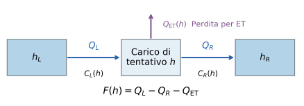

### Scrivere il bilancio idrico della cella centrale

Definita la conduttanza, esprimiamo le portate ai due lati della cella centrale. $h_L$ e $h_R$ sono i carichi assegnati al contorno, $h$ quello centrale, tutti in metri. $C_L(h)$ e $C_R(h)$ sono le conduttanze, in m²/s. Per entrambi i collegamenti il verso positivo è verso destra:

$$
Q_L(h)=-C_L(h)(h-h_L)=C_L(h)(h_L-h),
$$

$$
Q_R(h)=-C_R(h)(h_R-h)=C_R(h)(h-h_R).
$$

Le portate sono in m³/s. $Q_L$ positiva entra nella cella centrale; $Q_R$ positiva ne esce. Un valore negativo indica flusso opposto alla freccia: è una direzione fisicamente possibile, non un errore di calcolo.

*Le frecce definiscono i versi positivi, senza imporre la direzione che dovrà assumere il flusso calcolato.*

Consentiamo inoltre che l'**evapotraspirazione (ET)** sottragga acqua dalla cella centrale. $Q_{\mathrm{ET}}(h)$ indica la perdita positiva per ET, in m³/s. Per flusso stazionario senza ricarica né altre sorgenti o pozzi:

$$
F(h)=Q_L(h)-Q_R(h)-Q_{\mathrm{ET}}(h).
$$

**$F(h)$ è il residuo di portata: lo squilibrio idrico rimanente al carico di tentativo $h$.** Si misura in m³/s. Un residuo positivo indica entrate maggiori delle uscite; uno negativo, uscite maggiori delle entrate. Non è una portata fisica aggiuntiva attraverso un contorno.

Se, ad esempio, $Q_L=0.5$ L/s, $Q_R=0.3$ L/s e $Q_{\mathrm{ET}}=0.1$ L/s, il residuo è $0.1$ L/s. Le portate non soddisfano il bilancio stazionario. Occorre rivedere il carico di tentativo e ricalcolarle.

Il carico di equilibrio $h^*$ soddisfa:

$$
F(h^*)=0.
$$

Residuo nullo non significa che tutte le portate siano nulle. Entrate e uscite considerevoli possono compensarsi.

#### Da dove nasce la non linearità?

In un acquifero confinato con spessore saturo fisso e senza cambiamenti della relazione al contorno dipendenti dal carico, le conduttanze possono rimanere costanti. Il bilancio è allora lineare nel carico incognito anche con forti contrasti di conducibilità.

Per una cella libera non asciutta, con superficie freatica sotto il tetto:

$$
b=h-z_b,
$$

$b$ è lo spessore saturo e $z_b$ la quota di fondo, entrambi in metri. Modificare il carico incognito cambia sia la conduttanza sia le differenze di carico. Prodotti come $C_L(h)(h_L-h)$ possono pertanto essere non lineari in $h$, benché $K$ sia costante.

Un gradiente elevato non rende da solo non lineare la legge di Darcy. Qui la causa è la variazione dello spessore saturo. Anche le condizioni al contorno possono introdurre non linearità quando la relazione applicabile cambia con il carico.

La relazione di spessore precedente vale finché la cella contiene acqua e la superficie freatica rimane sotto il tetto. I modelli didattici con tetto finito limitano lo spessore saturo allo spessore fisico. Gli esempi storici di Mehl (2006) usano invece la relazione senza limite superiore; tale differenza è esplicitata nelle impostazioni.
