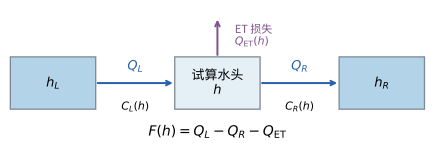

### 写出中央单元的水量平衡

定义连接传导系数后，写出中央单元两侧的流量。$h_L$、$h_R$ 为给定边界水头，$h$ 为中央水头，均以米计。$C_L(h)$、$C_R(h)$ 的单位为 m²/s。两条连接均规定向右为正：

$$
Q_L(h)=-C_L(h)(h-h_L)=C_L(h)(h_L-h),
$$

$$
Q_R(h)=-C_R(h)(h_R-h)=C_R(h)(h-h_R).
$$

流量单位为 m³/s。正的 $Q_L$ 流入中央单元，正的 $Q_R$ 流出中央单元。负值表示水流方向与箭头相反，这是可能的物理方向，并不意味着计算错误。

*箭头定义流量的正方向，不强制计算所得水流沿该方向运动。*

再允许**蒸散发（evapotranspiration，ET）**从中央单元消耗地下水。$Q_{\mathrm{ET}}(h)$ 表示取正值的 ET 损失量，单位为 m³/s。在无补给及其他源汇的稳态条件下：

$$
F(h)=Q_L(h)-Q_R(h)-Q_{\mathrm{ET}}(h).
$$

**$F(h)$ 是流量残差，即试算水头 $h$ 下尚未消除的水量不平衡。** 单位为 m³/s。残差为正表示流入大于流出，为负表示流出大于流入。它不是另一个通过边界的实际流量。

例如，若 $Q_L=0.5$ L/s、$Q_R=0.3$ L/s、$Q_{\mathrm{ET}}=0.1$ L/s，残差为 $0.1$ L/s。这些流量没有满足稳态平衡，需要修正试算水头并重新计算流量。

平衡水头 $h^*$ 满足：

$$
F(h^*)=0.
$$

残差为零不代表每个流量都为零。较大的流入和流出也可以相互平衡。

#### 非线性从何而来？

在饱和厚度固定的承压含水层中，如果边界关系不会随水头切换，连接传导系数可以保持不变。即使单元之间渗透系数差异很大，水量平衡对未知水头仍可为线性。

对于未干涸、潜水面低于含水层顶板的潜水单元：

$$
b=h-z_b,
$$

$b$ 为饱和厚度，$z_b$ 为底板高程，均以米计。未知水头变化时，连接传导系数和水头差会同时变化。因此，即使 $K$ 恒定，$C_L(h)(h_L-h)$ 这样的乘积也可能对 $h$ 非线性。

较大的水力梯度本身不会使达西定律变为非线性。这里的原因是饱和厚度变化。若适用的边界关系随水头改变，边界条件也可引入非线性。

上述厚度关系适用于单元有水且潜水面低于顶板的情况。顶板有限的教学模型将饱和厚度限制在实际层厚内。Mehl (2006) 的原始例子则不设这一上限；设置中明确说明了这个差异。
