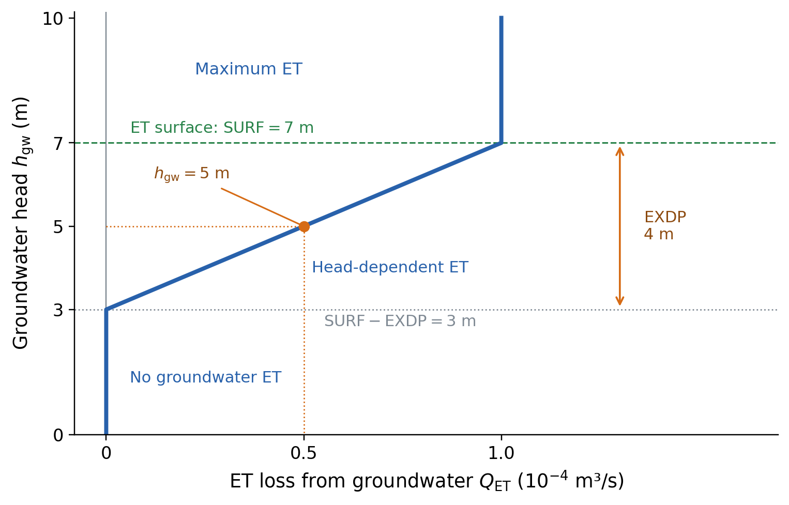

### Groundwater evapotranspiration: a brief recap

We use the terminology of the [Boundary Condition module](https://gwp-boundary-conditions-analysis.streamlit.app/):

- **SURF**: ET-surface elevation (m).
- **EXDP**: extinction depth below SURF (m).
- **EVTR**: maximum evapotranspiration rate (m/s).
- **RET**: groundwater evapotranspiration rate at the current head (m/s).
- **$Q_{\mathrm{ET}}=\mathrm{RET}\,A$**: positive ET loss from groundwater (m³/s), where $A$ is the horizontal cell area.

The groundwater head is $h_{\mathrm{gw}}$; in our central cell, $h_{\mathrm{gw}}=h$.

Groundwater ET is zero at or below **SURF − EXDP**, increases linearly between **SURF − EXDP** and **SURF**, and reaches **EVTR** at or above **SURF**. In the middle range,

$$
\mathrm{RET}
=
\mathrm{EVTR}
\frac{h_{\mathrm{gw}}-(\mathrm{SURF}-\mathrm{EXDP})}
{\mathrm{EXDP}}.
$$

The **$h$–$Q$ diagram** places head vertically and the positive ET loss horizontally. Accordingly, our cell balance is

$$
F(h)=Q_L(h)-Q_R(h)-Q_{\mathrm{ET}}(h).
$$

For iteration, the key point is that **crossing either threshold changes the applicable linear relation**. The ET loss remains continuous, but its sensitivity to head changes.

*Illustration: SURF = 7 m, EXDP = 4 m, EVTR = $10^{-8}$ m/s and horizontal area $A=10{,}000$ m². At $h_{\mathrm{gw}}=5$ m, ET loss is half its maximum. These are illustrative values, separate from Mehl's numerical ET example.*

