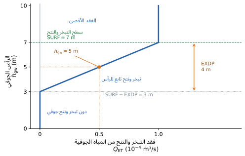

### التبخر والنتح من المياه الجوفية: تذكير موجز

نستخدم مصطلحات [وحدة تحليل الشروط الحدية](https://gwp-boundary-conditions-analysis.streamlit.app/):

- **SURF**: منسوب سطح التبخر والنتح (m).
- **EXDP**: عمق انعدام التبخر والنتح، مقاساً تحت SURF (m).
- **EVTR**: المعدل الأقصى للتبخر والنتح (m/s).
- **RET**: معدل التبخر والنتح من المياه الجوفية عند الرأس الحالي (m/s).
- **$Q_{\mathrm{ET}}=\mathrm{RET}\,A$**: الفقد الحجمي الموجب من المياه الجوفية (m³/s)، حيث $A$ المساحة الأفقية للخلية.

الرأس الجوفي هو $h_{\mathrm{gw}}$؛ وفي الخلية المركزية $h_{\mathrm{gw}}=h$.

ينعدم الفقد عند **SURF − EXDP** أو أدناه، ويزداد خطياً بين **SURF − EXDP** و**SURF**، ويبلغ **EVTR** عند **SURF** أو أعلاه. في المجال المتوسط:

$$
\mathrm{RET}
=
\mathrm{EVTR}
\frac{h_{\mathrm{gw}}-(\mathrm{SURF}-\mathrm{EXDP})}
{\mathrm{EXDP}}.
$$

يعرض **مخطط $h$–$Q$** الرأس رأسياً والفقد الموجب أفقياً. تصبح الموازنة:

$$
F(h)=Q_L(h)-Q_R(h)-Q_{\mathrm{ET}}(h).
$$

الأمر الأساسي للتكرار هو أن **عبور رأس حدي يغيّر العلاقة الخطية المطبقة**. يبقى الفقد متصلاً، لكن حساسيته للرأس تتغير.

*مثال توضيحي: SURF = 7 m، وEXDP = 4 m، وEVTR = $10^{-8}$ m/s، والمساحة الأفقية $A=10{,}000$ m². عند $h_{\mathrm{gw}}=5$ m يكون الفقد نصف أقصاه. هذه قيم توضيحية تختلف عن مثال Mehl (2006) العددي مع ET.*
