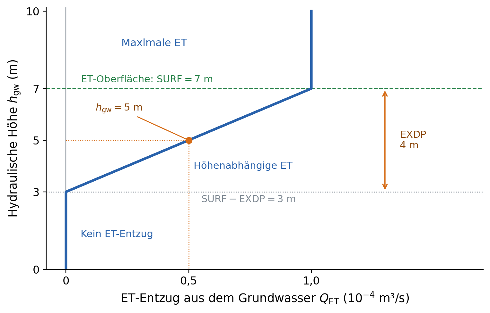

### Evapotranspiration aus dem Grundwasser

Wir verwenden die Bezeichnungen aus dem [Modul zu den Randbedingungen](https://gwp-boundary-conditions-analysis.streamlit.app/).

- **SURF** bezeichnet die Höhenlage der ET-Oberfläche (m).
- **EXDP** ist die Extinktionstiefe unterhalb von SURF (m). In dieser Tiefe endet der Grundwasserentzug durch ET.
- **EVTR** ist die maximale Evapotranspirationsrate (m/s).
- **RET** ist die tatsächliche Evapotranspirationsrate aus dem Grundwasser bei der aktuellen hydraulischen Höhe (m/s).
- **$Q_{\mathrm{ET}}=\mathrm{RET}\,A$** ist der als positiv gezählte ET-Entzug aus dem Grundwasser (m³/s). $A$ ist hier die horizontale Zellfläche.

Die hydraulische Höhe des Grundwassers heißt $h_{\mathrm{gw}}$. Für unsere mittlere Zelle ist $h_{\mathrm{gw}}=h$.

Bei und unter **SURF − EXDP** ist der Grundwasserentzug null. Zwischen **SURF − EXDP** und **SURF** steigt die Rate linear an. Bei und oberhalb von **SURF** erreicht sie den Maximalwert **EVTR**. Im mittleren Bereich gilt

$$
\mathrm{RET}
=
\mathrm{EVTR}
\frac{h_{\mathrm{gw}}-(\mathrm{SURF}-\mathrm{EXDP})}
{\mathrm{EXDP}}.
$$

Im **$h$–$Q$-Diagramm** steht die hydraulische Höhe auf der senkrechten Achse, der positive ET-Entzug auf der waagerechten. Mit dieser Vorzeichenkonvention lautet die Zellbilanz

$$
F(h)=Q_L(h)-Q_R(h)-Q_{\mathrm{ET}}(h).
$$

Für die Iteration ist wichtig, was mit der **Steigung beim Überschreiten einer Schwellenhöhe** geschieht. Der ET-Entzug verläuft stetig. Seine Änderung pro Meter Höhenänderung unterscheidet sich jedoch zwischen den drei Bereichen.

*Beispiel: SURF = 7 m, EXDP = 4 m, EVTR = $10^{-8}$ m/s und horizontale Zellfläche $A=10\,000$ m². Bei $h_{\mathrm{gw}}=5$ m erreicht der ET-Entzug die Hälfte seines Maximalwerts. Für Mehls numerisches ET-Beispiel gelten andere Parameter.*
