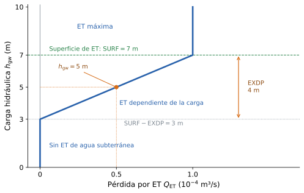

### Evapotranspiración del agua subterránea: breve repaso

Utilizamos la terminología del [módulo de condiciones de contorno](https://gwp-boundary-conditions-analysis.streamlit.app/):

- **SURF**: cota de la superficie de ET (m).
- **EXDP**: profundidad de extinción medida bajo SURF (m).
- **EVTR**: tasa máxima de evapotranspiración (m/s).
- **RET**: tasa de evapotranspiración del agua subterránea para la carga actual (m/s).
- **$Q_{\mathrm{ET}}=\mathrm{RET}\,A$**: pérdida positiva de agua subterránea por ET (m³/s), donde $A$ es el área horizontal de la celda.

La carga del agua subterránea es $h_{\mathrm{gw}}$; en la celda central, $h_{\mathrm{gw}}=h$.

La ET es nula a la cota **SURF − EXDP** o por debajo de ella, aumenta linealmente entre **SURF − EXDP** y **SURF**, y alcanza **EVTR** a partir de **SURF**. En el intervalo intermedio:

$$
\mathrm{RET}
=
\mathrm{EVTR}
\frac{h_{\mathrm{gw}}-(\mathrm{SURF}-\mathrm{EXDP})}
{\mathrm{EXDP}}.
$$

El **diagrama $h$–$Q$** representa la carga en vertical y la pérdida positiva por ET en horizontal. El balance es, por tanto:

$$
F(h)=Q_L(h)-Q_R(h)-Q_{\mathrm{ET}}(h).
$$

Para la iteración, lo fundamental es que **al cruzar cualquiera de los dos umbrales cambia la relación lineal aplicable**. La pérdida por ET es continua, pero cambia su sensibilidad a la carga.

*Ejemplo ilustrativo: SURF = 7 m, EXDP = 4 m, EVTR = $10^{-8}$ m/s y área horizontal $A=10{,}000$ m². Para $h_{\mathrm{gw}}=5$ m, la pérdida por ET es la mitad del máximo. Estos valores son ilustrativos y difieren del ejemplo numérico de Mehl (2006) con ET.*
