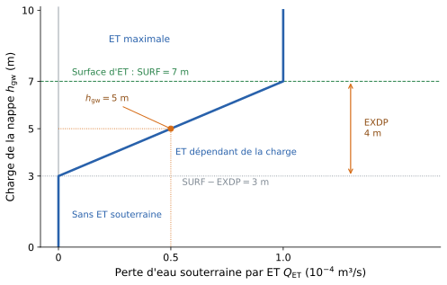

### Évapotranspiration souterraine : bref rappel

Nous reprenons la terminologie du [module sur les conditions aux limites](https://gwp-boundary-conditions-analysis.streamlit.app/) :

- **SURF** : cote de la surface d'ET (m).
- **EXDP** : profondeur d'extinction mesurée sous SURF (m).
- **EVTR** : taux maximal d'évapotranspiration (m/s).
- **RET** : taux d'évapotranspiration prélevé dans la nappe à la charge actuelle (m/s).
- **$Q_{\mathrm{ET}}=\mathrm{RET}\,A$** : perte positive d'eau souterraine par ET (m³/s), où $A$ est la surface horizontale de la maille.

La charge de la nappe est $h_{\mathrm{gw}}$ ; dans la maille centrale, $h_{\mathrm{gw}}=h$.

L'ET prélevée dans la nappe est nulle au niveau de **SURF − EXDP** et en dessous, croît linéairement entre **SURF − EXDP** et **SURF**, puis atteint **EVTR** au niveau de **SURF** et au-dessus. Dans l'intervalle intermédiaire :

$$
\mathrm{RET}
=
\mathrm{EVTR}
\frac{h_{\mathrm{gw}}-(\mathrm{SURF}-\mathrm{EXDP})}
{\mathrm{EXDP}}.
$$

Le **diagramme $h$–$Q$** place la charge sur l'axe vertical et la perte positive par ET sur l'axe horizontal. Le bilan de la maille s'écrit donc :

$$
F(h)=Q_L(h)-Q_R(h)-Q_{\mathrm{ET}}(h).
$$

Pour l'itération, le point essentiel est que **le franchissement de l'un des seuils change la relation linéaire applicable**. La perte par ET reste continue, mais sa sensibilité à la charge change.

*Illustration : SURF = 7 m, EXDP = 4 m, EVTR = $10^{-8}$ m/s et surface horizontale $A=10\,000$ m². À $h_{\mathrm{gw}}=5$ m, la perte par ET vaut la moitié de son maximum. Ces valeurs illustratives sont distinctes de celles de l'exemple numérique avec ET de Mehl (2006).*
