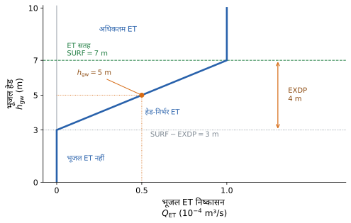

### भूजल वाष्पोत्सर्जन: संक्षिप्त पुनरावलोकन

हम [सीमा शर्त मॉड्यूल](https://gwp-boundary-conditions-analysis.streamlit.app/) के प्रतीक और शब्दावली अपनाते हैं:

- **SURF**: ET सतह की ऊँचाई (m)।
- **EXDP**: SURF से नीचे मापी गई समाप्ति गहराई (extinction depth; m)।
- **EVTR**: अधिकतम वाष्पोत्सर्जन दर (m/s)।
- **RET**: वर्तमान हेड पर भूजल वाष्पोत्सर्जन दर (m/s)।
- **$Q_{\mathrm{ET}}=\mathrm{RET}\,A$**: भूजल से धनात्मक ET निष्कासन की आयतन दर (m³/s); $A$ सेल का क्षैतिज क्षेत्रफल है।

भूजल हेड $h_{\mathrm{gw}}$ है; केंद्रीय सेल में $h_{\mathrm{gw}}=h$ है।

**SURF − EXDP** या उससे नीचे भूजल ET शून्य है। **SURF − EXDP** और **SURF** के बीच यह रैखिक रूप से बढ़ता है; **SURF** या उससे ऊपर **EVTR** के बराबर रहता है। मध्य अंतराल में:

$$
\mathrm{RET}
=
\mathrm{EVTR}
\frac{h_{\mathrm{gw}}-(\mathrm{SURF}-\mathrm{EXDP})}
{\mathrm{EXDP}}.
$$

**$h$–$Q$ आरेख** में हेड ऊर्ध्वाधर और धनात्मक ET निष्कासन क्षैतिज अक्ष पर है। जल संतुलन है:

$$
F(h)=Q_L(h)-Q_R(h)-Q_{\mathrm{ET}}(h).
$$

पुनरावृत्ति के लिए मुख्य बात है: **सीमा हेड पार करने पर लागू रैखिक संबंध बदलता है।** ET निष्कासन सतत रहता है, लेकिन हेड के प्रति उसकी संवेदनशीलता बदलती है।

*उदाहरण: SURF = 7 m, EXDP = 4 m, EVTR = $10^{-8}$ m/s और क्षैतिज क्षेत्रफल $A=10{,}000$ m²। $h_{\mathrm{gw}}=5$ m पर निष्कासन अधिकतम का आधा है। ये समझाने के लिए चुने गए मान हैं, Mehl (2006) के ET उदाहरण के मान नहीं।*
