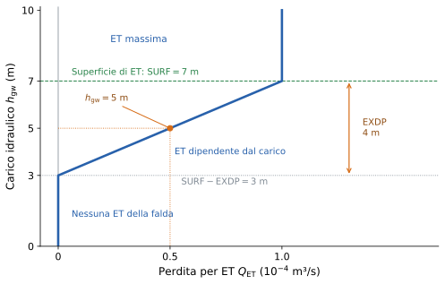

### Evapotraspirazione della falda: breve richiamo

Utilizziamo la terminologia del [modulo sulle condizioni al contorno](https://gwp-boundary-conditions-analysis.streamlit.app/):

- **SURF**: quota della superficie di ET (m).
- **EXDP**: profondità di estinzione sotto SURF (m).
- **EVTR**: tasso massimo di evapotraspirazione (m/s).
- **RET**: tasso di evapotraspirazione della falda al carico attuale (m/s).
- **$Q_{\mathrm{ET}}=\mathrm{RET}\,A$**: perdita positiva di acqua sotterranea per ET (m³/s), con $A$ area orizzontale della cella.

Il carico della falda è $h_{\mathrm{gw}}$; nella cella centrale $h_{\mathrm{gw}}=h$.

L'ET della falda è nulla a **SURF − EXDP** o al di sotto, aumenta linearmente fra **SURF − EXDP** e **SURF** e raggiunge **EVTR** a **SURF** e al di sopra. Nell'intervallo intermedio:

$$
\mathrm{RET}
=
\mathrm{EVTR}
\frac{h_{\mathrm{gw}}-(\mathrm{SURF}-\mathrm{EXDP})}
{\mathrm{EXDP}}.
$$

Il **diagramma $h$–$Q$** riporta il carico in verticale e la perdita positiva per ET in orizzontale. Il bilancio diventa:

$$
F(h)=Q_L(h)-Q_R(h)-Q_{\mathrm{ET}}(h).
$$

Per l'iterazione è essenziale che **attraversare una soglia cambi la relazione lineare applicabile**. La perdita per ET rimane continua, ma cambia la sua sensibilità al carico.

*Esempio illustrativo: SURF = 7 m, EXDP = 4 m, EVTR = $10^{-8}$ m/s e area orizzontale $A=10{,}000$ m². A $h_{\mathrm{gw}}=5$ m la perdita è metà del massimo. Questi valori sono illustrativi e distinti dall'esempio numerico di Mehl (2006) con ET.*
