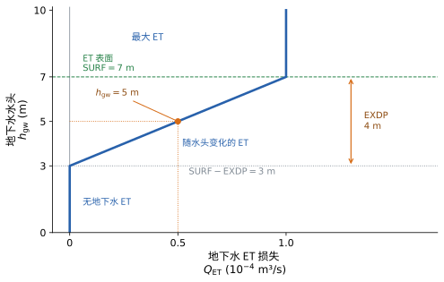

### 地下水蒸散发：简要回顾

我们采用[边界条件分析模块](https://gwp-boundary-conditions-analysis.streamlit.app/)的符号和术语：

- **SURF**：ET 作用表面高程（m）。
- **EXDP**：从 SURF 向下量取的蒸散发极限深度（m）。
- **EVTR**：最大蒸散发率（m/s）。
- **RET**：当前水头下的地下水蒸散发率（m/s）。
- **$Q_{\mathrm{ET}}=\mathrm{RET}\,A$**：取正值的地下水 ET 体积损失率（m³/s）；$A$ 为单元水平面积。

地下水水头为 $h_{\mathrm{gw}}$；中央单元中 $h_{\mathrm{gw}}=h$。

当水头位于 **SURF − EXDP** 或以下时，地下水 ET 为零；在 **SURF − EXDP** 与 **SURF** 之间线性增大；达到 **SURF** 或更高时保持 **EVTR**。中间区间内：

$$
\mathrm{RET}
=
\mathrm{EVTR}
\frac{h_{\mathrm{gw}}-(\mathrm{SURF}-\mathrm{EXDP})}
{\mathrm{EXDP}}.
$$

**$h$–$Q$ 图**以水头为纵轴、正的 ET 损失流量为横轴。水量平衡为：

$$
F(h)=Q_L(h)-Q_R(h)-Q_{\mathrm{ET}}(h).
$$

对迭代而言，关键在于：**跨越水头阈值会改变当前适用的线性关系。** ET 损失量保持连续，但其对水头的敏感性发生变化。

*示例：SURF = 7 m，EXDP = 4 m，EVTR = $10^{-8}$ m/s，水平面积 $A=10{,}000$ m²。在 $h_{\mathrm{gw}}=5$ m 时，损失量为最大值的一半。这些是示意参数，与 Mehl (2006) 的 ET 数值示例不同。*
