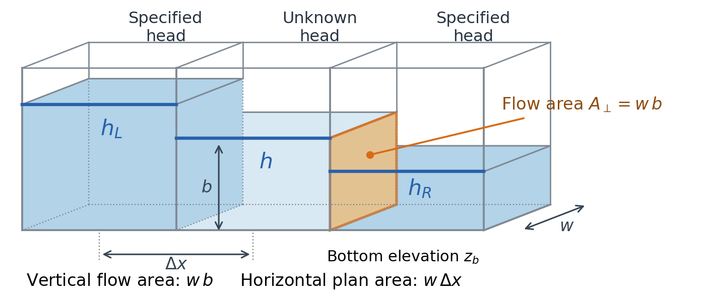

### Why do we need repeated calculations?

A groundwater model combines Darcy's law with a water balance. Under steady-state conditions, storage does not change: the water entering each modeled cell must equal the water leaving it. The unknown heads must satisfy these balances simultaneously.

The difficulty is that some quantities in the flow equation depend on the heads we are trying to calculate. In an unconfined aquifer, for example, pumping lowers the water table and reduces the saturated thickness. This reduces the area available for horizontal flow, even if the hydraulic conductivity of the aquifer material stays unchanged.

One such quantity is **conductance**. It combines hydraulic conductivity with the geometry of a flow connection. Hydraulic conductivity describes the material's ability to transmit water; conductance describes a particular connection's capacity to transmit discharge per unit head difference. Two connections through the same sand can have different conductances because they differ in width, saturated thickness, or length.

There is therefore a mutual dependence: the heads determine the saturated thickness and conductances, while those conductances help determine the heads. Iterative methods begin with estimated heads and repeatedly improve them until the heads and resulting flows satisfy the equations sufficiently closely.

**These iterations are numerical calculations, not stages in the physical movement of groundwater.** A steady-state problem may require many iterations even though no physical time passes in the calculation.

### Why begin with only three cells?

Consider three adjacent cells. The heads in the left and right cells, $h_L$ and $h_R$, are specified. Only the central head, $h$, is unknown. This makes it possible to see how a head estimate changes conductances, flows, and the next estimate.

*The highlighted vertical face is the area perpendicular to horizontal flow. Each cell has length $\Delta x$ and width $w$. The saturated thickness is $b$; $z_b$ is the bottom elevation. These dimensions and all heads are in metres, with elevations measured from a common datum. The stepped levels represent cell values, not physical jumps in the water table. The dimensions are illustrative.*

Mehl (2006) uses this simple arrangement to examine two sources of difficulty: a smooth unconfined-flow problem, and a problem in which groundwater evapotranspiration follows different relations in different head ranges. We first develop the equations and the two iteration methods, then examine these examples.
