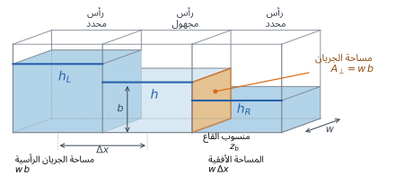

### لماذا نكرر الحسابات؟

يجمع نموذج الجريان الجوفي بين قانون دارسي والموازنة المائية. في الحالة المستقرة لا يتغير التخزين: يجب أن تتساوى كمية الماء الداخلة إلى كل خلية مع الخارجة منها. ولا بد أن تحقق الرؤوس المجهولة جميع هذه الموازنات معاً.

تنشأ الصعوبة لأن بعض كميات معادلة الجريان تعتمد على الرؤوس التي نريد حسابها. ففي الخزان غير المحصور، مثلاً، يخفض الضخ منسوب الماء ويقلل السمك المشبع. وبذلك تصغر المساحة المتاحة للجريان الأفقي، حتى إذا بقيت الموصلية الهيدروليكية للمادة ثابتة.

إحدى هذه الكميات هي **مواصلة الوصلة الهيدروليكية (conductance)**، ونختصرها هنا إلى **المواصلة**. وهي تجمع بين الموصلية الهيدروليكية وهندسة وصلة الجريان. تصف الموصلية قدرة المادة على نقل الماء، أما المواصلة فتصف التصريف الذي تنقله وصلة محددة لكل وحدة من فرق الرأس. ولذلك قد تختلف مواصلة وصلتين في الرمل نفسه إذا اختلف العرض أو السمك المشبع أو الطول.

توجد إذن علاقة متبادلة: تحدد الرؤوس السمك المشبع والمواصلة، وتساهم هاتان الكميتان بدورهما في تحديد الرؤوس. تبدأ الطرائق التكرارية بتقديرات للرؤوس، وتحسّنها حتى تحقق الرؤوس والتصاريف المعادلات بالدقة المطلوبة.

**التكرارات حسابات عددية، وليست مراحل زمنية للحركة الفيزيائية للمياه الجوفية.** قد تتطلب مسألة مستقرة تكرارات كثيرة دون أي تقدّم في الزمن الفيزيائي.

### لماذا نبدأ بثلاث خلايا فقط؟

نأخذ ثلاث خلايا متجاورة. الرأس في الخليتين اليسرى واليمنى محدد، ويساوي $h_L$ و$h_R$. الرأس المركزي $h$ وحده مجهول. بذلك نستطيع تتبّع أثر التقدير على المواصلة والتصاريف والتقدير التالي.

*الوجه الرأسي المميز هو مساحة المقطع العمودي على الجريان الأفقي. طول كل خلية $\Delta x$ وعرضها $w$، وسمكها المشبع $b$ ومنسوب قاعها $z_b$. الأبعاد والرؤوس بالمتر، وتُقاس المناسيب بالنسبة إلى مرجع ارتفاع مشترك. المناسيب المتدرجة تمثل قيم الخلايا، لا انقطاعات فيزيائية في سطح الماء. الأبعاد توضيحية.*

يستخدم Mehl (2006) هذه البنية لدراسة صعوبتين: جريان غير محصور بعلاقة ملساء، وجريان تتغير فيه علاقة التبخر والنتح من المياه الجوفية بين مجالات الرأس. نشرح المعادلات والطريقتين أولاً، ثم ندرس المثالين.
