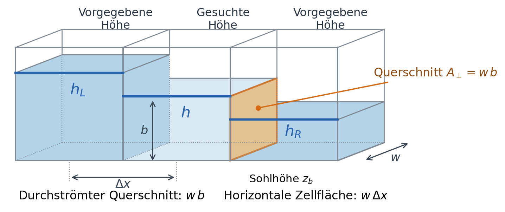

### Warum müssen wir die Rechnung wiederholen?

Ein Grundwassermodell verknüpft das Darcy-Gesetz mit der Wasserbilanz. Bei stationärer Strömung ändert sich der Speicherinhalt nicht. In jede Modellzelle muss daher genau so viel Wasser einströmen, wie aus ihr abströmt. Die gesuchten hydraulischen Höhen müssen diese Bedingung in allen Zellen gleichzeitig erfüllen.

Einige Größen in der Strömungsgleichung hängen selbst von den gesuchten Höhen ab. Sinkt durch eine Entnahme der Grundwasserspiegel in einem ungespannten Grundwasserleiter, nimmt die gesättigte Mächtigkeit ab. Der für die horizontale Strömung verfügbare Querschnitt wird kleiner, auch wenn die hydraulische Leitfähigkeit des Materials gleich bleibt.

Eine solche Größe ist der **hydraulische Leitwert** (englisch *conductance*) der Verbindung zwischen zwei Zellen. Die hydraulische Leitfähigkeit ist eine Materialeigenschaft. Der Leitwert berücksichtigt zusätzlich die Geometrie und gibt an, welcher Volumenstrom bei einer bestimmten Höhendifferenz durch diese Verbindung fließt. Zwei Verbindungen im selben Sand können deshalb unterschiedliche Leitwerte haben, wenn sie sich in Breite, gesättigter Mächtigkeit oder Länge unterscheiden.

Damit ergibt sich eine wechselseitige Abhängigkeit. Aus den hydraulischen Höhen folgen die gesättigten Mächtigkeiten und die Leitwerte. Die Leitwerte bestimmen ihrerseits die berechneten Höhen mit. Iterative Verfahren beginnen mit geschätzten Höhen und verbessern diese, bis die Höhen und die zugehörigen Volumenströme die Gleichungen hinreichend genau erfüllen.

**Eine Iteration ist ein Rechenschritt.** Auch bei einer stationären Strömung können viele solcher Schritte nötig sein, obwohl im Modell keine Zeit vergeht.

### Weshalb mit drei Zellen beginnen?

Betrachten Sie drei benachbarte Zellen. Links und rechts sind die hydraulischen Höhen $h_L$ und $h_R$ vorgegeben. Nur die Höhe $h$ in der Mitte ist unbekannt. So lässt sich für einen einzigen Schätzwert verfolgen, wie er die Leitwerte, die Volumenströme und schließlich den nächsten Schätzwert beeinflusst.

*Die hervorgehobene senkrechte Fläche ist der Querschnitt senkrecht zur horizontalen Strömung. Jede Zelle hat die Länge $\Delta x$ und die Breite $w$. Die gesättigte Mächtigkeit ist $b$, die Höhenlage der Sohle ist $z_b$. Alle Maße und Höhen sind in Metern angegeben. Für alle Höhen gilt derselbe Bezugshorizont. Die Stufen zeigen diskrete Zellwerte. Der tatsächliche Grundwasserspiegel verläuft zwischen den Zellzentren kontinuierlich. Die Abmessungen dienen der Veranschaulichung.*

Mehl untersucht mit dieser Anordnung zwei Situationen. Im ersten Beispiel ändern sich die Strömungsgrößen im ungespannten Grundwasserleiter glatt mit der Höhe. Im zweiten folgt die Evapotranspiration aus dem Grundwasser je nach Höhe unterschiedlichen Beziehungen. Wir leiten zunächst die Gleichungen und die beiden Verfahren her und untersuchen anschließend beide Beispiele.
