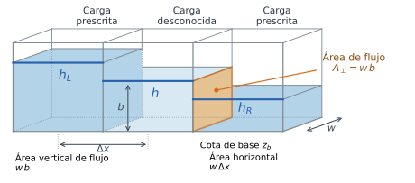

### ¿Por qué necesitamos repetir los cálculos?

Un modelo de aguas subterráneas combina la ley de Darcy con un balance de agua. En régimen estacionario no cambia el almacenamiento: el agua que entra en cada celda debe igualar la que sale. Las cargas desconocidas deben satisfacer simultáneamente todos estos balances.

La dificultad aparece porque algunas magnitudes de la ecuación de flujo dependen de las cargas que intentamos calcular. En un acuífero libre, por ejemplo, el bombeo hace descender el nivel freático y reduce el espesor saturado. Esto reduce el área disponible para el flujo horizontal, aunque la conductividad hidráulica del material no cambie.

Una de estas magnitudes es la **conductancia**. Combina la conductividad hidráulica con la geometría de una conexión de flujo. La conductividad describe la capacidad del material para transmitir agua; la conductancia describe la capacidad de una conexión concreta para transmitir caudal por unidad de diferencia de carga. Dos conexiones a través de la misma arena pueden tener conductancias distintas si cambian su anchura, espesor saturado o longitud.

Existe, por tanto, una dependencia mutua: las cargas determinan el espesor saturado y las conductancias, y estas contribuyen a determinar las cargas. Los métodos iterativos parten de cargas estimadas y las mejoran hasta que las cargas y los caudales resultantes satisfacen las ecuaciones con suficiente aproximación.

**Estas iteraciones son cálculos numéricos, no etapas del movimiento físico del agua subterránea.** Un problema estacionario puede necesitar muchas iteraciones sin que transcurra tiempo físico en el cálculo.

### ¿Por qué empezar con solo tres celdas?

Considere tres celdas contiguas. Las cargas de las celdas izquierda y derecha, $h_L$ y $h_R$, están prescritas. Solo se desconoce la carga central, $h$. Así se puede observar cómo una estimación modifica las conductancias, los caudales y la estimación siguiente.

*La cara vertical resaltada es el área perpendicular al flujo horizontal. Cada celda tiene longitud $\Delta x$ y anchura $w$. El espesor saturado es $b$ y la cota de la base es $z_b$. Estas dimensiones y todas las cargas se expresan en metros; las cotas se refieren a un mismo datum. Los niveles escalonados representan valores de celda, no saltos físicos del nivel freático. Las dimensiones son ilustrativas.*

Mehl (2006) utiliza esta disposición para estudiar dos dificultades: un problema de flujo libre con una relación suave y otro en el que la evapotranspiración del agua subterránea sigue relaciones distintas según el intervalo de carga. Primero desarrollaremos las ecuaciones y ambos métodos; después examinaremos estos ejemplos.
