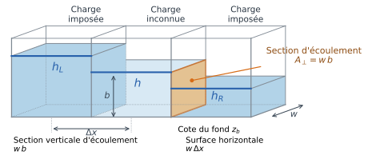

### Pourquoi répéter les calculs ?

Un modèle d'écoulement souterrain associe la loi de Darcy à un bilan en eau. En régime permanent, le stockage ne varie pas : la quantité d'eau entrant dans chaque maille doit égaler celle qui en sort. Les charges inconnues doivent satisfaire simultanément ces bilans.

La difficulté vient de ce que certaines grandeurs de l'équation d'écoulement dépendent des charges que nous cherchons à calculer. Dans un aquifère à nappe libre, par exemple, le pompage abaisse la surface de la nappe et réduit l'épaisseur saturée. La section disponible pour l'écoulement horizontal diminue, même si la conductivité hydraulique du matériau reste constante.

La **conductance** est l'une de ces grandeurs. Elle combine la conductivité hydraulique et la géométrie d'une connexion entre mailles. La conductivité hydraulique caractérise l'aptitude du matériau à transmettre l'eau ; la conductance caractérise le débit transmis par une connexion donnée pour une différence de charge unitaire. Deux connexions à travers le même sable peuvent avoir des conductances différentes si leurs largeurs, épaisseurs saturées ou longueurs diffèrent.

Il existe donc une dépendance réciproque : les charges déterminent les épaisseurs saturées et les conductances, tandis que ces conductances interviennent dans le calcul des charges. Les méthodes itératives partent de charges estimées et les améliorent jusqu'à ce que les charges et les débits correspondants satisfassent les équations avec une précision suffisante.

**Ces itérations sont des opérations numériques, et non des étapes du déplacement physique de l'eau souterraine.** Un problème en régime permanent peut demander de nombreuses itérations sans qu'aucun temps physique ne s'écoule dans le calcul.

### Pourquoi commencer par trois mailles ?

Considérons trois mailles adjacentes. Les charges dans les mailles gauche et droite, $h_L$ et $h_R$, sont imposées. Seule la charge centrale $h$ est inconnue. On peut ainsi suivre comment une estimation de charge modifie les conductances, les débits et l'estimation suivante.

*La face verticale mise en évidence est la section perpendiculaire à l'écoulement horizontal. Chaque maille a une longueur $\Delta x$ et une largeur $w$. L'épaisseur saturée est $b$ ; $z_b$ désigne la cote du fond. Ces dimensions et toutes les charges sont exprimées en mètres, les cotes étant rapportées au même niveau de référence. Les niveaux en escalier représentent les valeurs des mailles, et non des discontinuités physiques de la surface de la nappe. Les dimensions sont illustratives.*

Mehl (2006) utilise cette disposition simple pour examiner deux difficultés : un problème d'écoulement en nappe libre dont la relation est régulière, puis un problème où l'évapotranspiration souterraine suit des relations différentes selon l'intervalle de charge. Nous établissons d'abord les équations et les deux méthodes d'itération, puis étudions ces exemples.
