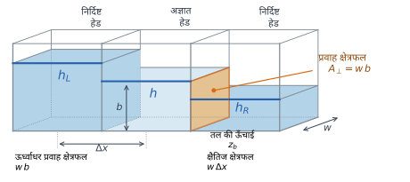

### गणनाएँ दोहराने की आवश्यकता क्यों पड़ती है?

भूजल प्रवाह मॉडल Darcy के नियम को जल संतुलन से जोड़ता है। स्थिर अवस्था में भंडारण नहीं बदलता: प्रत्येक सेल में आने वाला जल, उससे निकलने वाले जल के बराबर होना चाहिए। अज्ञात हेडों को सभी सेल के संतुलन एक साथ संतुष्ट करने होते हैं।

कठिनाई यह है कि प्रवाह समीकरण की कुछ राशियाँ उन्हीं हेडों पर निर्भर करती हैं जिन्हें हमें निकालना है। उदाहरण के लिए, मुक्त जलभृत में पंपन जलस्तर को नीचे लाता है और संतृप्त मोटाई घटाता है। इससे क्षैतिज प्रवाह के लिए उपलब्ध क्षेत्रफल घटता है, भले ही पदार्थ की हाइड्रोलिक चालकता अपरिवर्तित रहे।

ऐसी एक राशि **हाइड्रोलिक कंडक्टेंस (conductance)** है। इसमें हाइड्रोलिक चालकता और प्रवाह संपर्क की ज्यामिति दोनों सम्मिलित हैं। चालकता पदार्थ की जल संचारित करने की क्षमता बताती है; कंडक्टेंस किसी विशेष संपर्क से प्रति इकाई हेड अंतर पर गुजरने वाली प्रवाह दर बताता है। एक ही रेत में बने दो संपर्कों की चौड़ाई, संतृप्त मोटाई या लंबाई अलग होने से उनके कंडक्टेंस अलग हो सकते हैं।

इसलिए निर्भरता परस्पर है: हेड से संतृप्त मोटाई और कंडक्टेंस निर्धारित होते हैं, और इन्हीं राशियों से हेड का समाधान प्रभावित होता है। पुनरावृत्ति विधियाँ हेड के प्रारंभिक अनुमान लेकर उन्हें सुधारती हैं, जब तक हेड और प्रवाह दरें समीकरणों को पर्याप्त सटीकता से संतुष्ट न कर दें।

**पुनरावृत्तियाँ संख्यात्मक गणनाएँ हैं, भूजल के भौतिक संचलन के समय-चरण नहीं।** स्थिर अवस्था की समस्या में भौतिक समय आगे बढ़े बिना अनेक पुनरावृत्तियाँ आवश्यक हो सकती हैं।

### केवल तीन सेल से शुरुआत क्यों?

तीन आसन्न सेल लें। बाएँ और दाएँ सेल के हेड $h_L$ और $h_R$ निर्दिष्ट हैं। केवल केंद्रीय हेड $h$ अज्ञात है। इस व्यवस्था में स्पष्ट देखा जा सकता है कि एक अनुमान कंडक्टेंस, प्रवाह दरों और अगले अनुमान को कैसे बदलता है।

*उभारा गया ऊर्ध्वाधर फलक क्षैतिज प्रवाह के लंबवत अनुप्रस्थ क्षेत्रफल है। प्रत्येक सेल की लंबाई $\Delta x$, चौड़ाई $w$ और संतृप्त मोटाई $b$ है। तल की ऊँचाई $z_b$ है। सभी लंबाइयाँ और हेड मीटर में हैं; ऊँचाइयाँ एक साझा संदर्भ तल से मापी जाती हैं। सीढ़ीनुमा जलस्तर सेल मान दिखाते हैं, वास्तविक जलस्तर में भौतिक असंततता नहीं। माप केवल समझाने के लिए हैं।*

Mehl (2006) इसी व्यवस्था से दो कठिनाइयाँ दिखाते हैं: मुक्त प्रवाह की एक सुचारु समस्या और एक समस्या जिसमें भूजल वाष्पोत्सर्जन का संबंध हेड के अलग-अलग अंतरालों में बदलता है। पहले समीकरण और विधियाँ समझेंगे, फिर इन उदाहरणों का अध्ययन करेंगे।
