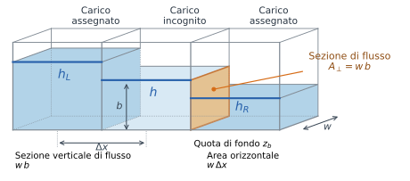

### Perché occorre ripetere i calcoli?

Un modello di flusso sotterraneo combina la legge di Darcy con un bilancio idrico. In regime stazionario l'immagazzinamento non cambia: l'acqua che entra in ogni cella deve uguagliare quella che ne esce. I carichi incogniti devono soddisfare contemporaneamente tutti questi bilanci.

La difficoltà nasce dal fatto che alcune grandezze dell'equazione dipendono dai carichi da calcolare. In un acquifero libero, ad esempio, il pompaggio abbassa la superficie freatica e riduce lo spessore saturo. Diminuisce quindi l'area disponibile per il flusso orizzontale, anche se la conducibilità idraulica del materiale rimane invariata.

Una di queste grandezze è la **conduttanza**. Essa combina la conducibilità idraulica con la geometria di un collegamento di flusso. La conducibilità descrive la capacità del materiale di trasmettere acqua; la conduttanza descrive la capacità di un particolare collegamento di trasmettere una portata per unità di differenza di carico. Due collegamenti nella stessa sabbia possono avere conduttanze diverse per larghezza, spessore saturo o lunghezza.

Esiste quindi una dipendenza reciproca: i carichi determinano spessori saturi e conduttanze, mentre queste contribuiscono a determinare i carichi. I metodi iterativi partono da stime dei carichi e le migliorano finché carichi e portate risultanti soddisfano le equazioni con sufficiente approssimazione.

**Le iterazioni sono calcoli numerici, non fasi del movimento fisico dell'acqua sotterranea.** Un problema stazionario può richiedere molte iterazioni senza alcun avanzamento del tempo fisico.

### Perché iniziare con sole tre celle?

Consideriamo tre celle adiacenti. I carichi nelle celle sinistra e destra, $h_L$ e $h_R$, sono assegnati. Soltanto il carico centrale $h$ è incognito. È quindi possibile osservare come una stima modifichi conduttanze, portate e stima successiva.

*La faccia verticale evidenziata è la sezione perpendicolare al flusso orizzontale. Ogni cella ha lunghezza $\Delta x$ e larghezza $w$. Lo spessore saturo è $b$ e la quota di fondo è $z_b$. Dimensioni e carichi sono espressi in metri; le quote si riferiscono a un unico riferimento altimetrico. I livelli a gradini rappresentano valori di cella, non discontinuità fisiche della superficie freatica. Le dimensioni sono illustrative.*

Mehl (2006) usa questa disposizione per esaminare due difficoltà: un problema di flusso libero con relazione regolare e uno in cui l'evapotraspirazione della falda segue relazioni diverse nei diversi intervalli di carico. Prima sviluppiamo le equazioni e i due metodi, poi analizziamo gli esempi.
