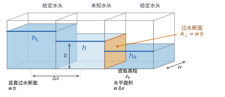

### 为什么需要反复计算？

地下水流模型将达西定律与水量平衡结合起来。在稳态条件下，储水量不变：进入每个单元的水量必须等于流出的水量。所有未知水头必须同时满足这些平衡。

困难在于，水流方程中的某些量取决于正在求解的水头。例如，在潜水含水层中，抽水降低潜水位，减小饱和厚度。即使介质的渗透系数保持不变，水平过水断面也会缩小。

其中一个量是**单元间连接的水力传导系数（conductance）**，以下称为**连接传导系数**。它同时包含渗透系数和连接的几何特征。渗透系数描述介质传输水的能力；连接传导系数描述一条具体连接在单位水头差下传输流量的能力。同样的砂层中，两条连接的宽度、饱和厚度或长度不同，连接传导系数也可能不同。

因此，两者相互依赖：水头决定饱和厚度和连接传导系数，而后者又参与决定水头。迭代方法从一组水头估计出发，逐步改进，直到水头和流量在要求的精度内满足方程。

**迭代是数值计算，不是地下水实际运动的时间阶段。** 稳态问题可以需要许多次迭代，而物理时间完全不变。

### 为什么从三个单元开始？

考虑三个相邻单元。左、右单元的水头 $h_L$ 和 $h_R$ 已给定，只有中央水头 $h$ 未知。因此，可以直接观察水头估计如何改变连接传导系数、流量和下一次估计。

*突出显示的竖直面是垂直于水平水流的过水断面。每个单元的长度为 $\Delta x$、宽度为 $w$，饱和厚度为 $b$，底板高程为 $z_b$。长度和水头均以米计，高程相对于同一基准面。阶梯状水位表示单元值，并非实际潜水面存在不连续跳变。图中尺寸用于示意。*

Mehl (2006) 用这一布置讨论两类困难：具有光滑关系的潜水流问题，以及地下水蒸散发关系随水头区间改变的问题。我们先建立方程并解释两种方法，再研究这些例子。
