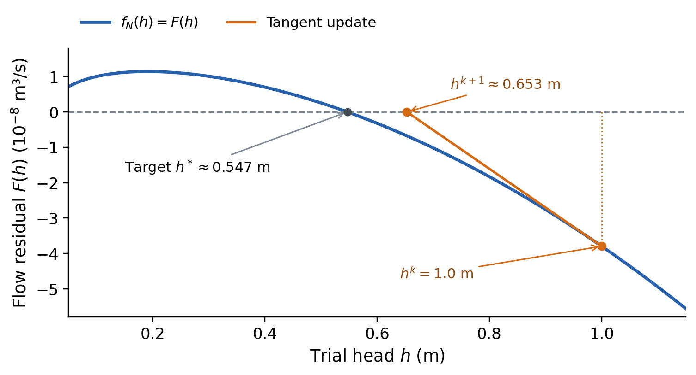

### Newton iteration: use the water-balance error and its slope

Newton seeks the same balanced head as Picard. It starts from the same equation,

$$
F(h)=Q_L(h)-Q_R(h)-Q_{\mathrm{ET}}(h)=0.
$$

The difference is how Newton calculates the next head. It uses both the **current water-balance error** and **how that error changes when the head changes**.

#### From a water-balance error to a head correction

At the current estimate $h^k$, calculate $F(h^k)$. Then calculate its derivative with respect to head, $F'(h^k)$.

The derivative is the slope of the residual curve. It describes the approximate change in the residual caused by a small change in head. Its units are m³/s per metre, or m²/s.

Near the current estimate, Newton represents the residual curve by a straight tangent:

$$
F(h^k+\Delta h)
\approx
F(h^k)+F'(h^k)\Delta h.
$$

Here, $\Delta h$ is a proposed head correction in metres.

We want the residual to be zero. Setting the tangent approximation to zero gives

$$
0=F(h^k)+F'(h^k)\Delta h,
$$

and therefore

$$
\Delta h=-\frac{F(h^k)}{F'(h^k)}.
$$

Adding this correction to the current head gives the **Newton update**:

$$
h^{k+1}
=
h^k-\frac{F(h^k)}{F'(h^k)}.
$$

This expression requires a nonzero derivative. The ratio $F/F'$ has units of metres, as a head correction must.

Newton thus uses the size of the current imbalance and its sensitivity to head to estimate the head adjustment needed to restore balance.

#### Reading the Newton diagram

The horizontal axis shows the trial head. The vertical axis shows the **flow residual**, rather than the proposed head used in the Picard diagram. We label the plotted Newton function

$$
f_N(h)=F(h).
$$

To follow an update:

1. Locate the current head $h^k$ on the horizontal axis and move to the blue residual curve.
2. Draw the tangent to the curve at that point.
3. Follow the tangent to its intersection with the horizontal zero-residual line.
4. Read the next estimate $h^{k+1}$ from that intersection.

**The tangent has zero residual at the proposed head; the actual residual curve generally does not.** Evaluate the actual residual and its slope again at the new head, then repeat.

For the same smooth example and starting head used in the Picard diagram, Newton gives

$$
1.000000
\;\rightarrow\;
0.652975
\;\rightarrow\;
0.556433
\;\rightarrow\;
0.546879
\;\rightarrow\;
0.546781\ \mathrm{m}.
$$

The solution is approximately $0.546781$ m. Newton approaches it rapidly in this example. The head-change and residual checks still determine when the calculation can stop.

*The same smooth three-cell model and starting head as in the Picard diagram. The orange tangent predicts $h^{k+1}\approx0.653$ m; the balanced head is $h^*\approx0.547$ m. Both methods seek the same solution, using different constructions.*

#### What additional information does Newton use?

Recall the complete central-cell balance:

$$
F(h)
=
C_L(h)(h_L-h)
-
C_R(h)(h-h_R)
-
Q_{\mathrm{ET}}(h).
$$

Its derivative is

$$
\begin{aligned}
F'(h)={}&C_L'(h)(h_L-h)-C_L(h)\\
&-C_R'(h)(h-h_R)-C_R(h)\\
&-Q_{\mathrm{ET}}'(h).
\end{aligned}
$$

The primes indicate derivatives with respect to the central head. Thus, $C_L'$ and $C_R'$ describe how the connection conductances change with head, and $Q_{\mathrm{ET}}'$ describes how the ET loss changes with head within the applicable head range.

Picard holds the conductances fixed while solving for the next head. **Newton also accounts for their sensitivity to head when calculating its correction.** Both methods described here retain the slope of the active linear ET segment.

Returning to the channel analogy: Picard calculates an updated depth using the flow area associated with the current estimate. Newton also accounts for how that area changes as the depth changes.

#### When is Newton particularly useful?

Changes in saturated thickness can strongly affect conductance in an unconfined aquifer. Including that sensitivity can give Newton a more effective head correction and reduce the number of iterations.

This advantage is especially clear sufficiently close to a solution where the residual curve is smooth and its derivative is nonzero. Under those conditions, the tangent becomes a good local approximation.

However, Newton is not guaranteed to converge from every starting head. A nearly horizontal tangent can predict a very large correction. A tangent calculated in one ET head range can also predict a head in another range, where the relationship has a different slope.

One common safeguard is **damping**: taking only a fraction of the proposed correction. It can help control large updates, although it does not guarantee convergence.

The examples in Mehl (2006) allow us to examine these differences directly: a smooth unconfined-flow problem and a problem with changes between ET head ranges. They also remind us that fewer iterations do not automatically mean less computation, because a Newton iteration requires additional derivative information.

