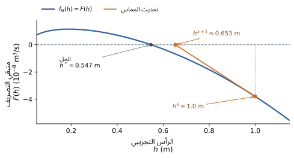

### تكرار Newton: استخدام عدم الاتزان المائي وميله

يبحث Newton عن الرأس المتزن نفسه، ويبدأ بالمعادلة نفسها:

$$
F(h)=Q_L(h)-Q_R(h)-Q_{\mathrm{ET}}(h)=0.
$$

يختلف حساب الرأس التالي؛ إذ يستخدم **عدم الاتزان الحالي** و**كيفية تغيره عندما يتغير الرأس**.

#### من عدم الاتزان إلى تصحيح الرأس

عند التقدير $h^k$، نحسب $F(h^k)$ ومشتقته بالنسبة إلى الرأس $F'(h^k)$.

المشتقة هي ميل منحنى المتبقي، وتصف تغيره التقريبي الناتج عن تغير صغير في الرأس. وحدتها m³/s لكل متر، أي m²/s.

قرب التقدير الحالي، يمثّل Newton المنحنى بمماس مستقيم:

$$
F(h^k+\Delta h)
\approx
F(h^k)+F'(h^k)\Delta h.
$$

$\Delta h$ تصحيح مقترح للرأس بالمتر.

بوضع التقريب المماسي مساوياً للصفر:

$$
0=F(h^k)+F'(h^k)\Delta h,
$$

نحصل على:

$$
\Delta h=-\frac{F(h^k)}{F'(h^k)}.
$$

وبإضافة التصحيح إلى الرأس الحالي نحصل على **تحديث Newton**:

$$
h^{k+1}
=
h^k-\frac{F(h^k)}{F'(h^k)}.
$$

يلزم أن تكون المشتقة غير صفرية. وحدة النسبة $F/F'$ هي المتر، كما يجب لتصحيح الرأس.

إذن يستخدم Newton مقدار عدم الاتزان وحساسيته للرأس لتقدير التعديل اللازم لاستعادة الموازنة.

#### قراءة مخطط Newton

يعرض المحور الأفقي الرأس التجريبي، ويعرض الرأسي **متبقي التصريف**، لا الرأس المقترح كما في مخطط Picard. الدالة المعروضة هي:

$$
f_N(h)=F(h).
$$

لتتبّع تحديث:

1. حدد $h^k$ على المحور الأفقي واصعد إلى المنحنى الأزرق.
2. ارسم المماس عند تلك النقطة.
3. اتبعه إلى خط المتبقي الصفري الأفقي.
4. اقرأ التقدير التالي $h^{k+1}$ عند التقاطع.

**يكون المماس صفراً عند الرأس المقترح، لكن المنحنى الفعلي ليس كذلك عادةً.** أعد تقييم المتبقي الفعلي وميله عند الرأس الجديد، ثم كرر.

للمثال الأملس والرأس الابتدائي نفسيهما المستخدمين في مخطط Picard، يعطي Newton:

$$
1.000000
\;\rightarrow\;
0.652975
\;\rightarrow\;
0.556433
\;\rightarrow\;
0.546879
\;\rightarrow\;
0.546781\ \mathrm{m}.
$$

الحل نحو $0.546781$ m. يقترب منه Newton سريعاً في هذا المثال، لكن اختباري تغير الرأس والمتبقي يظلان أساس قرار التوقف.

*النموذج الأملس والرأس الابتدائي نفسهما في مخطط Picard. يتنبأ المماس البرتقالي بـ$h^{k+1}\approx0.653$ m، بينما الرأس المتزن $h^*\approx0.547$ m. تبحث الطريقتان عن الحل نفسه بإنشاءين مختلفين.*

#### ما المعلومات الإضافية التي يستخدمها Newton؟

نتذكر الموازنة الكاملة:

$$
F(h)
=
C_L(h)(h_L-h)
-
C_R(h)(h-h_R)
-
Q_{\mathrm{ET}}(h).
$$

مشتقتها:

$$
\begin{aligned}
F'(h)={}&C_L'(h)(h_L-h)-C_L(h)\\
&-C_R'(h)(h-h_R)-C_R(h)\\
&-Q_{\mathrm{ET}}'(h).
\end{aligned}
$$

تدل الشرطة العليا على الاشتقاق بالنسبة إلى الرأس المركزي. يصف $C_L'$ و$C_R'$ تغير المواصلتين مع الرأس، ويصف $Q_{\mathrm{ET}}'$ تغير الفقد ضمن مجال الرأس المطبق.

يثبّت Picard المواصلات أثناء حل الرأس التالي. **أما Newton فيدرج أيضاً حساسيتها للرأس عند حساب التصحيح.** وتحتفظ الطريقتان هنا بميل فرع ET الخطي النشط.

في تشبيه القناة، يحسب Picard العمق الجديد بمساحة الجريان التابعة للتقدير الحالي. ويأخذ Newton أيضاً في الحسبان تغير المساحة عندما يتغير العمق.

#### متى تكون طريقة Newton مفيدة خصوصاً؟

قد تؤثر تغيرات السمك المشبع بقوة في مواصلة الخزان غير المحصور. وقد يعطي إدراج هذه الحساسية تصحيحاً أكثر فعالية للرأس ويقلل عدد التكرارات.

يتضح ذلك قرب حل يكون منحنى المتبقي عنده أملس ومشتقته غير صفرية، حيث يكون المماس تقريباً محلياً جيداً.

لكن التقارب غير مضمون من كل رأس ابتدائي. فقد يعطي المماس شبه الأفقي تصحيحاً كبيراً جداً. وقد يتنبأ مماس محسوب في مجال ET برأس يقع في مجال آخر مختلف الميل.

من التدابير الشائعة **التخميد (damping)**: قبول جزء فقط من التصحيح المقترح. قد يساعد ذلك على ضبط التحديثات الكبيرة، لكنه لا يضمن التقارب.

تتيح أمثلة Mehl (2006) دراسة هذين السلوكين مباشرةً: جريان غير محصور أملس، وجريان يتنقل بين مجالات ET. وتذكرنا أيضاً بأن تكرارات أقل لا تعني دائماً عملاً حسابياً أقل، لأن Newton يحتاج إلى معلومات مشتقات إضافية.
