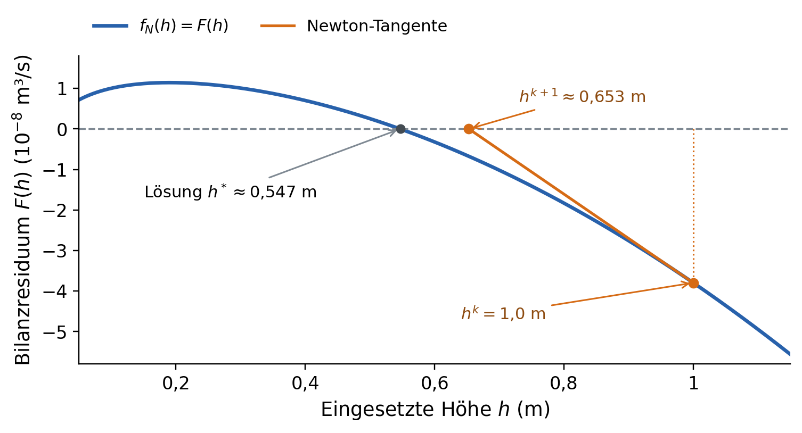

### Newton-Iteration: den Bilanzfehler und seine Steigung nutzen

Newton sucht dieselbe Höhe wie Picard. Ausgangspunkt ist dieselbe Wasserbilanz:

$$
F(h)=Q_L(h)-Q_R(h)-Q_{\mathrm{ET}}(h)=0.
$$

Newton verwendet für den nächsten Schritt zwei Informationen: **Wie groß ist der aktuelle Bilanzfehler? Wie stark ändert er sich, wenn die Höhe geringfügig verändert wird?**

#### Vom Bilanzfehler zur Höhenkorrektur

Für die aktuelle Näherung $h^k$ berechnen wir das Residuum $F(h^k)$ und seine Ableitung nach der Höhe, $F'(h^k)$.

Die Ableitung entspricht der Steigung der Residuenkurve. Sie gibt näherungsweise an, wie stark sich das Residuum bei einer kleinen Höhenänderung ändert. Ihre Einheit ist (m³/s)/m, also m²/s.

In der Umgebung der aktuellen Näherung ersetzt Newton die Kurve durch ihre Tangente:

$$
F(h^k+\Delta h)
\approx
F(h^k)+F'(h^k)\Delta h.
$$

Dabei bezeichnet $\Delta h$ die vorgeschlagene Höhenkorrektur in Metern.

Gesucht ist eine Höhe mit einem Residuum von null. Fordern wir dies zunächst für die Tangente, erhalten wir

$$
0=F(h^k)+F'(h^k)\Delta h,
$$

und damit

$$
\Delta h=-\frac{F(h^k)}{F'(h^k)}.
$$

Addieren wir diese Korrektur zur aktuellen Höhe, erhalten wir den **Newton-Schritt**:

$$
h^{k+1}
=
h^k-\frac{F(h^k)}{F'(h^k)}.
$$

Die Ableitung im Nenner muss von null verschieden sein. Der Quotient $F/F'$ hat die für eine Höhenkorrektur erforderliche Einheit Meter.

Newton schätzt also anhand der Größe des Bilanzfehlers und seiner Empfindlichkeit gegenüber der Höhe, welche Höhenkorrektur zum Ausgleich der Bilanz erforderlich ist.

#### Das Newton-Diagramm lesen

Auf der waagerechten Achse steht die eingesetzte hydraulische Höhe. Auf der senkrechten Achse steht hier das **Bilanzresiduum in m³/s**. Im Picard-Diagramm steht an dieser Stelle die nächste Höhe in Metern. Die dargestellte Newton-Funktion bezeichnen wir mit

$$
f_N(h)=F(h).
$$

Verfolgen Sie einen Schritt im Diagramm:

1. Gehen Sie von der aktuellen Höhe $h^k$ auf der waagerechten Achse senkrecht zur blauen Residuenkurve.
2. Legen Sie in diesem Punkt die Tangente an die Kurve.
3. Folgen Sie der Tangente bis zu ihrem Schnittpunkt mit der waagerechten Nulllinie.
4. Lesen Sie dort die nächste Näherung $h^{k+1}$ ab.

**Am Schnittpunkt ist der Wert der Tangente null.** Die tatsächliche Residuenkurve kann dort noch oberhalb oder unterhalb der Nulllinie liegen. Berechnen Sie an der neuen Höhe erneut das Residuum und seine Steigung.

Für dasselbe Beispiel ohne ET und denselben Startwert wie im Picard-Diagramm liefert Newton

$$
1{,}000000
\;\rightarrow\;
0{,}652975
\;\rightarrow\;
0{,}556433
\;\rightarrow\;
0{,}546879
\;\rightarrow\;
0{,}546781\ \mathrm{m}.
$$

Die Lösung liegt bei etwa $0{,}546781$ m. Newton nähert sich ihr hier rasch. Wann die Rechnung beendet wird, entscheiden weiterhin die Kriterien für Höhenänderung und Bilanzresiduum.

*Modell und Startwert stimmen mit denen im Picard-Diagramm überein. Die orange Tangente liefert $h^{k+1}\approx0{,}653$ m. Die gesuchte Höhe beträgt $h^*\approx0{,}547$ m. Beide Konstruktionen führen zur Lösung derselben Wasserbilanz.*

#### Welche zusätzliche Information verwendet Newton?

Die vollständige Wasserbilanz der mittleren Zelle lautet

$$
F(h)
=
C_L(h)(h_L-h)
-
C_R(h)(h-h_R)
-
Q_{\mathrm{ET}}(h).
$$

Ihre Ableitung ist

$$
\begin{aligned}
F'(h)={}&C_L'(h)(h_L-h)-C_L(h)\\
&-C_R'(h)(h-h_R)-C_R(h)\\
&-Q_{\mathrm{ET}}'(h).
\end{aligned}
$$

Die Striche kennzeichnen Ableitungen nach der Höhe in der mittleren Zelle. $C_L'$ und $C_R'$ geben an, wie sich die Leitwerte mit der Höhe ändern. $Q_{\mathrm{ET}}'$ erfasst die Änderung des ET-Entzugs im jeweils geltenden Höhenbereich.

Picard hält die Leitwerte bei der Berechnung der neuen Höhe fest. **Newton berücksichtigt bei der Korrektur zusätzlich, wie die Leitwerte auf eine Höhenänderung reagieren.** Beide hier verwendeten Verfahren berücksichtigen die Steigung des gerade geltenden linearen ET-Abschnitts.

Im Beispiel der Rinne berechnet Picard die neue Wassertiefe mit dem Querschnitt, der zum bisherigen Schätzwert gehört. Newton berücksichtigt zusätzlich, wie sich dieser Querschnitt bei einer Änderung der Wassertiefe verändert.

#### Wann eignet sich Newton besonders gut?

Im ungespannten Grundwasserleiter kann schon eine Änderung der gesättigten Mächtigkeit den Leitwert stark beeinflussen. Berücksichtigt Newton diese Abhängigkeit, kann die berechnete Höhenkorrektur näher an die Lösung führen und die Zahl der benötigten Iterationen verringern.

Das gelingt besonders gut in der Nähe einer Lösung, an der die Residuenkurve glatt verläuft und ihre Ableitung von null verschieden ist. Dort beschreibt die Tangente die Kurve lokal gut.

Vom Startwert hängt ab, ob Newton in diesen Bereich gelangt. Eine fast waagerechte Tangente kann eine sehr große Korrektur liefern. Eine Tangente aus einem ET-Abschnitt kann außerdem in einen anderen Höhenbereich führen, in dem eine andere Steigung gilt.

Eine Möglichkeit, große Schritte zu begrenzen, ist die **Dämpfung**. Dabei wird nur ein Teil der vorgeschlagenen Korrektur übernommen. Das kann die Konvergenz erleichtern, garantiert sie jedoch nicht.

Bei Mehl (2006) lässt sich das an einem glatten Strömungsproblem ohne ET und an einem Problem mit Übergängen zwischen den ET-Abschnitten untersuchen. Bedenken Sie beim Vergleich auch den Aufwand pro Schritt: Für einen Newton-Schritt müssen zusätzliche Ableitungen berechnet werden. Weniger Iterationen bedeuten deshalb nicht automatisch weniger Rechenaufwand.
