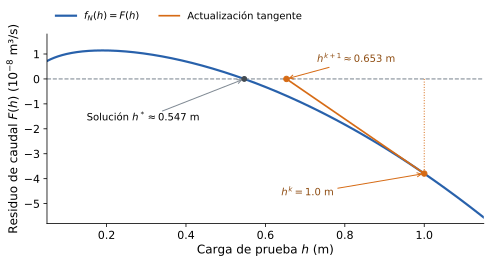

### Iteración de Newton: utilizar el desequilibrio de agua y su pendiente

Newton busca la misma carga de equilibrio que Picard. Parte de la misma ecuación:

$$
F(h)=Q_L(h)-Q_R(h)-Q_{\mathrm{ET}}(h)=0.
$$

La diferencia es cómo calcula la carga siguiente. Utiliza tanto el **desequilibrio actual** como **su variación cuando cambia la carga**.

#### Del desequilibrio a una corrección de carga

En la estimación actual $h^k$, calcule $F(h^k)$ y su derivada respecto a la carga, $F'(h^k)$.

La derivada es la pendiente de la curva de residuo. Describe su cambio aproximado ante una pequeña variación de carga. Sus unidades son m³/s por metro, es decir, m²/s.

Cerca de la estimación actual, Newton representa la curva mediante una tangente recta:

$$
F(h^k+\Delta h)
\approx
F(h^k)+F'(h^k)\Delta h.
$$

$\Delta h$ es una corrección propuesta de carga, en metros.

Queremos un residuo nulo. Igualando a cero la aproximación tangente:

$$
0=F(h^k)+F'(h^k)\Delta h,
$$

Por tanto:

$$
\Delta h=-\frac{F(h^k)}{F'(h^k)}.
$$

Sumar esta corrección a la carga actual proporciona la **actualización de Newton**:

$$
h^{k+1}
=
h^k-\frac{F(h^k)}{F'(h^k)}.
$$

Esta expresión exige una derivada no nula. El cociente $F/F'$ tiene unidades de metros, como corresponde a una corrección de carga.

Newton utiliza así la magnitud del desequilibrio y su sensibilidad a la carga para estimar el ajuste necesario para restablecer el balance.

#### Interpretar el diagrama de Newton

El eje horizontal muestra la carga de prueba. El vertical muestra el **residuo de caudal**, mientras que en Picard mostraba la carga propuesta. Denominamos a la función representada:

$$
f_N(h)=F(h).
$$

Para seguir una actualización:

1. Sitúe $h^k$ en el eje horizontal y llegue a la curva azul del residuo.
2. Trace la tangente en ese punto.
3. Siga la tangente hasta el eje horizontal de residuo nulo.
4. Lea en la intersección la estimación siguiente $h^{k+1}$.

**La tangente tiene residuo nulo en la carga propuesta; en general, la curva real no.** Evalúe de nuevo el residuo real y su pendiente en la nueva carga y repita.

Para el mismo ejemplo suave y la misma carga inicial del diagrama de Picard:

$$
1.000000
\;\rightarrow\;
0.652975
\;\rightarrow\;
0.556433
\;\rightarrow\;
0.546879
\;\rightarrow\;
0.546781\ \mathrm{m}.
$$

La solución es aproximadamente $0.546781$ m. En este ejemplo Newton se aproxima rápidamente, aunque los criterios de variación de carga y residuo siguen determinando cuándo detenerse.

*Se emplean el mismo modelo suave de tres celdas y la misma carga inicial que en el diagrama de Picard. La tangente naranja predice $h^{k+1}\approx0.653$ m; la carga de equilibrio es $h^*\approx0.547$ m. Ambos métodos buscan la misma solución mediante construcciones diferentes.*

#### ¿Qué información adicional utiliza Newton?

Recordemos el balance completo:

$$
F(h)
=
C_L(h)(h_L-h)
-
C_R(h)(h-h_R)
-
Q_{\mathrm{ET}}(h).
$$

Su derivada es:

$$
\begin{aligned}
F'(h)={}&C_L'(h)(h_L-h)-C_L(h)\\
&-C_R'(h)(h-h_R)-C_R(h)\\
&-Q_{\mathrm{ET}}'(h).
\end{aligned}
$$

Las primas indican derivadas respecto a la carga central. $C_L'$ y $C_R'$ describen cómo cambian las conductancias con la carga; $Q_{\mathrm{ET}}'$ describe cómo cambia la pérdida por ET en el intervalo aplicable.

Picard mantiene las conductancias fijas al resolver la carga siguiente. **Newton también incorpora su sensibilidad a la carga al calcular la corrección.** Ambos métodos aquí descritos conservan la pendiente del tramo lineal activo de ET.

Volviendo al canal: Picard calcula una profundidad actualizada usando la sección correspondiente a la estimación actual. Newton también tiene en cuenta cómo cambia esa sección al cambiar la profundidad.

#### ¿Cuándo resulta especialmente útil Newton?

En un acuífero libre, los cambios de espesor saturado pueden modificar mucho la conductancia. Incorporar esa sensibilidad puede mejorar la corrección de carga y reducir las iteraciones.

La ventaja es especialmente clara suficientemente cerca de una solución donde la curva de residuo sea suave y su derivada no nula. En esas condiciones la tangente es una buena aproximación local.

Sin embargo, Newton no garantiza la convergencia desde cualquier carga inicial. Una tangente casi horizontal puede proponer una corrección muy grande. Una tangente calculada en un tramo de ET puede predecir una carga situada en otro tramo con pendiente distinta.

Una protección habitual es la **amortiguación**: aceptar solo una fracción de la corrección. Puede controlar actualizaciones grandes, aunque tampoco garantiza la convergencia.

Los ejemplos de Mehl (2006) permiten examinar estas diferencias: un problema suave de flujo libre y otro con cambios entre intervalos de ET. También recuerdan que menos iteraciones no implican automáticamente menos trabajo computacional, porque cada iteración de Newton requiere información adicional sobre las derivadas.
