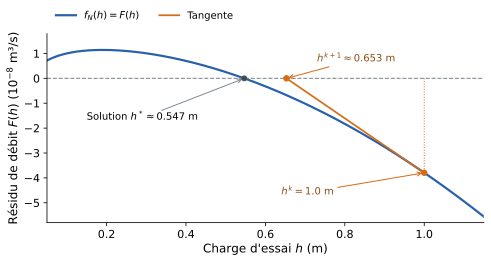

### Itération de Newton : utiliser le déséquilibre du bilan et sa pente

Newton recherche la même charge d'équilibre que Picard. Le point de départ est la même équation :

$$
F(h)=Q_L(h)-Q_R(h)-Q_{\mathrm{ET}}(h)=0.
$$

La différence tient au calcul de la charge suivante. Newton utilise à la fois le **déséquilibre actuel du bilan en eau** et **la manière dont ce déséquilibre varie avec la charge**.

#### Du déséquilibre du bilan à une correction de charge

À l'estimation actuelle $h^k$, calculez $F(h^k)$, puis sa dérivée par rapport à la charge, $F'(h^k)$.

Cette dérivée est la pente de la courbe du résidu. Elle décrit la variation approximative du résidu produite par une petite variation de charge. Son unité est le m³/s par mètre, soit le m²/s.

Au voisinage de l'estimation actuelle, Newton représente la courbe du résidu par sa tangente :

$$
F(h^k+\Delta h)
\approx
F(h^k)+F'(h^k)\Delta h.
$$

$\Delta h$ est une correction de charge proposée, en mètres.

Nous voulons annuler le résidu. En posant l'approximation tangente égale à zéro :

$$
0=F(h^k)+F'(h^k)\Delta h,
$$

D'où :

$$
\Delta h=-\frac{F(h^k)}{F'(h^k)}.
$$

Ajouter cette correction à la charge actuelle donne la **mise à jour de Newton** :

$$
h^{k+1}
=
h^k-\frac{F(h^k)}{F'(h^k)}.
$$

Cette expression exige une dérivée non nulle. Le rapport $F/F'$ s'exprime en mètres, comme doit le faire une correction de charge.

Newton utilise ainsi l'amplitude du déséquilibre et sa sensibilité à la charge pour estimer la correction nécessaire au rétablissement du bilan.

#### Lire le diagramme de Newton

L'axe horizontal représente la charge d'essai. L'axe vertical représente le **résidu de débit**, alors que celui du diagramme de Picard représente une charge proposée. La fonction tracée pour Newton est notée :

$$
f_N(h)=F(h).
$$

Pour suivre une mise à jour :

1. Repérez la charge actuelle $h^k$ sur l'axe horizontal et rejoignez la courbe bleue du résidu.
2. Tracez la tangente à la courbe en ce point.
3. Suivez la tangente jusqu'à son intersection avec la ligne horizontale de résidu nul.
4. Lisez l'estimation suivante $h^{k+1}$ à cette intersection.

**La tangente s'annule à la charge proposée ; la courbe du résidu réel ne s'y annule généralement pas.** Réévaluez le résidu réel et sa pente à la nouvelle charge, puis recommencez.

Pour le même exemple régulier et la même charge initiale que dans le diagramme de Picard, Newton donne :

$$
1.000000
\;\rightarrow\;
0.652975
\;\rightarrow\;
0.556433
\;\rightarrow\;
0.546879
\;\rightarrow\;
0.546781\ \mathrm{m}.
$$

La solution vaut environ 0,546781 m. Newton s'en approche rapidement dans cet exemple. Les contrôles de variation de charge et de résidu déterminent néanmoins quand le calcul peut s'arrêter.

*Le modèle régulier à trois mailles et la charge initiale sont les mêmes que dans le diagramme de Picard. La tangente orange prédit $h^{k+1}\approx0.653$ m ; la charge d'équilibre est $h^*\approx0.547$ m. Les deux méthodes recherchent la même solution à l'aide de constructions différentes.*

#### Quelle information supplémentaire Newton utilise-t-il ?

Rappelons le bilan complet de la maille centrale :

$$
F(h)
=
C_L(h)(h_L-h)
-
C_R(h)(h-h_R)
-
Q_{\mathrm{ET}}(h).
$$

Sa dérivée est :

$$
\begin{aligned}
F'(h)={}&C_L'(h)(h_L-h)-C_L(h)\\
&-C_R'(h)(h-h_R)-C_R(h)\\
&-Q_{\mathrm{ET}}'(h).
\end{aligned}
$$

Les primes désignent les dérivées par rapport à la charge centrale. $C_L'$ et $C_R'$ décrivent donc la variation des conductances avec la charge, et $Q_{\mathrm{ET}}'$ la variation de la perte par ET dans l'intervalle de charge applicable.

Picard maintient les conductances fixes pour calculer la charge suivante. **Newton tient aussi compte de leur sensibilité à la charge dans le calcul de sa correction.** Les deux méthodes décrites ici conservent la pente du segment linéaire d'ET actif.

Reprenons l'analogie du canal : Picard calcule une nouvelle profondeur avec la section d'écoulement correspondant à l'estimation actuelle. Newton tient aussi compte de la variation de cette section lorsque la profondeur change.

#### Quand Newton est-il particulièrement utile ?

Dans un aquifère à nappe libre, les variations d'épaisseur saturée peuvent modifier fortement la conductance. Prendre en compte cette sensibilité peut améliorer la correction de charge de Newton et réduire le nombre d'itérations.

Cet avantage apparaît surtout assez près d'une solution où la courbe du résidu est régulière et sa dérivée non nulle. La tangente constitue alors une bonne approximation locale.

Cependant, Newton ne converge pas nécessairement depuis toute charge initiale. Une tangente presque horizontale peut prédire une correction très importante. Une tangente calculée dans un intervalle d'ET peut aussi proposer une charge située dans un autre intervalle, où la pente est différente.

Une précaution courante est l'**amortissement** : n'appliquer qu'une fraction de la correction proposée. Cela peut limiter les mises à jour excessives sans garantir la convergence.

Les exemples de Mehl (2006) permettent d'étudier directement ces différences : un problème régulier d'écoulement en nappe libre et un problème comportant des changements d'intervalle d'ET. Ils rappellent aussi qu'un nombre réduit d'itérations ne signifie pas automatiquement un coût de calcul moindre, car chaque itération de Newton exige des informations supplémentaires sur les dérivées.
