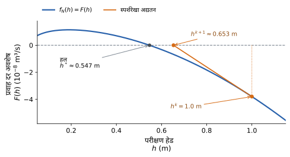

### Newton पुनरावृत्ति: जल असंतुलन और उसकी ढाल का उपयोग

Newton भी Picard वाला संतुलित हेड खोजता है और उसी समीकरण से शुरू होता है:

$$
F(h)=Q_L(h)-Q_R(h)-Q_{\mathrm{ET}}(h)=0.
$$

अंतर अगले हेड की गणना में है। Newton **वर्तमान जल असंतुलन** तथा **हेड बदलने पर उस असंतुलन के बदलने की दर**, दोनों का उपयोग करता है।

#### असंतुलन से हेड सुधार तक

वर्तमान अनुमान $h^k$ पर $F(h^k)$ तथा हेड के सापेक्ष अवकलज $F'(h^k)$ निकालें।

अवकलज अवशेष वक्र की ढाल है। यह बताता है कि हेड में छोटे परिवर्तन से अवशेष लगभग कितना बदलेगा। इसकी इकाई m³/s प्रति मीटर, अर्थात m²/s, है।

वर्तमान अनुमान के पास Newton वक्र को उसकी स्पर्शरेखा से निरूपित करता है:

$$
F(h^k+\Delta h)
\approx
F(h^k)+F'(h^k)\Delta h.
$$

$\Delta h$ मीटर में प्रस्तावित हेड सुधार है।

स्पर्शरेखीय सन्निकटन में अवशेष शून्य रखने पर:

$$
0=F(h^k)+F'(h^k)\Delta h,
$$

इसलिए:

$$
\Delta h=-\frac{F(h^k)}{F'(h^k)}.
$$

वर्तमान हेड में यह सुधार जोड़ने से **Newton अद्यतन** मिलता है:

$$
h^{k+1}
=
h^k-\frac{F(h^k)}{F'(h^k)}.
$$

इस व्यंजक के लिए अवकलज शून्य नहीं होना चाहिए। $F/F'$ की इकाई मीटर है, जैसा हेड सुधार के लिए अपेक्षित है।

इस प्रकार Newton वर्तमान असंतुलन और हेड के प्रति उसकी संवेदनशीलता से संतुलन बहाल करने के लिए आवश्यक हेड परिवर्तन अनुमानित करता है।

#### Newton आरेख पढ़ना

क्षैतिज अक्ष परीक्षण हेड दर्शाता है। ऊर्ध्वाधर अक्ष पर **प्रवाह दर अवशेष** है, Picard आरेख की तरह प्रस्तावित हेड नहीं। प्रदर्शित फलन है:

$$
f_N(h)=F(h).
$$

एक अद्यतन समझने के लिए:

1. क्षैतिज अक्ष पर $h^k$ से नीली वक्र तक जाएँ।
2. उस बिंदु पर स्पर्शरेखा खींचें।
3. स्पर्शरेखा पर चलकर शून्य-अवशेष की क्षैतिज रेखा तक पहुँचें।
4. प्रतिच्छेद से अगला अनुमान $h^{k+1}$ पढ़ें।

**प्रस्तावित हेड पर स्पर्शरेखा का अवशेष शून्य है; वास्तविक वक्र का सामान्यतः नहीं।** इसलिए नए हेड पर वास्तविक अवशेष और ढाल फिर निकालकर दोहराएँ।

Picard आरेख वाले सुचारु उदाहरण और उसी प्रारंभिक हेड से Newton देता है:

$$
1.000000
\;\rightarrow\;
0.652975
\;\rightarrow\;
0.556433
\;\rightarrow\;
0.546879
\;\rightarrow\;
0.546781\ \mathrm{m}.
$$

हल लगभग $0.546781$ m है। इस उदाहरण में Newton तेज़ी से उसके पास पहुँचता है। फिर भी गणना कब रुक सकती है, यह हेड परिवर्तन और अवशेष की जाँच तय करती है।

*Picard आरेख वाला ही सुचारु तीन-सेल मॉडल और प्रारंभिक हेड। नारंगी स्पर्शरेखा $h^{k+1}\approx0.653$ m का अनुमान देती है; संतुलित हेड $h^*\approx0.547$ m है। दोनों विधियाँ अलग रचनाओं से एक ही हल खोजती हैं।*

#### Newton कौन-सी अतिरिक्त जानकारी उपयोग करता है?

पूरा केंद्रीय संतुलन याद करें:

$$
F(h)
=
C_L(h)(h_L-h)
-
C_R(h)(h-h_R)
-
Q_{\mathrm{ET}}(h).
$$

इसका अवकलज है:

$$
\begin{aligned}
F'(h)={}&C_L'(h)(h_L-h)-C_L(h)\\
&-C_R'(h)(h-h_R)-C_R(h)\\
&-Q_{\mathrm{ET}}'(h).
\end{aligned}
$$

प्राइम चिह्न केंद्रीय हेड के सापेक्ष अवकलज दर्शाते हैं। $C_L'$ और $C_R'$ बताते हैं कि कंडक्टेंस हेड से कैसे बदलते हैं; $Q_{\mathrm{ET}}'$ लागू अंतराल में ET निष्कासन की हेड-संवेदनशीलता है।

Picard अगला हेड हल करते समय कंडक्टेंस स्थिर रखता है। **Newton सुधार निकालते समय हेड के प्रति कंडक्टेंस की संवेदनशीलता भी शामिल करता है।** यहाँ वर्णित दोनों विधियाँ लागू रैखिक ET खंड की ढाल बनाए रखती हैं।

नाली की उपमा में Picard वर्तमान गहराई वाले क्षेत्रफल से नई गहराई निकालता है। Newton यह भी सम्मिलित करता है कि गहराई बदलने से क्षेत्रफल कितना बदलता है।

#### Newton कब विशेष उपयोगी है?

मुक्त जलभृत में संतृप्त मोटाई का परिवर्तन कंडक्टेंस पर बड़ा प्रभाव डाल सकता है। इस संवेदनशीलता को शामिल करने से Newton का हेड सुधार अधिक प्रभावी हो सकता है और कम पुनरावृत्तियाँ लग सकती हैं।

यह लाभ विशेषकर हल के पर्याप्त पास स्पष्ट होता है, जहाँ अवशेष वक्र सुचारु और अवकलज अशून्य है। तब स्पर्शरेखा अच्छा स्थानीय सन्निकटन होती है।

लेकिन हर प्रारंभिक हेड से अभिसरण सुनिश्चित नहीं है। लगभग क्षैतिज स्पर्शरेखा बहुत बड़ा सुधार दे सकती है। एक ET अंतराल में निकाली गई स्पर्शरेखा दूसरे अंतराल का हेड भी दे सकती है, जहाँ ढाल अलग होती है।

एक सामान्य उपाय **डैम्पिंग (damping)** है: प्रस्तावित सुधार का केवल कुछ अंश स्वीकार करना। इससे बड़े अद्यतन नियंत्रित हो सकते हैं, लेकिन अभिसरण की गारंटी नहीं मिलती।

Mehl (2006) के सुचारु मुक्त-प्रवाह और ET-अंतराल बदलने वाले उदाहरण इन भेदों की प्रत्यक्ष जाँच देते हैं। कम पुनरावृत्तियाँ हमेशा कम गणनात्मक कार्य नहीं दर्शातीं, क्योंकि Newton को अतिरिक्त अवकलज जानकारी चाहिए।
