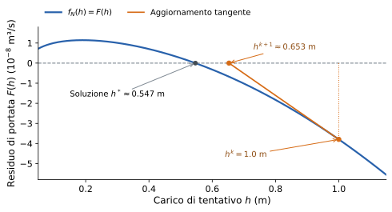

### Iterazione di Newton: usare lo squilibrio idrico e la sua pendenza

Newton cerca lo stesso carico di equilibrio di Picard e parte dalla stessa equazione:

$$
F(h)=Q_L(h)-Q_R(h)-Q_{\mathrm{ET}}(h)=0.
$$

Cambia il modo di calcolare il carico successivo: utilizza sia lo **squilibrio idrico attuale** sia **il modo in cui esso varia al variare del carico**.

#### Dallo squilibrio a una correzione del carico

Alla stima attuale $h^k$ si calcolano $F(h^k)$ e la sua derivata rispetto al carico, $F'(h^k)$.

La derivata è la pendenza della curva del residuo. Descrive la variazione approssimata del residuo dovuta a una piccola variazione di carico. Si misura in m³/s per metro, ossia m²/s.

Vicino alla stima attuale, Newton approssima la curva con una tangente:

$$
F(h^k+\Delta h)
\approx
F(h^k)+F'(h^k)\Delta h.
$$

$\Delta h$ è la correzione proposta del carico, in metri.

Imponendo residuo nullo nell'approssimazione tangente:

$$
0=F(h^k)+F'(h^k)\Delta h,
$$

Si ottiene:

$$
\Delta h=-\frac{F(h^k)}{F'(h^k)}.
$$

Sommando la correzione al carico attuale si ricava l'**aggiornamento di Newton**:

$$
h^{k+1}
=
h^k-\frac{F(h^k)}{F'(h^k)}.
$$

La derivata deve essere diversa da zero. Il rapporto $F/F'$ ha unità di metri, come richiesto per una correzione del carico.

Newton usa quindi l'entità dello squilibrio e la sua sensibilità al carico per stimare la modifica necessaria a ristabilire il bilancio.

#### Leggere il diagramma di Newton

L'asse orizzontale riporta il carico di tentativo. Quello verticale mostra il **residuo di portata**, anziché il carico proposto del diagramma di Picard. La funzione rappresentata è:

$$
f_N(h)=F(h).
$$

Per seguire un aggiornamento:

1. Individuate $h^k$ sull'asse orizzontale e raggiungete la curva blu.
2. Tracciate la tangente in quel punto.
3. Seguitela fino alla retta orizzontale di residuo nullo.
4. Leggete all'intersezione la stima successiva $h^{k+1}$.

**La tangente ha residuo nullo al carico proposto; in generale la curva effettiva no.** Rivalutate quindi residuo e pendenza al nuovo carico e ripetete.

Con lo stesso esempio regolare e carico iniziale del diagramma di Picard, Newton fornisce:

$$
1.000000
\;\rightarrow\;
0.652975
\;\rightarrow\;
0.556433
\;\rightarrow\;
0.546879
\;\rightarrow\;
0.546781\ \mathrm{m}.
$$

La soluzione è circa $0.546781$ m. Newton vi si avvicina rapidamente in questo esempio; i controlli di variazione del carico e di residuo continuano comunque a determinare l'arresto.

*Stesso modello regolare a tre celle e stesso carico iniziale del diagramma di Picard. La tangente arancione prevede $h^{k+1}\approx0.653$ m; il carico di equilibrio è $h^*\approx0.547$ m. I due metodi cercano la stessa soluzione con costruzioni diverse.*

#### Quale informazione aggiuntiva usa Newton?

Ricordiamo il bilancio completo:

$$
F(h)
=
C_L(h)(h_L-h)
-
C_R(h)(h-h_R)
-
Q_{\mathrm{ET}}(h).
$$

La sua derivata è:

$$
\begin{aligned}
F'(h)={}&C_L'(h)(h_L-h)-C_L(h)\\
&-C_R'(h)(h-h_R)-C_R(h)\\
&-Q_{\mathrm{ET}}'(h).
\end{aligned}
$$

Gli apici indicano derivate rispetto al carico centrale. $C_L'$ e $C_R'$ descrivono come variano le conduttanze con il carico; $Q_{\mathrm{ET}}'$ descrive la variazione della perdita per ET nell'intervallo applicabile.

Picard mantiene fisse le conduttanze durante la soluzione del carico successivo. **Newton considera anche la loro sensibilità al carico nel calcolare la correzione.** Entrambi i metodi qui descritti mantengono la pendenza del tratto lineare attivo di ET.

Nell'analogia del canale, Picard aggiorna la profondità utilizzando la sezione associata alla stima attuale. Newton considera anche come cambia tale sezione al variare della profondità.

#### Quando è particolarmente utile Newton?

In un acquifero libero, variazioni dello spessore saturo possono influire fortemente sulla conduttanza. Includere tale sensibilità può migliorare la correzione e ridurre il numero di iterazioni.

Il vantaggio è particolarmente evidente sufficientemente vicino a una soluzione dove la curva del residuo sia regolare e abbia derivata non nulla: la tangente diventa una buona approssimazione locale.

Newton non garantisce però la convergenza da ogni carico iniziale. Una tangente quasi orizzontale può prevedere una correzione molto grande. Una tangente calcolata in un intervallo di ET può prevedere un carico appartenente a un altro intervallo con pendenza diversa.

Una precauzione comune è lo **smorzamento**: accettare soltanto una frazione della correzione proposta. Può contenere aggiornamenti grandi, senza garantire la convergenza.

Gli esempi di Mehl (2006) consentono di osservare direttamente queste differenze in un problema regolare di flusso libero e in uno con cambiamenti fra intervalli di ET. Ricordano inoltre che meno iterazioni non significano automaticamente meno lavoro computazionale, perché Newton richiede informazioni aggiuntive sulle derivate.
