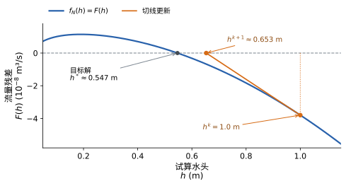

### Newton 迭代：利用水量不平衡及其斜率

Newton 寻找与 Picard 相同的平衡水头，从同一个方程出发：

$$
F(h)=Q_L(h)-Q_R(h)-Q_{\mathrm{ET}}(h)=0.
$$

区别在于下一水头的计算。Newton 同时使用**当前水量不平衡**和**不平衡随水头的变化率**。

#### 从不平衡量得到水头修正

在当前估计 $h^k$ 处，计算 $F(h^k)$ 及其关于水头的导数 $F'(h^k)$。

该导数是残差曲线的斜率，表示水头发生小变化时残差的近似变化率。单位为每米水头的 m³/s，即 m²/s。

在当前估计附近，Newton 用切线近似残差曲线：

$$
F(h^k+\Delta h)
\approx
F(h^k)+F'(h^k)\Delta h.
$$

$\Delta h$ 为建议的水头修正，单位为米。

令切线近似的残差为零：

$$
0=F(h^k)+F'(h^k)\Delta h,
$$

得到：

$$
\Delta h=-\frac{F(h^k)}{F'(h^k)}.
$$

将修正加到当前水头上，即为 **Newton 更新**：

$$
h^{k+1}
=
h^k-\frac{F(h^k)}{F'(h^k)}.
$$

这个式子要求导数非零。$F/F'$ 的单位为米，符合水头修正的量纲。

因此，Newton 根据当前不平衡的大小及其水头敏感性，估计恢复平衡所需的水头调整。

#### 阅读 Newton 图

横轴为试算水头，纵轴为**流量残差**，并非 Picard 图中的建议水头。图示函数为：

$$
f_N(h)=F(h).
$$

跟踪一次更新时：

1. 从横轴的 $h^k$ 移动到蓝色残差曲线。
2. 在该点作切线。
3. 沿切线到达水平的零残差线。
4. 从交点读出下一估计 $h^{k+1}$。

**建议水头处的切线残差为零，但实际曲线的残差通常不为零。** 因此需要在新水头处重新计算残差与斜率，再次迭代。

使用 Picard 图中相同的光滑例子和初始水头，Newton 得到：

$$
1.000000
\;\rightarrow\;
0.652975
\;\rightarrow\;
0.556433
\;\rightarrow\;
0.546879
\;\rightarrow\;
0.546781\ \mathrm{m}.
$$

解约为 $0.546781$ m。Newton 在这个例子中很快接近解，但何时停止仍由水头变化和残差检查共同决定。

*模型和初始水头与 Picard 图相同。橙色切线给出 $h^{k+1}\approx0.653$ m；平衡水头为 $h^*\approx0.547$ m。两种方法通过不同的几何构造寻找同一个解。*

#### Newton 使用了哪些额外信息？

回顾完整的中央单元平衡：

$$
F(h)
=
C_L(h)(h_L-h)
-
C_R(h)(h-h_R)
-
Q_{\mathrm{ET}}(h).
$$

其导数为：

$$
\begin{aligned}
F'(h)={}&C_L'(h)(h_L-h)-C_L(h)\\
&-C_R'(h)(h-h_R)-C_R(h)\\
&-Q_{\mathrm{ET}}'(h).
\end{aligned}
$$

撇号表示对中央水头求导。$C_L'$ 和 $C_R'$ 描述连接传导系数随水头的变化；$Q_{\mathrm{ET}}'$ 描述当前适用区间内 ET 损失量随水头的变化。

Picard 求解下一水头时固定连接传导系数。**Newton 在计算修正时还考虑这些系数对水头的敏感性。** 本文中的两种方法均保留当前线性 ET 分段的斜率。

回到水槽类比：Picard 用当前估计对应的过水断面求新水深；Newton 还考虑断面如何随水深改变。

#### Newton 何时特别有用？

在潜水含水层中，饱和厚度变化可能显著影响连接传导系数。纳入这种敏感性，可能使 Newton 的水头修正更有效，从而减少迭代次数。

当估计已足够接近解、残差曲线光滑且导数非零时，这一优势尤其明显，因为切线成为良好的局部近似。

但 Newton 不保证从每个初始水头出发都收敛。几乎水平的切线可能给出非常大的修正。在一个 ET 区间作出的切线，也可能预测出落在另一斜率区间内的水头。

一种常见措施是**阻尼（damping）**：仅接受建议修正的一部分。这有助于控制过大的更新，却不能保证收敛。

Mehl (2006) 的光滑潜水流和 ET 分段切换两个例子，让我们直接考察这些差异。它们也提醒我们：迭代次数较少不一定意味着计算量较小，因为 Newton 每次迭代还需要导数信息。
