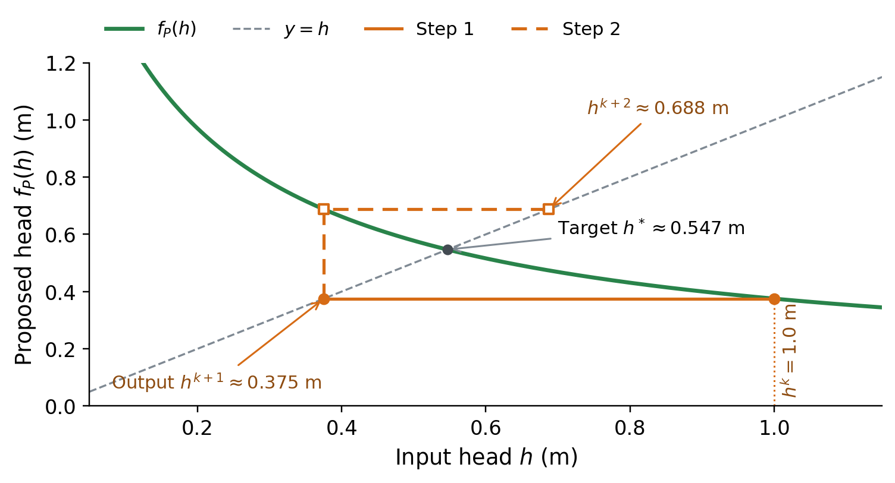

### Picard iteration: calculate conductances, solve for head, repeat

We now have the equation that the central head must satisfy. Picard solves it by using the current head estimate to calculate conductances, then holding those conductances fixed while calculating the next head.

We first consider the case **without evapotranspiration or other sources and sinks**.

#### One iteration, step by step

Start with an initial head estimate $h^0$. The superscript $k$ counts numerical iterations: $k=0$ is the initial estimate, and $h^{k+1}$ is the next estimate.

**1. Calculate conductances from the current head.**

$$
C_L^k=C_L(h^k),
\qquad
C_R^k=C_R(h^k).
$$

The superscript identifies which head estimate was used. Both conductances have units of m²/s.

**2. Hold these conductances fixed and solve the water balance.**

$$
C_L^k(h_L-h^{k+1})
-
C_R^k(h^{k+1}-h_R)=0.
$$

The only unknown in this equation is $h^{k+1}$. Collecting its terms gives

$$
(C_L^k+C_R^k)h^{k+1}
=
C_L^kh_L+C_R^kh_R.
$$

Consequently,

$$
h^{k+1}
=
\frac{C_L^kh_L+C_R^kh_R}
{C_L^k+C_R^k}.
$$

The new head is a weighted average of the two specified heads. A connection with greater conductance gives its boundary head greater weight.

**3. Recalculate using the new head.**

The new head changes saturated thickness and therefore the conductances. Recalculate them and evaluate the original water-balance residual $F(h^{k+1})$. Repeat the calculation until the head-change and residual criteria are both satisfied.

**Solving the equation with temporarily fixed conductances does not necessarily solve the original nonlinear equation.** This is why a further iteration can be necessary.

An analogy is calculating the water depth in a channel whose flow area depends on depth. Picard uses the current depth to estimate the flow area, calculates a revised depth with that area held fixed, then updates the area and repeats.

#### Reading the Picard diagram

We call the complete calculation that converts an input head into the next head $f_P$:

$$
h^{k+1}=f_P(h^k).
$$

The function $f_P$ returns a **head in metres**. It is different from $F$, which returns a **water-balance residual in m³/s**.

In the diagram:

1. Start at the current head on the horizontal axis.
2. Move vertically to the green curve. Its vertical coordinate is the next head.
3. Move horizontally to the dashed line $y=h$. This transfers the output head into the horizontal coordinate for the next iteration.
4. Move vertically to the curve again and repeat.

The thin dotted orange line locates the input head on the axis. The solid orange line shows the first update. The dashed orange path shows the second update, from $h^{k+1}$ to $h^{k+2}$.

The solution is the intersection where

$$
f_P(h^*)=h^*.
$$

At this point, the update returns the same head. This is called a **fixed point**.

For the illustrated smooth case from Mehl, a starting head of $1.000$ m gives approximately

$$
1.000
\;\rightarrow\;
0.375
\;\rightarrow\;
0.688
\;\rightarrow\;
0.474
\;\rightarrow\;\cdots
$$

The estimates alternate around the solution, approximately $0.547$ m. Their alternating direction does not itself indicate failure: here, the deviations become smaller. Other setups can produce slowly decreasing, persistent, or growing oscillations.

*The diagram illustrates Mehl's smooth three-cell case, with an illustrative starting head of 1.0 m for comparison with Newton. The paper's original starting heads will be used in the worked examples. In the lab's scaling, $h_L=4$ m, $h_R=0.1$ m, and $K_L,K_C,K_R=(0.005,0.25,100)$ m/day, with 100 m centre spacing, 1 m width, bottom elevation 0 m, and no ET or recharge.*

#### Including groundwater evapotranspiration

With ET, the balance also contains the positive extraction $Q_{\mathrm{ET}}$.

At each iteration, the current head determines which ET relation is used:

- **At or below SURF − EXDP:** use $Q_{\mathrm{ET}}=0$.
- **Between SURF − EXDP and SURF:** retain the linear dependence on the new head:
  
  $$
  Q_{\mathrm{ET}}(h^{k+1})
  =
  \mathrm{EVTR}\,A
  \frac{h^{k+1}-(\mathrm{SURF}-\mathrm{EXDP})}
  {\mathrm{EXDP}}.
  $$

- **At or above SURF:** use the constant maximum loss $Q_{\mathrm{ET}}=\mathrm{EVTR}\,A$.

Insert the selected relation into the water balance together with the fixed conductances. The equation remains linear in the new head.

**In the middle range, the ET loss is allowed to change with the new head.** It is not held at the discharge calculated for the previous head.

After the update, evaluate the actual ET loss using the complete relationship. If the new head has crossed a threshold, the next iteration uses the newly applicable segment.

