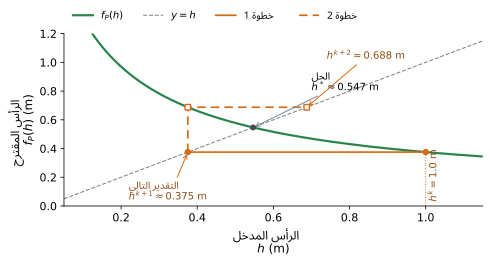

### تكرار Picard: احسب المواصلات، ثم حل الرأس، وكرر

أصبحت معادلة الرأس المركزي معروفة. يحسب Picard المواصلات من التقدير الحالي، ويثبتها أثناء حساب الرأس التالي.

نبدأ بالحالة **دون تبخر ونتح أو مصادر أو مصارف أخرى**.

#### خطوات تكرار واحد

نبدأ بتقدير $h^0$. يحصي الأس العلوي $k$ التكرارات العددية: $k=0$ هو التقدير الابتدائي، و$h^{k+1}$ هو التقدير التالي.

**1. احسب المواصلات عند الرأس الحالي.**

$$
C_L^k=C_L(h^k),
\qquad
C_R^k=C_R(h^k).
$$

يحدد الأس التقدير المستخدم. وحدة المواصلتين m²/s.

**2. ثبّتهما وحل الموازنة المائية.**

$$
C_L^k(h_L-h^{k+1})
-
C_R^k(h^{k+1}-h_R)=0.
$$

المجهول الوحيد هو $h^{k+1}$. بتجميع حدوده:

$$
(C_L^k+C_R^k)h^{k+1}
=
C_L^kh_L+C_R^kh_R.
$$

ومن ثم:

$$
h^{k+1}
=
\frac{C_L^kh_L+C_R^kh_R}
{C_L^k+C_R^k}.
$$

الرأس الجديد متوسط موزون للرأسين المحددين. تعطي الوصلة الأكبر مواصلةً وزناً أكبر لرأس حدّها.

**3. أعد الحساب عند الرأس الجديد.**

قد يغيّر الرأس الجديد السمك المشبع والمواصلة. أعد حسابهما، ثم قيّم المتبقي الأصلي $F(h^{k+1})$. كرر حتى يتحقق معيارا تغير الرأس والمتبقي معاً.

**حل المعادلة بمواصلات ثابتة مؤقتاً لا يحل بالضرورة المعادلة اللاخطية الأصلية.** لذلك قد يلزم تكرار آخر.

تخيّل قناة تعتمد مساحة جريانها على عمق الماء. يقدّر Picard المساحة من العمق الحالي، ثم يحسب عمقاً جديداً مع تثبيت تلك المساحة، ويحدّث المساحة ويكرر.

#### قراءة مخطط Picard

نسمّي الحساب الكامل الذي يحوّل الرأس المدخل إلى الرأس التالي $f_P$:

$$
h^{k+1}=f_P(h^k).
$$

تعطي $f_P$ **رأساً بالمتر**، بينما تعطي $F$ **متبقي الموازنة بوحدة m³/s**.

في المخطط:

1. ابدأ بالرأس الحالي على المحور الأفقي.
2. تحرك رأسياً إلى المنحنى الأخضر؛ ارتفاعه هو الرأس التالي.
3. تحرك أفقياً إلى القطر المتقطع $y=h$، فتحوّل الرأس الناتج إلى مدخل أفقي للتكرار التالي.
4. عد رأسياً إلى المنحنى وكرر.

يحدد الخط البرتقالي المنقّط الرفيع الرأس المدخل على المحور. يبيّن الخط المتصل التحديث الأول، والمسار المتقطع التحديث الثاني من $h^{k+1}$ إلى $h^{k+2}$.

يقع الحل عند التقاطع الذي يحقق:

$$
f_P(h^*)=h^*.
$$

يعيد التحديث هنا الرأس نفسه؛ وتسمى هذه **نقطة ثابتة**.

في حالة Mehl (2006) الملساء الموضحة، تعطي البداية من $1.000$ m تقريباً:

$$
1.000
\;\rightarrow\;
0.375
\;\rightarrow\;
0.688
\;\rightarrow\;
0.474
\;\rightarrow\;\cdots
$$

تتناوب التقديرات حول الحل، نحو $0.547$ m. لا يدل تبدل الاتجاه وحده على الفشل؛ فالانحرافات تتناقص هنا. وقد تعطي إعدادات أخرى تذبذبات بطيئة التناقص أو مستمرة أو متزايدة.

*حالة Mehl (2006) الملساء بثلاث خلايا، وبرأس ابتدائي توضيحي 1.0 m للمقارنة مع Newton. تستخدم الأمثلة اللاحقة البدايات الأصلية. في مقياس المختبر، $h_L=4$ m و$h_R=0.1$ m و$K_L,K_C,K_R=(0.005,0.25,100)$ m/day، مع تباعد مراكز 100 m وعرض 1 m وقاع عند 0 m، ودون ET أو تغذية.*

#### إدراج التبخر والنتح من المياه الجوفية

مع ET، تتضمن الموازنة الفقد الموجب $Q_{\mathrm{ET}}$.

يختار الرأس الحالي علاقة ET المستخدمة:

- **عند SURF − EXDP أو أدناه:** $Q_{\mathrm{ET}}=0$.
- **بين SURF − EXDP وSURF:** نحتفظ بالاعتماد الخطي على الرأس الجديد:

$$
  Q_{\mathrm{ET}}(h^{k+1})
  =
  \mathrm{EVTR}\,A
  \frac{h^{k+1}-(\mathrm{SURF}-\mathrm{EXDP})}
  {\mathrm{EXDP}}.
  $$

- **عند SURF أو أعلاه:** فقد أقصى ثابت $Q_{\mathrm{ET}}=\mathrm{EVTR}\,A$.

تُدرج العلاقة المختارة في الموازنة مع المواصلات الثابتة. وتظل المعادلة خطية في الرأس الجديد.

**في المجال المتوسط، يمكن أن يتغير الفقد مع الرأس الجديد.** فلا يُثبَّت عند التصريف المحسوب من الرأس السابق.

بعد التحديث، نقيّم الفقد الفعلي بالعلاقة الكاملة. وإذا عبر الرأس الجديد إحدى العتبات، يستخدم التكرار التالي الفرع الجديد المناسب.
