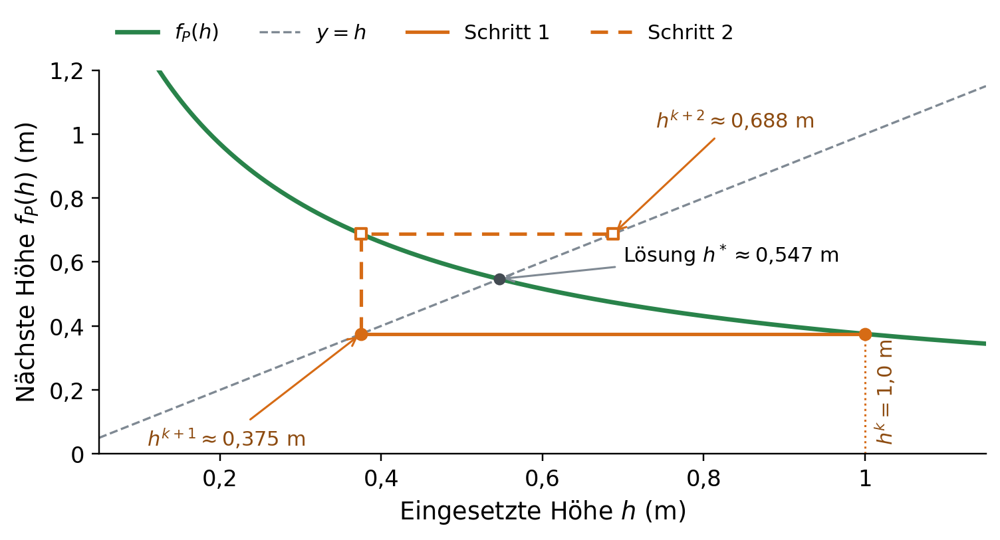

### Picard-Iteration: Leitwerte bestimmen, Höhe berechnen, wiederholen

Die Gleichung für die mittlere Zelle ist nun bekannt. Picard berechnet die Leitwerte aus der aktuellen Näherung für die hydraulische Höhe. Mit diesen vorläufig festgehaltenen Leitwerten berechnet das Verfahren die nächste Höhe.

Zunächst betrachten wir den Fall **ohne Evapotranspiration und ohne weitere Quellen oder Senken**.

#### Eine Iteration Schritt für Schritt

Wir beginnen mit einer geschätzten Höhe $h^0$. Der hochgestellte Index $k$ zählt die Iterationen. $k=0$ bezeichnet den Startwert, $h^{k+1}$ die nächste Näherung.

**1. Die Leitwerte aus der aktuellen Höhe berechnen.**

$$
C_L^k=C_L(h^k),
\qquad
C_R^k=C_R(h^k).
$$

Am hochgestellten Index erkennen Sie, mit welcher Näherung die beiden Leitwerte in m²/s berechnet wurden.

**2. Die Leitwerte festhalten und die Wasserbilanz nach der neuen Höhe auflösen.**

$$
C_L^k(h_L-h^{k+1})
-
C_R^k(h^{k+1}-h_R)=0.
$$

Die einzige Unbekannte in dieser Gleichung ist $h^{k+1}$. Fassen wir die Terme mit dieser Unbekannten zusammen, erhalten wir

$$
(C_L^k+C_R^k)h^{k+1}
=
C_L^kh_L+C_R^kh_R.
$$

Daraus folgt

$$
h^{k+1}
=
\frac{C_L^kh_L+C_R^kh_R}
{C_L^k+C_R^k}.
$$

Die neue Höhe ist ein gewichtetes Mittel der beiden Randhöhen. Über die Verbindung mit dem größeren Leitwert erhält die zugehörige Randhöhe mehr Gewicht.

**3. Die Bilanz für die neue Höhe prüfen.**

Mit der neuen Höhe ändern sich die gesättigte Mächtigkeit und damit die Leitwerte. Berechnen Sie diese erneut und setzen Sie sie in die ursprüngliche Wasserbilanz ein. Das Ergebnis ist das Residuum $F(h^{k+1})$. Wiederholen Sie die Rechnung, bis sowohl die Höhenänderung als auch das Bilanzresiduum ihre jeweiligen Kriterien erfüllen.

**Für die vorläufig festgehaltenen Leitwerte ist die Gleichung gelöst.** Setzt man jedoch die zur neuen Höhe gehörenden Leitwerte ein, kann in der ursprünglichen nichtlinearen Gleichung ein Bilanzfehler verbleiben. Dann ist mindestens ein weiterer Schritt nötig.

Denken Sie wieder an eine Rinne, deren durchströmter Querschnitt von der Wassertiefe abhängt. Picard ermittelt die Fläche aus der geschätzten Tiefe, berechnet mit genau dieser Fläche eine neue Tiefe und bestimmt daraus die Fläche für den nächsten Schritt.

#### Das Picard-Diagramm lesen

Die gesamte Rechenvorschrift, die aus einer eingesetzten Höhe die nächste Höhe bestimmt, bezeichnen wir mit $f_P$. Es gilt

$$
h^{k+1}=f_P(h^k).
$$

$f_P$ liefert eine **hydraulische Höhe in Metern**. Die Bilanzfunktion $F$ liefert dagegen ein **Bilanzresiduum in m³/s**.

So verfolgen Sie die Iteration im Diagramm:

1. Suchen Sie die aktuelle Höhe auf der waagerechten Achse.
2. Gehen Sie senkrecht bis zur grünen Kurve. An der senkrechten Achse können Sie die Höhe für den nächsten Schritt ablesen.
3. Gehen Sie waagerecht zur gestrichelten Diagonalen $y=h$. Deren beide Koordinaten sind gleich. Damit ist die gerade berechnete Höhe der neue Eingabewert auf der waagerechten Achse.
4. Gehen Sie erneut senkrecht zur grünen Kurve und wiederholen Sie die Konstruktion.

Die dünne gepunktete orange Linie verbindet den Eingabewert auf der Achse mit der Konstruktion. Die durchgezogene orange Linie zeigt den ersten Schritt, die gestrichelte orange Linie den zweiten Schritt von $h^{k+1}$ zu $h^{k+2}$.

Am Schnittpunkt von Kurve und Diagonale gilt

$$
f_P(h^*)=h^*.
$$

Werden dort Eingabe und Ausgabe verglichen, ergeben beide dieselbe Höhe. Ein solcher Wert heißt **Fixpunkt**.

Für das dargestellte Beispiel von Mehl (2006) ohne ET ergibt sich ausgehend von $1{,}000$ m näherungsweise die Folge

$$
1{,}000
\;\rightarrow\;
0{,}375
\;\rightarrow\;
0{,}688
\;\rightarrow\;
0{,}474
\;\rightarrow\;\cdots
$$

Die Näherungswerte liegen abwechselnd oberhalb und unterhalb der Lösung von rund $0{,}547$ m. Hier werden die Abweichungen bei jedem Wechsel kleiner. Bei anderen Einstellungen können sie nur langsam abnehmen, gleich groß bleiben oder anwachsen.

*Die Abbildung zeigt das Drei-Zellen-Beispiel von Mehl (2006) ohne ET. Für den Vergleich mit Newton verwenden wir hier einen gemeinsamen Startwert von 1,0 m. In den durchgerechneten Originalbeispielen folgen anschließend die unterschiedlichen Startwerte von Mehl (2006). In der Skalierung des Labors gelten $h_L=4$ m, $h_R=0{,}1$ m und $(K_L,K_C,K_R)=(0{,}005;\,0{,}25;\,100)$ m/d. Die Zellzentren liegen 100 m auseinander, die Breite beträgt 1 m und die Sohle liegt bei 0 m. ET und Grundwasserneubildung sind null.*

#### Evapotranspiration berücksichtigen

Mit ET enthält die Wasserbilanz zusätzlich den als positiv gezählten Entzug $Q_{\mathrm{ET}}$.

Die aktuelle Höhe bestimmt in jedem Schritt, welcher Abschnitt der ET-Beziehung für die Berechnung verwendet wird.

- **Bei und unter SURF − EXDP** gilt $Q_{\mathrm{ET}}=0$.
- **Zwischen SURF − EXDP und SURF** bleibt der Entzug linear von der neu zu berechnenden Höhe abhängig:

$$
  Q_{\mathrm{ET}}(h^{k+1})
  =
  \mathrm{EVTR}\,A
  \frac{h^{k+1}-(\mathrm{SURF}-\mathrm{EXDP})}
  {\mathrm{EXDP}}.
  $$

- **Bei und über SURF** gilt der konstante maximale Entzug $Q_{\mathrm{ET}}=\mathrm{EVTR}\,A$.

Setzen Sie die für den jeweiligen Höhenbereich gewählte Beziehung zusammen mit den vorläufig festgehaltenen Leitwerten in die Wasserbilanz ein. Die entstehende Gleichung ist linear in der neuen Höhe.

**Im mittleren Bereich darf sich der ET-Entzug mit der neu berechneten Höhe ändern.** Für den Picard-Schritt wird also die lineare Beziehung beibehalten, nicht der Entzugswert der vorherigen Iteration.

Nach dem Schritt wird der tatsächliche ET-Entzug aus der vollständigen Beziehung bestimmt. Hat die neue Höhe eine Schwelle überschritten, gilt für die nächste Iteration ein anderer Abschnitt.
