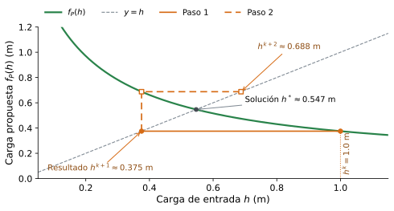

### Iteración de Picard: calcular conductancias, resolver la carga y repetir

Ya conocemos la ecuación que debe satisfacer la carga central. Picard utiliza la estimación actual para calcular las conductancias y las mantiene fijas al calcular la carga siguiente.

Primero consideramos el caso **sin evapotranspiración ni otras fuentes o sumideros**.

#### Una iteración, paso a paso

Partimos de una estimación inicial $h^0$. El superíndice $k$ cuenta iteraciones numéricas: $k=0$ corresponde a la estimación inicial y $h^{k+1}$ a la siguiente.

**1. Calcular las conductancias con la carga actual.**

$$
C_L^k=C_L(h^k),
\qquad
C_R^k=C_R(h^k).
$$

El superíndice identifica la estimación utilizada. Ambas conductancias se expresan en m²/s.

**2. Mantenerlas fijas y resolver el balance de agua.**

$$
C_L^k(h_L-h^{k+1})
-
C_R^k(h^{k+1}-h_R)=0.
$$

La única incógnita es $h^{k+1}$. Agrupando sus términos:

$$
(C_L^k+C_R^k)h^{k+1}
=
C_L^kh_L+C_R^kh_R.
$$

Por tanto:

$$
h^{k+1}
=
\frac{C_L^kh_L+C_R^kh_R}
{C_L^k+C_R^k}.
$$

La nueva carga es una media ponderada de las dos cargas prescritas. La conexión de mayor conductancia da más peso a su carga de contorno.

**3. Recalcular con la nueva carga.**

La nueva carga modifica el espesor saturado y, por ello, las conductancias. Recálculelas y evalúe el residuo original $F(h^{k+1})$. Repita hasta satisfacer tanto el criterio de variación de carga como el de residuo.

**Resolver la ecuación con conductancias temporalmente fijas no resuelve necesariamente la ecuación no lineal original.** Por eso puede ser necesaria otra iteración.

Una analogía es calcular la profundidad del agua en un canal cuya sección de flujo depende de esa profundidad. Picard estima la sección con la profundidad actual, calcula otra profundidad manteniendo esa sección fija y después actualiza la sección y repite.

#### Interpretar el diagrama de Picard

Denominamos $f_P$ al cálculo completo que transforma una carga de entrada en la carga siguiente:

$$
h^{k+1}=f_P(h^k).
$$

$f_P$ devuelve una **carga en metros**. Se distingue de $F$, que devuelve un **residuo del balance en m³/s**.

En el diagrama:

1. Parta de la carga actual sobre el eje horizontal.
2. Suba o baje verticalmente hasta la curva verde. Su coordenada vertical es la carga siguiente.
3. Avance horizontalmente hasta la recta discontinua $y=h$. Así se transfiere la carga de salida a la coordenada horizontal de la siguiente iteración.
4. Vuelva verticalmente a la curva y repita.

La línea naranja fina de puntos sitúa la carga de entrada en el eje. La línea naranja continua muestra la primera actualización. El recorrido naranja de trazos muestra la segunda, de $h^{k+1}$ a $h^{k+2}$.

La solución está en la intersección donde:

$$
f_P(h^*)=h^*.
$$

La actualización devuelve allí la misma carga. Se denomina **punto fijo**.

En el caso suave de Mehl (2006) ilustrado, una carga inicial de $1.000$ m produce aproximadamente:

$$
1.000
\;\rightarrow\;
0.375
\;\rightarrow\;
0.688
\;\rightarrow\;
0.474
\;\rightarrow\;\cdots
$$

Las estimaciones alternan a ambos lados de la solución, aproximadamente $0.547$ m. Alternar no significa por sí solo fracasar: aquí las desviaciones disminuyen. En otros casos las oscilaciones pueden disminuir lentamente, persistir o crecer.

*El diagrama muestra el caso suave de tres celdas de Mehl (2006) con una carga inicial ilustrativa de 1.0 m para compararlo con Newton. Los ejemplos posteriores utilizan los valores iniciales originales. En la escala del laboratorio, $h_L=4$ m, $h_R=0.1$ m y $K_L,K_C,K_R=(0.005,0.25,100)$ m/día, con centros separados 100 m, anchura de 1 m, cota de base de 0 m y sin ET ni recarga.*

#### Incluir la evapotranspiración del agua subterránea

Con ET, el balance incluye además la extracción positiva $Q_{\mathrm{ET}}$.

En cada iteración, la carga actual determina la relación de ET utilizada:

- **En SURF − EXDP o por debajo:** $Q_{\mathrm{ET}}=0$.
- **Entre SURF − EXDP y SURF:** se conserva la dependencia lineal de la carga nueva:

$$
  Q_{\mathrm{ET}}(h^{k+1})
  =
  \mathrm{EVTR}\,A
  \frac{h^{k+1}-(\mathrm{SURF}-\mathrm{EXDP})}
  {\mathrm{EXDP}}.
  $$

- **En SURF o por encima:** se utiliza la pérdida máxima constante $Q_{\mathrm{ET}}=\mathrm{EVTR}\,A$.

Se incorpora la relación seleccionada al balance junto con las conductancias fijas. La ecuación sigue siendo lineal respecto a la carga nueva.

**En el intervalo intermedio, la pérdida por ET puede cambiar con la carga nueva.** No se mantiene el caudal calculado con la carga anterior.

Tras actualizar la carga, evalúe la pérdida real por ET con la relación completa. Si se ha cruzado un umbral, la siguiente iteración utiliza el nuevo tramo aplicable.
