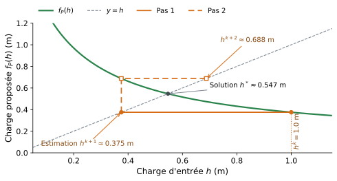

### Itération de Picard : calculer les conductances, résoudre pour la charge, recommencer

Nous disposons maintenant de l'équation que doit satisfaire la charge centrale. Picard utilise l'estimation actuelle de la charge pour calculer les conductances, puis maintient ces conductances fixes pendant le calcul de la charge suivante.

Considérons d'abord le cas **sans évapotranspiration ni autres sources ou prélèvements**.

#### Une itération, étape par étape

Partons d'une estimation initiale $h^0$. L'exposant $k$ compte les itérations numériques : $k=0$ correspond à l'estimation initiale et $h^{k+1}$ à l'estimation suivante.

**1. Calculer les conductances à partir de la charge actuelle.**

$$
C_L^k=C_L(h^k),
\qquad
C_R^k=C_R(h^k).
$$

L'exposant indique l'estimation utilisée. Les deux conductances s'expriment en m²/s.

**2. Maintenir ces conductances fixes et résoudre le bilan en eau.**

$$
C_L^k(h_L-h^{k+1})
-
C_R^k(h^{k+1}-h_R)=0.
$$

La seule inconnue de cette équation est $h^{k+1}$. En regroupant les termes qui la contiennent :

$$
(C_L^k+C_R^k)h^{k+1}
=
C_L^kh_L+C_R^kh_R.
$$

On obtient donc :

$$
h^{k+1}
=
\frac{C_L^kh_L+C_R^kh_R}
{C_L^k+C_R^k}.
$$

La nouvelle charge est une moyenne pondérée des deux charges imposées. La connexion de plus grande conductance donne davantage de poids à la charge située à son extrémité.

**3. Recalculer avec la nouvelle charge.**

La nouvelle charge modifie l'épaisseur saturée et donc les conductances. Recalculez celles-ci, puis évaluez le résidu du bilan original $F(h^{k+1})$. Répétez jusqu'à satisfaire à la fois le critère sur la variation de charge et celui sur le résidu.

**Résoudre l'équation avec des conductances temporairement fixes ne résout pas nécessairement l'équation non linéaire originale.** Une nouvelle itération peut donc être nécessaire.

On peut comparer cette démarche au calcul de la profondeur d'eau dans un canal dont la section d'écoulement dépend de la profondeur. Picard estime la section à partir de la profondeur actuelle, calcule une nouvelle profondeur à section fixe, puis actualise la section et recommence.

#### Lire le diagramme de Picard

Nous appelons $f_P$ le calcul complet qui transforme une charge d'entrée en charge suivante :

$$
h^{k+1}=f_P(h^k).
$$

La fonction $f_P$ renvoie une **charge en mètres**. Elle diffère de $F$, qui renvoie un **résidu du bilan en eau en m³/s**.

Dans le diagramme :

1. Partez de la charge actuelle sur l'axe horizontal.
2. Montez ou descendez verticalement jusqu'à la courbe verte. Son ordonnée donne la charge suivante.
3. Déplacez-vous horizontalement jusqu'à la droite en tirets $y=h$. La charge calculée devient ainsi l'abscisse de l'itération suivante.
4. Rejoignez à nouveau la courbe verticalement et recommencez.

La fine ligne pointillée orange repère la charge d'entrée sur l'axe. Le tracé orange continu montre la première mise à jour. Le tracé orange en tirets montre la seconde, de $h^{k+1}$ à $h^{k+2}$.

La solution se trouve à l'intersection où :

$$
f_P(h^*)=h^*.
$$

À cet endroit, la mise à jour renvoie la même charge. C'est un **point fixe**.

Pour le cas régulier de Mehl (2006) représenté ici, une charge initiale de $1.000$ m donne approximativement :

$$
1.000
\;\rightarrow\;
0.375
\;\rightarrow\;
0.688
\;\rightarrow\;
0.474
\;\rightarrow\;\cdots
$$

Les estimations alternent autour de la solution, proche de 0,547 m. L'alternance ne signifie pas à elle seule un échec : ici, les écarts diminuent. D'autres configurations peuvent produire des oscillations qui diminuent lentement, persistent ou s'amplifient.

*Le diagramme représente le cas régulier à trois mailles de Mehl (2006), avec une charge initiale illustrative de 1,0 m pour la comparaison avec Newton. Les exemples détaillés utiliseront les charges initiales de la publication. À l'échelle du laboratoire, $h_L=4$ m, $h_R=0.1$ m et $K_L,K_C,K_R=(0.005,0.25,100)$ m/jour ; les centres sont espacés de 100 m, la largeur vaut 1 m et le fond est à 0 m. Il n'y a ni ET ni recharge.*

#### Inclure l'évapotranspiration souterraine

Avec l'ET, le bilan comprend aussi le prélèvement positif $Q_{\mathrm{ET}}$.

À chaque itération, la charge actuelle détermine la relation d'ET à utiliser :

- **Au niveau de SURF − EXDP et en dessous :** utiliser $Q_{\mathrm{ET}}=0$.
- **Entre SURF − EXDP et SURF :** conserver la dépendance linéaire à la nouvelle charge :

  $$
  Q_{\mathrm{ET}}(h^{k+1})
  =
  \mathrm{EVTR}\,A
  \frac{h^{k+1}-(\mathrm{SURF}-\mathrm{EXDP})}
  {\mathrm{EXDP}}.
  $$

- **Au niveau de SURF et au-dessus :** utiliser la perte maximale constante $Q_{\mathrm{ET}}=\mathrm{EVTR}\,A$.

Introduisez la relation retenue dans le bilan, avec les conductances fixes. L'équation reste linéaire par rapport à la nouvelle charge.

**Dans l'intervalle intermédiaire, la perte par ET peut varier avec la nouvelle charge.** Elle n'est pas figée au débit calculé pour la charge précédente.

Après la mise à jour, évaluez la perte effective avec la relation complète. Si la nouvelle charge a franchi un seuil, l'itération suivante emploie le segment désormais applicable.
