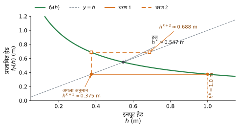

### Picard पुनरावृत्ति: कंडक्टेंस निकालें, हेड हल करें, फिर दोहराएँ

अब केंद्रीय हेड का संतुलन समीकरण ज्ञात है। Picard वर्तमान अनुमान से कंडक्टेंस निकालता है और अगला हेड निकालते समय इन्हें स्थिर रखता है।

पहले **वाष्पोत्सर्जन तथा अन्य स्रोतों या निष्कासन के बिना** मामला लें।

#### एक पुनरावृत्ति के चरण

प्रारंभिक अनुमान $h^0$ लें। ऊपरी सूचकांक $k$ संख्यात्मक पुनरावृत्तियाँ गिनता है: $k=0$ प्रारंभिक अनुमान है और $h^{k+1}$ अगला अनुमान।

**1. वर्तमान हेड से कंडक्टेंस निकालें।**

$$
C_L^k=C_L(h^k),
\qquad
C_R^k=C_R(h^k).
$$

ऊपरी सूचकांक प्रयुक्त हेड अनुमान बताता है। दोनों कंडक्टेंस m²/s में हैं।

**2. इन्हें स्थिर रखकर जल संतुलन हल करें।**

$$
C_L^k(h_L-h^{k+1})
-
C_R^k(h^{k+1}-h_R)=0.
$$

एकमात्र अज्ञात $h^{k+1}$ है। इसके पद एकत्र करने पर:

$$
(C_L^k+C_R^k)h^{k+1}
=
C_L^kh_L+C_R^kh_R.
$$

इसलिए:

$$
h^{k+1}
=
\frac{C_L^kh_L+C_R^kh_R}
{C_L^k+C_R^k}.
$$

नया हेड निर्दिष्ट सीमा हेडों का भारित माध्य है। अधिक कंडक्टेंस वाला संपर्क अपने सीमा हेड को अधिक भार देता है।

**3. नए हेड से पुनर्गणना करें।**

नया हेड संतृप्त मोटाई और कंडक्टेंस बदल सकता है। इन्हें दोबारा निकालें और मूल अवशेष $F(h^{k+1})$ की जाँच करें। हेड परिवर्तन और अवशेष, दोनों मानदंड पूरे होने तक दोहराएँ।

**अस्थायी रूप से स्थिर कंडक्टेंस वाले समीकरण का हल, मूल अरैखिक समीकरण का हल होना आवश्यक नहीं है।** इसलिए अगली पुनरावृत्ति लग सकती है।

ऐसी नाली सोचें जिसका प्रवाह क्षेत्रफल जल की गहराई पर निर्भर करता है। Picard वर्तमान गहराई से क्षेत्रफल अनुमानित करता है, उसे स्थिर रखकर नई गहराई निकालता है, फिर क्षेत्रफल अद्यतन करके दोहराता है।

#### Picard आरेख पढ़ना

इनपुट हेड को अगले हेड में बदलने वाली पूरी गणना को $f_P$ कहें:

$$
h^{k+1}=f_P(h^k).
$$

$f_P$ का परिणाम **मीटर में हेड** है; $F$ का परिणाम **m³/s में जल संतुलन अवशेष** है।

आरेख में:

1. क्षैतिज अक्ष पर वर्तमान हेड से शुरू करें।
2. हरी वक्र तक ऊर्ध्वाधर जाएँ; उसकी ऊँचाई अगला हेड बताती है।
3. वहाँ से क्षैतिज दिशा में टूटी रेखा $y=h$ तक जाएँ। इस प्रकार आउटपुट हेड अगले चरण का क्षैतिज इनपुट बनता है।
4. फिर वक्र तक ऊर्ध्वाधर जाएँ और दोहराएँ।

पतली नारंगी बिंदु रेखा अक्ष पर इनपुट हेड पहचानती है। सतत नारंगी रेखा पहला अद्यतन और डैश वाली रेखा $h^{k+1}$ से $h^{k+2}$ का दूसरा अद्यतन दिखाती है।

हल उस प्रतिच्छेद पर है जहाँ:

$$
f_P(h^*)=h^*.
$$

यहाँ अद्यतन वही हेड लौटाता है: इसे **नियत बिंदु (fixed point)** कहते हैं।

Mehl (2006) के दर्शाए गए सुचारु मामले में $1.000$ m से शुरू करने पर लगभग:

$$
1.000
\;\rightarrow\;
0.375
\;\rightarrow\;
0.688
\;\rightarrow\;
0.474
\;\rightarrow\;\cdots
$$

अनुमान लगभग $0.547$ m के हल के दोनों ओर बारी-बारी आते हैं। दिशा बदलना अपने आप विफलता नहीं है: यहाँ विचलन घटते हैं। अन्य परिस्थितियों में दोलन धीरे घट सकते हैं, स्थिर रह सकते हैं या बढ़ सकते हैं।

*यह Mehl (2006) का सुचारु तीन-सेल मामला है; Newton से तुलना के लिए प्रारंभिक हेड 1.0 m लिया गया है। अगले उदाहरण मूल प्रारंभिक मान लेते हैं। प्रयोगशाला के पैमाने में $h_L=4$ m, $h_R=0.1$ m तथा $K_L,K_C,K_R=(0.005,0.25,100)$ m/day हैं; केंद्र दूरी 100 m, चौड़ाई 1 m और तल 0 m है। ET और पुनर्भरण शून्य हैं।*

#### भूजल वाष्पोत्सर्जन जोड़ना

ET होने पर संतुलन में धनात्मक निष्कासन $Q_{\mathrm{ET}}$ शामिल होता है।

वर्तमान हेड उपयोग किया जाने वाला ET संबंध चुनता है:

- **SURF − EXDP या उससे नीचे:** $Q_{\mathrm{ET}}=0$।
- **SURF − EXDP और SURF के बीच:** नए हेड पर रैखिक निर्भरता बनी रहती है:

$$
  Q_{\mathrm{ET}}(h^{k+1})
  =
  \mathrm{EVTR}\,A
  \frac{h^{k+1}-(\mathrm{SURF}-\mathrm{EXDP})}
  {\mathrm{EXDP}}.
  $$

- **SURF या उससे ऊपर:** अधिकतम नियत निष्कासन $Q_{\mathrm{ET}}=\mathrm{EVTR}\,A$।

चुना गया संबंध स्थिर कंडक्टेंस के साथ संतुलन समीकरण में आता है। समीकरण नए हेड में रैखिक रहता है।

**मध्य अंतराल में ET निष्कासन नए हेड के साथ बदल सकता है।** इसे पुराने हेड पर निकाली गई प्रवाह दर के बराबर स्थिर नहीं किया जाता।

अद्यतन के बाद पूरे ET संबंध से वास्तविक निष्कासन फिर निकालें। यदि नया हेड किसी सीमा को पार कर गया है, तो अगली पुनरावृत्ति नया लागू खंड उपयोग करती है।
