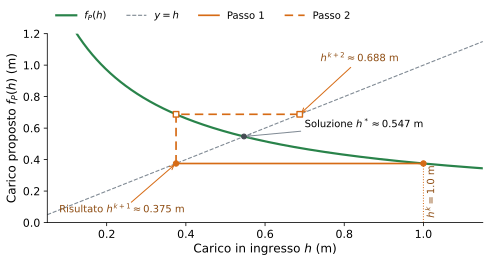

### Iterazione di Picard: calcolare le conduttanze, risolvere il carico, ripetere

Conosciamo ora l'equazione che il carico centrale deve soddisfare. Picard calcola le conduttanze dalla stima attuale e le mantiene costanti mentre calcola il carico successivo.

Consideriamo dapprima il caso **senza evapotraspirazione né altre sorgenti o pozzi**.

#### Una iterazione, passo per passo

Si parte da una stima iniziale $h^0$. L'apice $k$ conta le iterazioni numeriche: $k=0$ indica la stima iniziale e $h^{k+1}$ quella successiva.

**1. Calcolare le conduttanze dal carico attuale.**

$$
C_L^k=C_L(h^k),
\qquad
C_R^k=C_R(h^k).
$$

L'apice identifica la stima utilizzata. Entrambe le conduttanze si misurano in m²/s.

**2. Mantenerle fisse e risolvere il bilancio idrico.**

$$
C_L^k(h_L-h^{k+1})
-
C_R^k(h^{k+1}-h_R)=0.
$$

L'unica incognita è $h^{k+1}$. Raccogliendone i termini:

$$
(C_L^k+C_R^k)h^{k+1}
=
C_L^kh_L+C_R^kh_R.
$$

Di conseguenza:

$$
h^{k+1}
=
\frac{C_L^kh_L+C_R^kh_R}
{C_L^k+C_R^k}.
$$

Il nuovo carico è una media ponderata dei carichi assegnati. Il collegamento con conduttanza maggiore attribuisce maggiore peso al proprio carico di contorno.

**3. Ricalcolare con il nuovo carico.**

Il nuovo carico modifica lo spessore saturo e quindi le conduttanze. Ricalcolatele e valutate il residuo originale $F(h^{k+1})$. Ripetete finché siano soddisfatti entrambi i criteri, di variazione del carico e di residuo.

**Risolvere l'equazione con conduttanze temporaneamente fisse non risolve necessariamente l'equazione non lineare originale.** Per questo può servire un'altra iterazione.

Pensate a un canale la cui sezione di flusso dipenda dalla profondità dell'acqua. Picard stima la sezione dalla profondità attuale, calcola una nuova profondità mantenendo fissa tale sezione, poi aggiorna la sezione e ripete.

#### Leggere il diagramma di Picard

Chiamiamo $f_P$ il calcolo completo che trasforma il carico in ingresso nel carico successivo:

$$
h^{k+1}=f_P(h^k).
$$

$f_P$ restituisce un **carico in metri**, mentre $F$ restituisce un **residuo del bilancio in m³/s**.

Nel diagramma:

1. Partite dal carico attuale sull'asse orizzontale.
2. Spostatevi verticalmente fino alla curva verde: la sua ordinata è il carico successivo.
3. Spostatevi orizzontalmente fino alla retta tratteggiata $y=h$, trasferendo così il carico in uscita all'ascissa dell'iterazione successiva.
4. Tornate verticalmente alla curva e ripetete.

La sottile linea arancione punteggiata individua il carico in ingresso sull'asse. La linea continua mostra il primo aggiornamento; il percorso tratteggiato mostra il secondo, da $h^{k+1}$ a $h^{k+2}$.

La soluzione è l'intersezione per cui:

$$
f_P(h^*)=h^*.
$$

Qui l'aggiornamento restituisce lo stesso carico: è un **punto fisso**.

Nel caso regolare illustrato di Mehl (2006), partendo da $1.000$ m si ottiene approssimativamente:

$$
1.000
\;\rightarrow\;
0.375
\;\rightarrow\;
0.688
\;\rightarrow\;
0.474
\;\rightarrow\;\cdots
$$

Le stime oscillano attorno alla soluzione, circa $0.547$ m. Alternare la direzione non indica di per sé un fallimento: qui gli scarti diminuiscono. Altre configurazioni possono produrre oscillazioni lentamente decrescenti, persistenti o crescenti.

*Il diagramma rappresenta il caso regolare a tre celle di Mehl (2006) con un carico iniziale illustrativo di 1.0 m per il confronto con Newton. Gli esempi successivi utilizzano i valori iniziali originali. Nella scala del laboratorio, $h_L=4$ m, $h_R=0.1$ m e $K_L,K_C,K_R=(0.005,0.25,100)$ m/giorno, con distanza fra centri di 100 m, larghezza di 1 m, fondo a 0 m e senza ET né ricarica.*

#### Includere l'evapotraspirazione della falda

Con ET, il bilancio comprende la sottrazione positiva $Q_{\mathrm{ET}}$.

Il carico attuale seleziona la relazione di ET da usare:

- **A SURF − EXDP o al di sotto:** $Q_{\mathrm{ET}}=0$.
- **Fra SURF − EXDP e SURF:** si mantiene la dipendenza lineare dal nuovo carico:

$$
  Q_{\mathrm{ET}}(h^{k+1})
  =
  \mathrm{EVTR}\,A
  \frac{h^{k+1}-(\mathrm{SURF}-\mathrm{EXDP})}
  {\mathrm{EXDP}}.
  $$

- **A SURF o al di sopra:** perdita massima costante $Q_{\mathrm{ET}}=\mathrm{EVTR}\,A$.

La relazione scelta entra nel bilancio insieme alle conduttanze fisse. L'equazione rimane lineare nel nuovo carico.

**Nell'intervallo intermedio, la perdita per ET può variare con il nuovo carico.** Non viene fissata alla portata calcolata con il carico precedente.

Dopo l'aggiornamento si valuta la perdita effettiva con la relazione completa. Se il nuovo carico ha attraversato una soglia, l'iterazione successiva usa il nuovo tratto applicabile.
