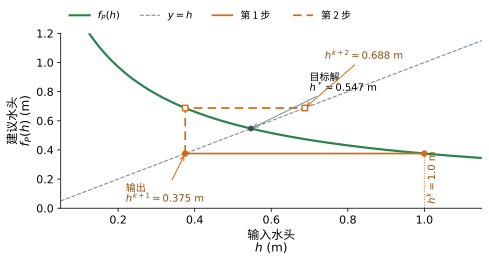

### Picard 迭代：计算连接传导系数、求解水头、再重复

现在已知中央水头必须满足的方程。Picard 用当前估计计算连接传导系数，并在求解下一水头时将其暂时固定。

先考虑**没有蒸散发或其他源汇**的情形。

#### 一次迭代的步骤

从初始估计 $h^0$ 开始。上标 $k$ 是数值迭代计数：$k=0$ 表示初始估计，$h^{k+1}$ 是下一估计。

**1. 根据当前水头计算连接传导系数。**

$$
C_L^k=C_L(h^k),
\qquad
C_R^k=C_R(h^k).
$$

上标表示采用了哪次水头估计。两个连接传导系数的单位均为 m²/s。

**2. 固定这些系数，求解水量平衡。**

$$
C_L^k(h_L-h^{k+1})
-
C_R^k(h^{k+1}-h_R)=0.
$$

唯一未知量是 $h^{k+1}$。合并含该未知量的项：

$$
(C_L^k+C_R^k)h^{k+1}
=
C_L^kh_L+C_R^kh_R.
$$

因此：

$$
h^{k+1}
=
\frac{C_L^kh_L+C_R^kh_R}
{C_L^k+C_R^k}.
$$

新水头是两个给定边界水头的加权平均。连接传导系数越大，对应边界水头的权重越大。

**3. 用新水头重新计算。**

新水头可能改变饱和厚度及连接传导系数。重新计算它们，并检查原始残差 $F(h^{k+1})$。重复此过程，直到水头变化和残差两个标准均满足。

**解出连接传导系数暂时固定的方程，并不一定解出了原来的非线性方程。** 因此，可能仍需要下一次迭代。

设想一条过水断面随水深变化的水槽。Picard 根据当前水深估计断面，固定该断面求出新水深，再更新断面并重复。

#### 阅读 Picard 图

将“由输入水头计算下一水头”的完整过程记作 $f_P$：

$$
h^{k+1}=f_P(h^k).
$$

$f_P$ 返回的是**以米计的水头**；$F$ 返回的是**以 m³/s 计的水量平衡残差**。

读图时：

1. 从横轴上的当前水头出发。
2. 竖直移动到绿色曲线，其纵坐标就是下一水头。
3. 水平移动到虚线 $y=h$，把输出水头转换为下一次迭代的横轴输入。
4. 再竖直移动到曲线，并重复。

细橙色点线标示横轴上的输入水头。橙色实线表示第一次更新，橙色虚线表示从 $h^{k+1}$ 到 $h^{k+2}$ 的第二次更新。

解位于满足下式的交点：

$$
f_P(h^*)=h^*.
$$

更新在此返回原来的水头，因此称为**不动点（fixed point）**。

在图示 Mehl (2006) 光滑情形中，从 $1.000$ m 开始大致得到：

$$
1.000
\;\rightarrow\;
0.375
\;\rightarrow\;
0.688
\;\rightarrow\;
0.474
\;\rightarrow\;\cdots
$$

估计值在约 $0.547$ m 的解两侧交替出现。方向交替并不意味着失败：这里的偏差逐渐减小。其他设置可能出现缓慢衰减、持续或增大的振荡。

*图中采用 Mehl (2006) 的光滑三单元问题，初始水头取 1.0 m 以便与 Newton 比较。后续例子使用原文的初始值。在本实验室尺度下，$h_L=4$ m、$h_R=0.1$ m、$K_L,K_C,K_R=(0.005,0.25,100)$ m/day，中心间距 100 m，宽度 1 m，底板 0 m，无 ET 和补给。*

#### 加入地下水蒸散发

存在 ET 时，平衡中加入正的损失量 $Q_{\mathrm{ET}}$。

当前水头选择本次求解使用的 ET 关系：

- **在 SURF − EXDP 或以下：** $Q_{\mathrm{ET}}=0$。
- **在 SURF − EXDP 与 SURF 之间：** 保留对新水头的线性依赖：

$$
  Q_{\mathrm{ET}}(h^{k+1})
  =
  \mathrm{EVTR}\,A
  \frac{h^{k+1}-(\mathrm{SURF}-\mathrm{EXDP})}
  {\mathrm{EXDP}}.
  $$

- **在 SURF 或以上：** 保持最大损失量 $Q_{\mathrm{ET}}=\mathrm{EVTR}\,A$。

把选中的关系与固定的连接传导系数一起代入平衡。方程对新水头仍为线性。

**在中间区间内，ET 损失量可以随新水头改变。** 它并非固定为旧水头下算出的流量。

更新后，用完整的 ET 关系重新评价实际损失量。如果新水头跨过阈值，下一次迭代就采用新的适用分段。
