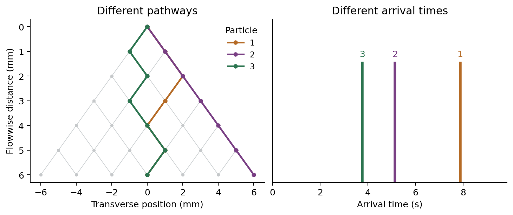
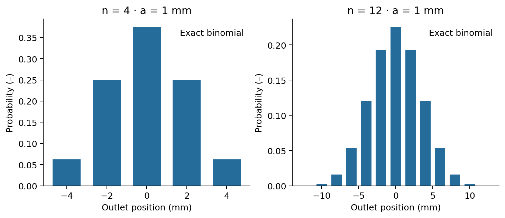
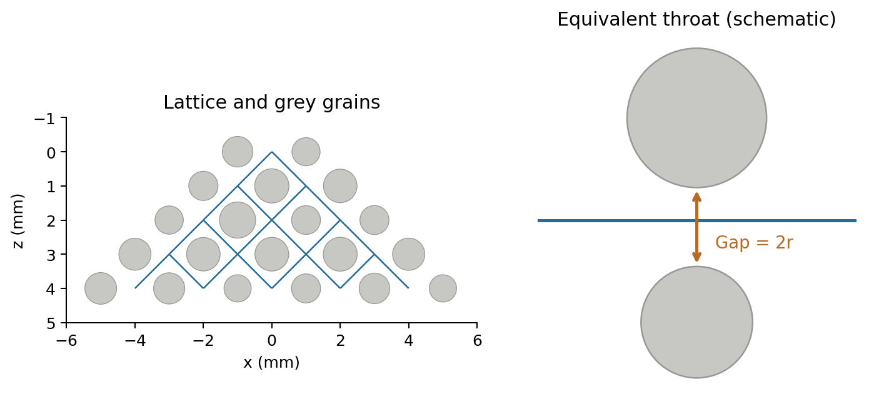

# 1. Physical processes

## Advection, dispersion, and mixing

**Advection** carries dissolved mass with moving water. **Mechanical dispersion** describes spreading caused by differences in velocity and pathway. **Molecular diffusion** redistributes solute through molecular motion. A plume can spread without becoming locally well mixed; plume width alone is not a mixing measure ([Devlin, 2020](https://books.gw-project.org/groundwater-velocity/chapter/subsurface-mixing/); [Dentz, Hidalgo & Lester, 2023](https://doi.org/10.1007/s11242-022-01852-x)).

This module represents a conservative, passive solute by equal-mass markers. They are computational parcels of dissolved mass, not grains or molecules that collide. A left/right choice summarizes unresolved pathway selection. The physical Galton board motivates the analogy, but the code does not calculate gravitational acceleration or disk collisions.

Begin with the fixed experiment below. Open the equations when you want to explain your observations. Full source details and model limits are available under **References and model notes**.

{width=6.2in}

# 2. The pinboard

## Independent choices create transverse spreading

At every pin, a marker moves one row forward and either left or right. Each decision is independent, with probability 1/2. Let **n** be the number of rows and **a** the horizontal and flowwise increment. After **K** rightward choices, the outlet position is

$$
K\sim\mathrm{Binomial}(n,1/2),\qquad X_n=a(2K-n).
$$

Counting the possible decision sequences gives the exact outlet probabilities:

$$
\Pr[X_n=a(2k-n)]=\binom{n}{k}2^{-n},\qquad k=0,\ldots,n.
$$

The mean and variance follow by adding independent signed increments:

$$
\mathrm{E}[X_n]=0,\qquad \mathrm{Var}(X_n)=na^2,\qquad \sigma_x=a\sqrt{n}.
$$

This is the coin-toss version of the Galton-board principle illustrated by [Yale Physics](https://yppsweb2.its.yale.edu/physics/demos/demomain.asp?id=4G10.10&task=viewdemo). The finite distribution is **binomial**, not exactly Gaussian. A normal approximation improves as the number of independent steps increases, especially away from the tails. Adding more particles samples a fixed distribution more clearly; it does not change its theoretical width.

## What fixed times do—and do not—show

If each step lasts **μ** seconds, every marker traverses the board in

$$
T=n\mu,\qquad \mathrm{Var}(T)=0.
$$

An instantaneous pulse therefore spreads across outlets but arrives everywhere at the same time. At integer step times before collection, the population variance satisfies

$$
\mathrm{Var}[X(t)]=2D_{T,\mathrm{board}}t,\qquad D_{T,\mathrm{board}}=\frac{a^2}{2\mu}.
$$

This is an effective transverse random-walk coefficient for the ideal board. Between nodes, the app linearly interpolates the motion for visualization; the displayed continuous trajectory is not a Brownian path. The coefficient is not a fitted soil dispersivity. With fixed n, changing a changes both the spread and the physical board dimensions.

**Prediction:** doubling n increases the population standard deviation by √2; doubling the number of markers leaves that population value unchanged.

{width=6.2in}

# 3. Arrival times and injection

## Travel time and release time are different quantities

In variable-time mode, step times are independent positive lognormal variables with mean **μ** and coefficient of variation **c = standard deviation / mean**. Direction and step time are sampled independently. For a standard normal variable Z, the code uses

$$
\tau=\mu\exp\!\left(\sigma_\ell Z-\frac{\sigma_\ell^2}{2}\right),\qquad \sigma_\ell^2=\ln(1+c^2).
$$

Thus E[τ] = μ and Var(τ) = μ²c². For the **transit time** T, measured from a particle's own release to its collection,

$$
T=\sum_{j=1}^n\tau_j,\qquad \mathrm{E}[T]=n\mu,\qquad \mathrm{Var}(T)=n\mu^2c^2.
$$

This is a deliberately simple random-walk construction, related conceptually to classical random-step descriptions (Saffman, 1959). The lognormal choice is an instructional assumption, not an empirical law for all soils. Real pore-flow velocity correlations can matter; correlated continuous-time random walks address this additional structure (de Anna et al., 2013).

## A longer injection also broadens arrival times

Let **R** denote release time and **d** the injection duration. R is sampled uniformly on [0,d], independently of route and transit time; for an impulse, R = 0. The **arrival time** A is measured from the start of the whole injection:

$$
A=R+T,\qquad \mathrm{E}[A]=\frac d2+\mathrm{E}[T],\qquad
\mathrm{Var}(A)=\frac{d^2}{12}+\mathrm{Var}(T).
$$

Where probability densities exist, the arrival distribution is the convolution of the release distribution and the transit-time distribution:

$$
f_A(t)=\int_0^t f_R(s)f_T(t-s)\,\mathrm{d}s.
$$

For fixed transit time, this reduces to a shifted copy of the injection signal. A finite injection can therefore broaden the outlet record **without any transit-time dispersion**. The app reports both mean transit time and mean arrival time to keep this distinction visible. A single histogram bar for simultaneous arrivals represents a point mass using a finite bin; its height is not a physical peak concentration.

**Prediction:** with n = 12, μ = 1 s and c = 0.6, transit-time variance is 4.32 s². Adding a 6 s injection contributes another 3 s² to arrival-time variance. These are population values; a small sample fluctuates.

{width=6.2in}

# 4. Grey-grain network

## From grain geometry to an idealized hydraulic network

The grey-grain version retains a triangular diamond lattice of pore nodes. Grain centres lie on its dual lattice. For lattice increment a, neighbouring grain centres are separated by √2a. Grain radii are defined by

$$
R_g=\frac{a}{\sqrt{2}}\kappa(1-vU_g),\qquad U_g\sim\mathrm{Uniform}(0,1).
$$

Here κ is the **grain-size factor** (formerly the packing control) and v the grain-size variation. Larger κ narrows gaps. Larger v broadens the radius distribution while also reducing its mean, E[Rg] = aκ(1−v/2)/√2. Neither control is measured porosity; grains stay on fixed centres and are not mechanically compacted.

For the two grains flanking edge e, the **surface gap is mapped to a circular tube diameter**:

$$
r_e=\frac{\sqrt{2}a-R_{g1}-R_{g2}}2,\qquad L_e=\sqrt{2}a.
$$

This is the app's geometric surrogate, not the exact aperture or resistance of a real three-dimensional pore. Pore bodies have zero storage and no added resistance. Conductance-based network modelling and simple cylindrical throat approximations are described in the official OpenPNM documentation; this app uses its own solver.

## Solve water flow before moving solute

For dynamic water viscosity $\mu_w$ = 0.001 Pa s, the ideal tube conductance and signed flow are

$$
g_e=\frac{\pi r_e^4}{8\mu_wL_e},\qquad Q_{ij}=g_e(P_i-P_j),\qquad \sum_jQ_{ij}=0.
$$

The last equation applies at every internal node. Inlet pressure potential is ΔP; every outlet is held at zero. There are no connections across the outer sides. The downward coordinate is flowwise distance, **not elevation head**; gravity is not added separately. No solute is moved in the preparation preview, although the steady water-flow field is already calculated.

An outgoing route is sampled with its fraction of the outgoing flow, and each throat is traversed at its cross-sectional mean velocity:

$$
p_{ij}=\frac{Q_{ij}}{\sum_{k:Q_{ik}>0}Q_{ik}},\qquad
u_e=\frac{|Q_e|}{\pi r_e^2},\qquad \tau_e=\frac{\pi r_e^2L_e}{|Q_e|}.
$$

This imposes instantaneous complete mixing at zero-volume junctions. Molecular mixing and velocity profiles within tubes are not simulated. The routing rule is therefore a model closure, not a claim that pore junctions always mix completely. The flow always follows decreasing pressure; a local edge can point upward on the drawing without forming a loop. Zero-flow throats are excluded.

## Independent model references

Exact outlet probabilities and first two transit-time moments are computed recursively on the pressure-directed graph. For expected remaining transit time mᵢ and second moment sᵢ, with zero values at outlets,

$$
m_i=\sum_jp_{ij}(\tau_{ij}+m_j),\qquad
s_i=\sum_jp_{ij}(\tau_{ij}^2+2\tau_{ij}m_j+s_j).
$$

The inlet variance is s₀−m₀². A separate check is m₀ = flowing throat volume / inlet flow. Outlet probabilities also equal outlet water-flux fractions under the stated mixing rule. These checks verify the mathematical implementation; they do not validate the geometric surrogate against a soil.

**Prediction:** doubling ΔP doubles flows and halves transit times while preserving route probabilities. With identical grains, reducing every tube radius by half reduces flow by 16 and increases transit time by four at fixed pressure. Check the reported throat Reynolds number, Re = 2ρur/$\mu_w$ (ρ = 1000 kg/m³); creeping-flow conditions are not assured if Re approaches or exceeds 1.

{width=6.2in}

# 5. Continuum interpretation

## Connection to continuum solute-transport equations

For a saturated medium with constant mobile porosity, steady incompressible flow, a conservative dilute solute, and appropriate averaging, a common continuum description is the advection–dispersion equation (ADE):

$$
\frac{\partial C}{\partial t}+\mathbf{v}\cdot\nabla C
=\nabla\cdot(\mathbf{D}\nabla C).
$$

Here C is dissolved concentration, **v** the mean pore-water velocity (not Darcy flux), and **D** the dispersion tensor. In a uniform medium with flow along z and transverse coordinate x, constant coefficients give

$$
\frac{\partial C}{\partial t}+v\frac{\partial C}{\partial z}
=D_L\frac{\partial^2C}{\partial z^2}+D_T\frac{\partial^2C}{\partial x^2}.
$$

A common constitutive representation is $D_L$ = $\alpha_L$|v| + $D_{m,\mathrm{eff}}$ and $D_T$ = $\alpha_T$|v| + $D_{m,\mathrm{eff}}$. Dispersion coefficients D have units of length²/time; dispersivities α have units of length. Effective molecular diffusion $D_{m,\mathrm{eff}}$ accounts for porous-medium restrictions. These continuum relations provide context; the module does **not** solve this ADE or prescribe $\alpha_L$ and $\alpha_T$ (Wexler, 1992).

## A spatial variance is not an arrival-time variance

For an unbounded, constant-coefficient continuum pulse, longitudinal spatial variance grows as $2D_Lt$. For a different observable—the first-passage time to an absorbing plane at distance L starting at zero with an unbounded upstream domain, constant v > 0, and $D_L$—the moments are

$$
\mathrm{E}[T]=\frac Lv,\qquad \mathrm{Var}(T)=\frac{2D_LL}{v^3}.
$$

These identities concern specific boundary conditions and observables (Probability Distribution Explorer, Inverse Gaussian distribution). As a mathematical illustration, matching the pinboard moments with L = na and v = a/μ would give

$$
D_{L,\mathrm{moment}}=\frac{\mathrm{Var}(T)v^3}{2L}=\frac{a^2c^2}{2\mu}.
$$

This is only a **moment-matched analogy**. It does not make the board's transit-time distribution the ADE first-passage distribution; a sum of lognormal step times is generally not inverse Gaussian. The module therefore reports widths and moments, without presenting this expression as an estimated soil dispersion coefficient. Arrival-time variance from a finite injection must first be separated from transit-time variance even for that analogy.

## Why finite networks may not be Fickian

Bijeljic and Blunt (2006) show that an asymptotic dispersion description can require transport through many pores; their network explicitly includes advection and molecular diffusion. The present board has only 2–40 rows in either configurable mode and uses simpler physics. A smooth-looking histogram does not establish an asymptotic regime, Gaussian transport, or a scale-independent dispersivity. The single inlet, widening triangular geometry, and equal-pressure outlet boundary all influence the grain-network response.

# 6. Mass markers and model limits

## Highlighted and background particles carry the same mass

Let H be the number of highlighted particles (1–10) and B the number of background particles per highlighted particle (0–1000). The total is

$$
N=H(1+B),\qquad m_p=\frac1N.
$$

There are H numbered markers and HB blue background markers, at most 10,010 in total. Background markers are independent samples of the same transport process; they are **not clones** of a visible path. Highlighting is a display choice and has no effect on motion or mass.

At a fixed particle seed, the numerical engine preserves the release times and complete trajectories of the first H markers when B changes. The interface normally advances the seed on Rerun to draw a new realization; enter an earlier sample’s recorded seed to reproduce it. Play replays the current sample. The total normalized injected mass remains 1, so each marker's statistical weight changes to 1/N. This is an increase in sampling resolution, not an additional physical dose. With independent samples, typical sampling errors decrease approximately as $N^{-1/2}$; more particles do not create stronger dispersion.

## Read the plots as mass distributions

At every time, the model partitions all markers into three disjoint groups:

$$
N_{\mathrm{waiting}}+N_{\mathrm{inside}}+N_{\mathrm{collected}}=N.
$$

The spatial bars give collected mass per outlet, $n_k/N$. In temporal bin b with width $\Delta t_b$, the plotted height is

$$
h_b=\frac{n_b}{N\Delta t_b}.
$$

Its units are s⁻¹. The complete histogram has area 1; an incomplete histogram integrates to the collected fraction. This is a normalized arrival mass rate, not a resident concentration. Converting it to an outlet concentration would require injected mass and water discharge, with a consistent flux-averaging convention. Those conversions are not implemented here.

The exact reference describes the probability distribution of this model. Empirical standard deviations use division by N, appropriate to the plotted empirical distribution. They are not N−1 estimates. With one marker, the empirical width is zero even when the population width is positive. Ten markers are useful for understanding paths, not for establishing a smooth distribution.

## Limits to keep in view

The marker model omits sorption, reaction, density effects, collisions, explicit molecular diffusion, and diffusion into immobile regions. The grain model additionally omits pore-body storage, pore-body hydraulic resistance, and velocity profiles within throats. Instantaneous junction mixing is imposed rather than resolved. Thus spatial spreading, node redistribution, and molecular homogenization must not be treated as interchangeable processes (Dentz et al., 2023).

Parameter changes can affect several quantities together: spacing changes board size, grain variation changes mean size as well as variability, and pressure changes velocity. State what was held constant before attributing an observed change to a single mechanism.

# 7. Upward and slow pathways

## Follow the pressure gradient, not just the downward axis

The grain network is a pressure-driven flow model. At each connection, the code uses

$$
Q_{ij}=g_{ij}(P_i-P_j),\qquad g_{ij}>0.
$$

A particle follows outgoing water flow, so pressure decreases along every traversed connection. With heterogeneous conductances, a lower-pressure neighbour can lie slightly **upward on the drawing**. This is a local detour, not motion against the calculated flow. The downward coordinate describes distance along the board; it is not an elevation-head term. A pressure-driven network formulation is described in the [OpenPNM transport documentation](https://openpnm.org/examples/tutorials/08_simulating_transport.html); our app uses its own solver and the stated simplified boundary conditions.

## A slow connection can look like a pause

Connection travel time is water-filled throat volume divided by flow magnitude:

$$
\tau_e=\frac{\pi r_e^2 L_e}{|Q_e|}.
$$

A small but nonzero flow can therefore produce a long, finite travel time. Movement is interpolated continuously between node times. The animation covers the latest arrival in the complete run; with many particles, a rare slow path can make most particles arrive early and leave a few moving very slowly. Overlapping blue markers can also obscure individual motion.

**To inspect a path:** pause, use Previous step / Next step, then open the pathway details at the bottom. The table includes node pressure and connection travel time. Pressure must decrease even along an upward segment. The checks require positive travel times, no repeated nodes, arrival at an outlet, and conserved mass. These are checks of this idealized network, not a validation against a measured soil. No trapping, sorption, or diffusion into immobile pores has been introduced.

## Why most particles can arrive early on the display

Grain-network playback now starts with **60 screen seconds**. Model time still runs linearly from zero to the latest arrival. A rare, very slow connection can stretch this time range; a longer display does not remove that difference in physical travel times.

A reproducible check with 20 rows, a = 1 mm, grain-size factor 0.75, variation 0.25, pressure difference 0.5 Pa, grain seed 7, particle seed 42, a pulse and 10,010 particles gave a median arrival of about **423 s**, a 95th percentile of **772 s**, and a latest arrival of **5,897 s**. The latest particle took **no upward steps**. It spent about **90%** of its transit time in one downward connection with a pressure drop of only 0.000051 Pa. No sampled path revisited a node.

For that particular sample, 95% of particles have arrived by about **7.9 screen seconds** on the 60-second display, compared with about 1.0 screen second on an eight-second display. Other seeds and settings give different values. The independently checked pressure solve and travel-time equations support a low-flow explanation, not an endless loop. This model omits molecular diffusion and immobile-pore exchange; its late tail is not a calibrated prediction for a real soil. Use Pause and the node-step buttons to inspect individual passages.

# 8. Where the controls belong

| Setting or function | Location | Interpretation |
|---|---|---|
| Highlighted count | All three experiments → Particles and injection plan | 1–10; starts with one. |
| Background count | Pinboard / Grain network → Particles and injection plan | 0–1,000 per highlighted marker, increments of 50; total N = H(1+B). Run starts the planned cohort. |
| Smaller framed preview | All experiments → Initial board and injection plan | 80% width; stationary; distinct from the full transport board. |
| Fixed guided board | Principles and guided experiment | 20 rows, a = 1 mm, 1 s per row, pulse; first seed 42, advanced on rerun. |
| Regular / variable-time model | Pinboard → Board and transport | Separate from the grain-network stage. |
| Rows, spacing, mean time, time CV | Pinboard → Board and transport | 2–40 rows; CV only for variable times. |
| Grain-size factor, variability, pressure, medium seed | Grain network → Board and transport | Same hydraulic model; 2–40 rows; initially 20. Equal x/y scales preserve circular grains; surrounding grains are decorative. |
| Injection duration, particle seed | Pinboard / Grain network → Injection and repetition | Advanced source/repetition settings remain available. |
| Run | All experiments → Observe the transport (outside expanders) | First run uses the displayed seed; Rerun draws a new realization and focuses Observe the transport with the Run button visible. Play replays the current result. |
| Start, progress, Final result, Play/Pause, Previous/Next step | All experiments → Progress through the experiment | Collapsed by default; display clock: 8 s for guided/pinboard, 60 s for grain network. Paused steps follow the selected particle; model time is unchanged. |
| Duration, traces, possible routes, histogram bins, stacked plots | Pinboard / Grain network → Optional display settings | Collapsed by default. Guided uses fixed settings and 60 bins. |
| Where / when plots | Directly below each transport board | Side by side by default; remain visible at completion. |
| Selected particle and path details | Bottom of each experiment | Full calculated trajectory; grain pressure and connection travel times are included. |
| Comparisons, CSV, JSON | Pinboard / Grain network → Repeat, compare, and download | Absent from guided stage; describes the full calculated run. |
| Rerun with new particle realization | Pinboard / Grain network → Repeat, compare, and download | Save the current run first if wanted. Rerun uses a new seed and autoplays; saved comparison remains. |
| Detailed equations | Relevant experiment expanders and References | Introductory stage retains only the basic pinboard theory. |
| Language flags and page layout | Sidebar | Existing Soil Water Retention convention is unchanged. |

# 9. References

## Research basis

The model equations in this module are derived from its stated stochastic and hydraulic assumptions. The sources below establish the surrounding scientific context; they do not constitute calibration or validation of this particular board.

1. **Yale Physics Lecture Demonstrations.** *Galton Board*, demonstration 4G10.10. [Official demonstration](https://yppsweb2.its.yale.edu/physics/demos/demomain.asp?id=4G10.10&task=viewdemo). Physical motivation: repeated approximately equiprobable left/right outcomes and a binomial distribution.
2. **Wexler, E. J. (1992).** *Analytical solutions for one-, two-, and three-dimensional solute transport in ground-water systems with uniform flow.* USGS Techniques of Water-Resources Investigations 3-B7, 190 pp. [DOI: 10.3133/twri03B7](https://doi.org/10.3133/twri03B7). Context for continuum advection–dispersion equations, sources, and boundary conditions.
3. **Devlin, J. F. (2020).** *Groundwater Velocity.* The Groundwater Project. [Section 4.3: Subsurface mixing](https://books.gw-project.org/groundwater-velocity/chapter/subsurface-mixing/). Explains why plume spreading and local mixing should be distinguished.
4. **Saffman, P. G. (1959).** A theory of dispersion in a porous medium. *Journal of Fluid Mechanics, 6*(3), 321–349. [DOI: 10.1017/S0022112059000672](https://doi.org/10.1017/S0022112059000672); [author repository and abstract](https://authors.library.caltech.edu/records/gzwx1-g0582). Historical connection to random steps with variable directions and durations; the board is not a reproduction of Saffman's theory.
5. **Bijeljic, B., & Blunt, M. J. (2006).** Pore-scale modeling and continuous time random walk analysis of dispersion in porous media. *Water Resources Research, 42*, W01202. [DOI: 10.1029/2005WR004578](https://doi.org/10.1029/2005WR004578). Demonstrates the importance of pore travel-time variability and the distance needed to reach asymptotic dispersion. Their model includes physics absent from this teaching network.
6. **de Anna, P., Le Borgne, T., Dentz, M., Tartakovsky, A. M., Bolster, D., & Davy, P. (2013).** Flow intermittency, dispersion, and correlated continuous time random walks in porous media. *Physical Review Letters, 110*, 184502. [DOI: 10.1103/PhysRevLett.110.184502](https://doi.org/10.1103/PhysRevLett.110.184502). Establishes a link between correlated temporal increments and non-Fickian transport; supports caution about independent step-time assumptions.
7. **Dentz, M., Hidalgo, J. J., & Lester, D. (2023).** Mixing in porous media: Concepts and approaches across scales. *Transport in Porous Media, 146*, 5–53 (online 2022). [DOI: 10.1007/s11242-022-01852-x](https://doi.org/10.1007/s11242-022-01852-x). Review distinguishing dispersion, stirring, and mixing, including suitable measures of mixing.
8. **OpenPNM documentation.** [Simulating Single Phase Transport](https://openpnm.org/examples/tutorials/08_simulating_transport.html) and [Basic Transport](https://openpnm.org/examples/reference/simulations/basic_transport.html). Official documentation for conductance laws, pressure boundary conditions, and conservation-based network solutions. OpenPNM is a reference, not an app dependency.
9. **Uliana, M. M. (2025).** *Basic Hydrogeology: An Introduction to the Fundamentals of Groundwater Science.* The Groundwater Project. [Section 12.4: Mass transport equations](https://books.gw-project.org/basic-hydrogeology-an-introduction-to-the-fundamentals-of-groundwater-science/chapter/mass-transport-equations/). Accessible companion reading on advection, dispersion coefficients, and transport equations. [Book DOI: 10.62592/CBIQ7579](https://doi.org/10.62592/CBIQ7579).

10. **Probability Distribution Explorer.** [Inverse Gaussian distribution](https://distribution-explorer.github.io/continuous/inverse_gaussian.html). Author-maintained technical documentation giving the first-passage interpretation, parameter mapping, and moments used in the continuum comparison.

Sources checked on 30 October 2026. The Saffman and de Anna connections above are limited to their accessible abstracts and bibliographic records. The calculated diagrams are original. The physical Galton-board photograph by Mark Hebner is reproduced unmodified under CC BY-SA 4.0; see the attribution below.

## Image attribution

 Mark Hebner, *GaltonBoard.png* (2018), [Wikimedia Commons](https://commons.wikimedia.org/wiki/File:GaltonBoard.png). [CC BY-SA 4.0](https://creativecommons.org/licenses/by-sa/4.0/). Unmodified; displayed at reduced size. The licence applies to this photograph. Physical demonstration: [Yale Physics, Galton Board](https://yppsweb2.its.yale.edu/physics/demos/demomain.asp?id=4G10.10&task=viewdemo).

