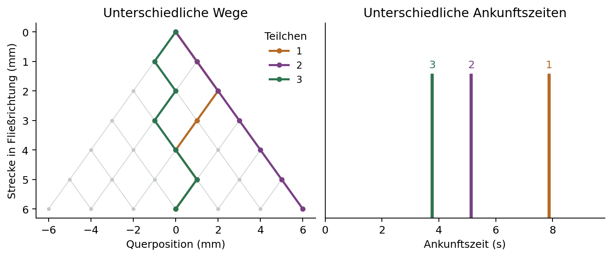
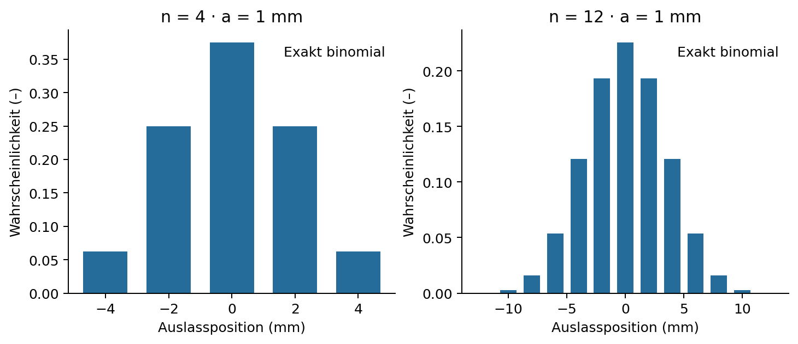
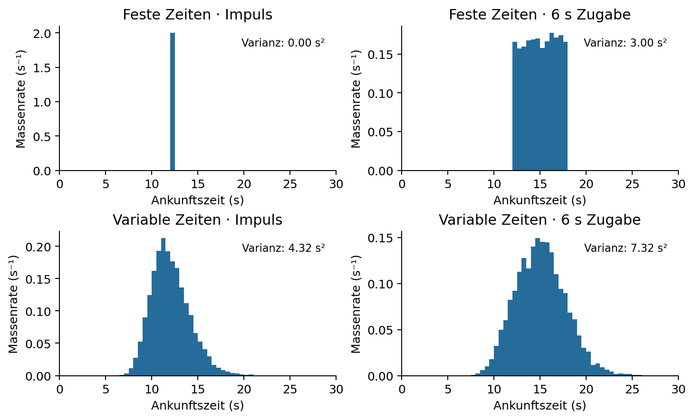
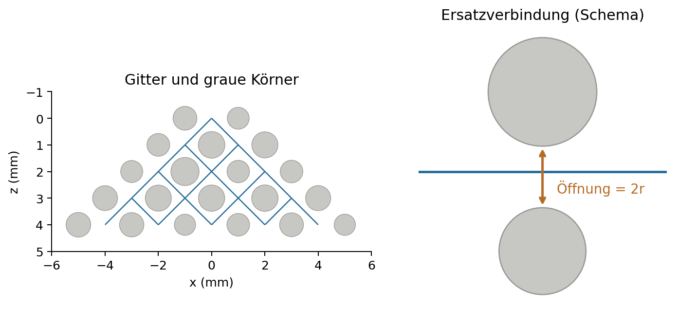

# 1. Physikalische Prozesse

## Advektion, Dispersion und Mischung

**Advektion** transportiert gelöste Masse mit dem strömenden Wasser. **Mechanische Dispersion** beschreibt die Ausbreitung infolge unterschiedlicher Geschwindigkeiten und Fließwege. **Molekulare Diffusion** verteilt Stoff durch molekulare Bewegung um. Eine Stoffwolke kann sich ausbreiten, ohne lokal gut durchmischt zu sein; ihre Breite allein ist kein Mischungsmaß ([Devlin, 2020](https://books.gw-project.org/groundwater-velocity/chapter/subsurface-mixing/); [Dentz, Hidalgo & Lester, 2023](https://doi.org/10.1007/s11242-022-01852-x)).

Das Modul stellt einen konservativen, passiven Stoff durch Teilchen gleicher Masse dar. Es sind rechnerische Pakete gelöster Masse, keine kollidierenden Körner oder Moleküle. Eine Links-rechts-Entscheidung fasst die nicht aufgelöste Wahl eines Fließwegs zusammen. Das physische Galtonbrett liefert die Analogie; Erdbeschleunigung und Scheibenkollisionen werden nicht berechnet.

Lesen Sie bei Bedarf die folgenden Abschnitte und verbinden Sie anschließend im festen Experiment die Gleichungen mit einzelnen Wegen. Vollständige Quellen und Modellgrenzen finden Sie unter **Quellen und Modellhinweise**.

{width=6.2in}

# 2. Das Galtonbrett

## Unabhängige Entscheidungen erzeugen Querstreuung

An jedem Stift bewegt sich ein Teilchen eine Reihe vorwärts und entweder nach links oder rechts. Die Entscheidungen sind unabhängig und haben jeweils die Wahrscheinlichkeit 1/2. **n** bezeichnet die Reihenzahl, **a** die Quer- und Längsschrittweite. Nach **K** Rechtsentscheidungen ist die Auslassposition

$$
K\sim\mathrm{Binomial}(n,1/2),\qquad X_n=a(2K-n).
$$

Aus der Anzahl möglicher Entscheidungsfolgen ergeben sich die exakten Auslasswahrscheinlichkeiten:

$$
\Pr[X_n=a(2k-n)]=\binom{n}{k}2^{-n},\qquad k=0,\ldots,n.
$$

Mittelwert und Varianz folgen aus der Summe unabhängiger vorzeichenbehafteter Schritte:

$$
\mathrm{E}[X_n]=0,\qquad \mathrm{Var}(X_n)=na^2,\qquad \sigma_x=a\sqrt{n}.
$$

Dies ist die Münzwurfversion des von [Yale Physics](https://yppsweb2.its.yale.edu/physics/demos/demomain.asp?id=4G10.10&task=viewdemo) veranschaulichten Galtonbrett-Prinzips. Die endliche Verteilung ist **binomial**, nicht exakt normalverteilt. Mit mehr unabhängigen Schritten verbessert sich die Normalapproximation, insbesondere außerhalb der Verteilungsränder. Mehr Teilchen bilden dieselbe Verteilung deutlicher ab; ihre theoretische Breite ändert sich dadurch nicht.

## Was feste Schrittzeiten zeigen

Dauert jeder Schritt **μ** Sekunden, durchläuft jedes Teilchen das Brett in

$$
T=n\mu,\qquad \mathrm{Var}(T)=0.
$$

Ein momentaner Impuls verteilt sich somit auf verschiedene Auslässe, erreicht diese aber überall gleichzeitig. Zu ganzzahligen Schrittzeiten vor dem Sammeln gilt für die Populationsvarianz

$$
\mathrm{Var}[X(t)]=2D_{T,\mathrm{board}}t,\qquad D_{T,\mathrm{board}}=\frac{a^2}{2\mu}.
$$

Dies ist ein effektiver transversaler Random-Walk-Koeffizient des idealen Bretts. Zwischen Knoten interpoliert die App die Bewegung zur Darstellung linear; der sichtbare kontinuierliche Weg ist keine Brownsche Bewegung. Der Koeffizient ist keine angepasste Bodendispersivität. Bei festem n verändert a sowohl die Streuung als auch die Abmessungen des Bretts.

**Vorhersage:** Eine Verdopplung von n vergrößert die Populationsstandardabweichung um √2. Eine Verdopplung der Teilchenzahl lässt diesen Populationswert unverändert.

{width=6.2in}

# 3. Ankunftszeiten und Zugabe

## Durchlaufzeit und Freisetzungszeit sind unterschiedliche Größen

Im Modus mit variablen Laufzeiten sind die Schrittzeiten unabhängige, positive lognormale Zufallsgrößen mit Mittelwert **μ** und Variationskoeffizient **c = Standardabweichung / Mittelwert**. Richtung und Schrittzeit werden unabhängig gezogen. Für eine standardnormalverteilte Größe Z verwendet der Code

$$
\tau=\mu\exp\!\left(\sigma_\ell Z-\frac{\sigma_\ell^2}{2}\right),\qquad \sigma_\ell^2=\ln(1+c^2).
$$

Damit gelten E[τ] = μ und Var(τ) = μ²c². Für die **Durchlaufzeit** T, gemessen von der individuellen Freisetzung bis zum Sammeln, folgt

$$
T=\sum_{j=1}^n\tau_j,\qquad \mathrm{E}[T]=n\mu,\qquad \mathrm{Var}(T)=n\mu^2c^2.
$$

Dies ist ein bewusst einfacher Random Walk, konzeptionell mit klassischen Zufallsschritt-Beschreibungen verwandt (Saffman, 1959). Die Lognormalverteilung ist eine didaktische Annahme, kein empirisches Gesetz für alle Böden. Korrelationen realer Porenströmungsgeschwindigkeiten können wichtig sein; korrelierte Continuous-Time Random Walks berücksichtigen diese zusätzliche Struktur (de Anna et al., 2013).

## Auch eine längere Zugabe verbreitert die Ankunftszeiten

**R** bezeichnet die Freisetzungszeit, **d** die Zugabedauer. R wird unabhängig von Weg und Durchlaufzeit gleichverteilt auf [0,d] gezogen; für einen Impuls ist R = 0. Die **Ankunftszeit** A wird seit Beginn der gesamten Zugabe gemessen:

$$
A=R+T,\qquad \mathrm{E}[A]=\frac d2+\mathrm{E}[T],\qquad
\mathrm{Var}(A)=\frac{d^2}{12}+\mathrm{Var}(T).
$$

Soweit Wahrscheinlichkeitsdichten existieren, ist die Ankunftsverteilung die Faltung von Freisetzungs- und Durchlaufzeitverteilung:

$$
f_A(t)=\int_0^t f_R(s)f_T(t-s)\,\mathrm{d}s.
$$

Bei fester Durchlaufzeit entsteht eine zeitlich verschobene Kopie des Zugabesignals. Eine endliche Zugabe kann die Auslasskurve somit **ohne Durchlaufzeitdispersion** verbreitern. Die App gibt mittlere Durchlaufzeit und mittlere Ankunftszeit getrennt an. Ein einzelner Balken für gleichzeitige Ankünfte stellt eine Punktmasse in einer endlichen Klasse dar; seine Höhe ist keine physikalische Spitzenkonzentration.

**Vorhersage:** Für n = 12, μ = 1 s und c = 0,6 beträgt die Durchlaufzeitvarianz 4,32 s². Eine Zugabedauer von 6 s erhöht die Ankunftszeitvarianz um weitere 3 s². Dies sind Populationswerte; kleine Stichproben schwanken.

{width=6.2in}

# 4. Netzwerk mit grauen Körnern

## Von der Korngeometrie zum idealisierten hydraulischen Netzwerk

Die Version mit grauen Körnern verwendet ein dreieckiges Rautengitter von Porenknoten. Die Kornmittelpunkte liegen auf dessen dualem Gitter. Bei Gitterinkrement a beträgt der Abstand benachbarter Kornmittelpunkte √2a. Die Kornradien sind

$$
R_g=\frac{a}{\sqrt{2}}\kappa(1-vU_g),\qquad U_g\sim\mathrm{Uniform}(0,1).
$$

κ ist der **Korngrößenfaktor** (bisher Packungsparameter), v die Korngrößenvariation. Ein größeres κ verengt Öffnungen. Ein größeres v verbreitert die Radiusverteilung und verringert zugleich ihren Mittelwert, E[Rg] = aκ(1−v/2)/√2. Keiner dieser Parameter ist eine gemessene Porosität; die Kornmittelpunkte bleiben fest, eine mechanische Verdichtung findet nicht statt.

Für die beiden Körner neben einer Verbindung e wird der **Oberflächenabstand als Durchmesser einer kreisförmigen Röhre** angesetzt:

$$
r_e=\frac{\sqrt{2}a-R_{g1}-R_{g2}}2,\qquad L_e=\sqrt{2}a.
$$

Dies ist die geometrische Ersatzannahme der App, nicht die exakte Öffnung oder der Widerstand einer realen dreidimensionalen Pore. Porenkörper haben weder Speicherraum noch zusätzlichen Widerstand. Leitwertbasierte Netzwerke und einfache zylindrische Porenverbindungen beschreibt die offizielle OpenPNM-Dokumentation; diese App verwendet einen eigenen Löser.

## Erst Wasserströmung, dann Stofftransport

Für die dynamische Wasserviskosität $\mu_w$ = 0,001 Pa s ergeben sich Röhrenleitwert und vorzeichenbehafteter Durchfluss zu

$$
g_e=\frac{\pi r_e^4}{8\mu_wL_e},\qquad Q_{ij}=g_e(P_i-P_j),\qquad \sum_jQ_{ij}=0.
$$

Die letzte Gleichung gilt an jedem inneren Knoten. Am Einlass ist das Druckpotential ΔP, an allen Auslässen null. Über die äußeren Seiten gibt es keine Verbindungen. Die nach unten gerichtete Koordinate ist die Strecke in Fließrichtung, **keine geodätische Höhe**; Gravitation wird nicht zusätzlich angesetzt. Die Vorbereitungsvorschau bewegt keinen Stoff, berechnet aber bereits die stationäre Wasserströmung.

Ein ausgehender Weg wird entsprechend seinem Anteil am ausgehenden Durchfluss gewählt. Jede Verbindung wird mit der mittleren Querschnittsgeschwindigkeit durchlaufen:

$$
p_{ij}=\frac{Q_{ij}}{\sum_{k:Q_{ik}>0}Q_{ik}},\qquad
u_e=\frac{|Q_e|}{\pi r_e^2},\qquad \tau_e=\frac{\pi r_e^2L_e}{|Q_e|}.
$$

Dies setzt momentane vollständige Mischung an volumenlosen Knoten voraus. Molekulare Mischung und Geschwindigkeitsprofile in Röhren werden nicht simuliert. Die Wegwahl ist deshalb eine Modellannahme, keine Aussage, dass reale Porenknoten stets vollständig durchmischt sind. Die Strömung folgt abnehmendem Druck; eine Verbindung kann in der Zeichnung lokal nach oben zeigen, ohne eine Schleife zu bilden. Verbindungen ohne Durchfluss werden nicht gewählt.

## Unabhängige Modellreferenzen

Exakte Auslasswahrscheinlichkeiten und die ersten beiden Durchlaufzeitmomente werden rekursiv auf dem druckgerichteten Graphen berechnet. Für die erwartete verbleibende Durchlaufzeit mᵢ und ihr zweites Moment sᵢ, mit null an den Auslässen, gilt

$$
m_i=\sum_jp_{ij}(\tau_{ij}+m_j),\qquad
s_i=\sum_jp_{ij}(\tau_{ij}^2+2\tau_{ij}m_j+s_j).
$$

Die Varianz am Einlass ist s₀−m₀². Eine unabhängige Kontrolle ist m₀ = durchströmtes Röhrenvolumen / Zufluss. Unter der angegebenen Mischungsannahme entsprechen die Auslasswahrscheinlichkeiten den Wasserflussanteilen der Auslässe. Diese Prüfungen verifizieren die mathematische Implementierung; sie validieren die Geometrieannahme nicht anhand eines Bodens.

**Vorhersage:** Eine Verdopplung von ΔP verdoppelt Durchflüsse und halbiert Durchlaufzeiten; Wegwahrscheinlichkeiten bleiben gleich. Bei identischen Körnern verringert eine Halbierung aller Röhrenradien den Durchfluss um den Faktor 16 und erhöht die Durchlaufzeit bei festem Druck um den Faktor vier. Beachten Sie die ausgegebene Poren-Reynolds-Zahl Re = 2ρur/$\mu_w$ (ρ = 1000 kg/m³); bei Re nahe oder über 1 ist schleichende Strömung nicht gesichert.

{width=6.2in}

# 5. Kontinuumsinterpretation

## Bezug zu Kontinuumsgleichungen des Stofftransports

Für ein gesättigtes Medium mit konstanter mobiler Porosität, stationärer inkompressibler Strömung, einen konservativen verdünnten Stoff und geeignete Mittelung ist die Advektions-Dispersions-Gleichung (ADE) eine übliche Kontinuumsbeschreibung:

$$
\frac{\partial C}{\partial t}+\mathbf{v}\cdot\nabla C
=\nabla\cdot(\mathbf{D}\nabla C).
$$

C ist die gelöste Konzentration, **v** die mittlere Porenwassergeschwindigkeit (nicht der Darcy-Fluss), **D** der Dispersionstensor. In einem homogenen Medium mit Strömung in z-Richtung, Querkoordinate x und konstanten Koeffizienten folgt

$$
\frac{\partial C}{\partial t}+v\frac{\partial C}{\partial z}
=D_L\frac{\partial^2C}{\partial z^2}+D_T\frac{\partial^2C}{\partial x^2}.
$$

Ein üblicher konstitutiver Ansatz ist $D_L$ = $\alpha_L$|v| + $D_{m,\mathrm{eff}}$ und $D_T$ = $\alpha_T$|v| + $D_{m,\mathrm{eff}}$. Dispersionskoeffizienten D haben die Einheit Länge²/Zeit, Dispersivitäten α die Einheit Länge. Die effektive molekulare Diffusion $D_{m,\mathrm{eff}}$ berücksichtigt Einschränkungen durch das poröse Medium. Diese Beziehungen dienen der Einordnung; das Modul löst diese ADE **nicht** und gibt $\alpha_L$ und $\alpha_T$ nicht vor (Wexler, 1992).

## Räumliche Varianz ist keine Ankunftszeitvarianz

Für einen Kontinuumsimpuls im unbegrenzten Raum mit konstanten Koeffizienten wächst die longitudinale Ortsvarianz mit $2D_Lt$. Für eine andere Beobachtungsgröße – die erstmalige Ankunft an einer absorbierenden Ebene im Abstand L bei Start bei null, stromaufwärts unbegrenztem Gebiet, konstantem v > 0 und $D_L$ – gelten die Momente

$$
\mathrm{E}[T]=\frac Lv,\qquad \mathrm{Var}(T)=\frac{2D_LL}{v^3}.
$$

Diese Identitäten setzen bestimmte Randbedingungen und Beobachtungsgrößen voraus (Probability Distribution Explorer, Inverse Gaussian distribution). Als mathematische Illustration ergäbe ein Abgleich mit den Galtonbrett-Momenten bei L = na und v = a/μ

$$
D_{L,\mathrm{moment}}=\frac{\mathrm{Var}(T)v^3}{2L}=\frac{a^2c^2}{2\mu}.
$$

Dies ist nur eine **Analogie durch Momentenabgleich**. Die Durchlaufzeitverteilung des Bretts wird dadurch nicht zur ADE-Erstankunftsverteilung; eine Summe lognormaler Schrittzeiten ist im Allgemeinen nicht invers-gaußverteilt. Das Modul zeigt deshalb Breiten und Momente, ohne diesen Ausdruck als geschätzten Bodendispersionskoeffizienten auszugeben. Selbst für diese Analogie muss bei endlicher Zugabe zunächst deren Beitrag von der Durchlaufzeitvarianz getrennt werden.

## Warum endliche Netzwerke nicht Ficksch sein müssen

Bijeljic und Blunt (2006) zeigen, dass eine asymptotische Dispersionsbeschreibung den Transport durch viele Poren erfordern kann; ihr Netzwerk berücksichtigt Advektion und molekulare Diffusion explizit. Das vorliegende Brett besitzt nur 2–40 Reihen in beiden konfigurierbaren Modellen und verwendet einfachere Physik. Ein glatt wirkendes Histogramm belegt weder ein asymptotisches Regime noch gaußförmigen Transport oder skalenunabhängige Dispersivität. Der einzelne Einlass, die sich verbreiternde Dreiecksgeometrie und die Auslässe mit gleichem Druck beeinflussen die Antwort des Kornnetzwerks.

# 6. Massenteilchen und Modellgrenzen

## Hervorgehobene und Hintergrundteilchen tragen dieselbe Masse

H bezeichnet die Zahl hervorgehobener Teilchen (1–10), B die Zahl der Hintergrundteilchen je hervorgehobenem Teilchen (0–1000). Insgesamt gilt

$$
N=H(1+B),\qquad m_p=\frac1N.
$$

Es gibt H nummerierte und HB blaue Hintergrundteilchen, zusammen höchstens 10.010. Hintergrundteilchen sind unabhängige Stichproben desselben Transportprozesses, **keine Kopien** eines sichtbaren Wegs. Die Hervorhebung dient nur der Darstellung und beeinflusst weder Bewegung noch Masse.

Bei festem Teilchenstartwert erhält der numerische Rechenkern die Freisetzungszeiten und vollständigen Wege der ersten H Teilchen, wenn B geändert wird. Die Oberfläche erhöht bei erneutem Start normalerweise den Startwert für eine neue Realisierung; geben Sie zum Reproduzieren den notierten Startwert einer früheren Stichprobe ein. Abspielen wiederholt die aktuelle Stichprobe. Die normierte Gesamtzugabemasse bleibt 1; das statistische Gewicht jedes Teilchens wird daher zu 1/N. Dies erhöht die Stichprobenauflösung, nicht die physikalisch zugegebene Masse. Bei unabhängigen Stichproben nehmen typische Stichprobenfehler ungefähr mit $N^{-1/2}$ ab; mehr Teilchen erzeugen keine stärkere Dispersion.

## Die Grafiken als Massenverteilungen lesen

Zu jeder Zeit zerlegt das Modell alle Teilchen in drei disjunkte Gruppen:

$$
N_{\mathrm{waiting}}+N_{\mathrm{inside}}+N_{\mathrm{collected}}=N.
$$

Die räumlichen Balken zeigen die gesammelte Masse je Auslass, $n_k/N$. In Zeitklasse b mit Breite $\Delta t_b$ beträgt die dargestellte Höhe

$$
h_b=\frac{n_b}{N\Delta t_b}.
$$

Ihre Einheit ist s⁻¹. Das vollständige Histogramm hat die Fläche 1; ein unvollständiges integriert sich zum bereits gesammelten Anteil. Es handelt sich um eine normierte Ankunftsmassenrate, nicht um eine residente Konzentration. Eine Umrechnung in Auslasskonzentration benötigte Zugabemasse und Wasserdurchfluss mit einer konsistenten flussgewichteten Mittelung. Diese Umrechnung ist hier nicht implementiert.

Die exakte Referenz beschreibt die Wahrscheinlichkeitsverteilung dieses Modells. Empirische Standardabweichungen werden passend zur dargestellten empirischen Verteilung mit Division durch N berechnet. Es sind keine N−1-Schätzer. Ein einzelnes Teilchen hat die empirische Breite null, auch wenn die Populationsbreite positiv ist. Zehn Teilchen helfen beim Verständnis der Wege, belegen aber keine glatte Verteilung.

## Modellgrenzen beachten

Nicht enthalten sind Sorption, Reaktion, Dichteeffekte, Kollisionen, explizite molekulare Diffusion und Diffusion in immobile Bereiche. Das Kornmodell vernachlässigt zusätzlich Speicherraum und hydraulischen Widerstand der Porenkörper sowie Geschwindigkeitsprofile in Porenverbindungen. Momentane Knotenmischung wird vorausgesetzt, nicht aufgelöst. Räumliche Ausbreitung, Umverteilung am Knoten und molekulare Homogenisierung sind daher unterschiedliche Prozesse (Dentz et al., 2023).

Parameteränderungen können mehrere Größen gleichzeitig beeinflussen: Der Gitterabstand verändert die Brettgröße, die Kornvariation neben der Variabilität auch die mittlere Größe und der Druck die Geschwindigkeit. Benennen Sie konstant gehaltene Größen, bevor Sie eine beobachtete Änderung einem einzelnen Mechanismus zuordnen.

# 7. Aufwärtswege und langsame Verbindungen

## Dem Druckgefälle folgen, nicht nur der Abwärtsrichtung

Das Kornnetzwerk beschreibt eine druckgetriebene Strömung. Für jede Verbindung gilt im Code

$$
Q_{ij}=g_{ij}(P_i-P_j),\qquad g_{ij}>0.
$$

Ein Teilchen folgt dem ausströmenden Wasser; daher nimmt der Druck entlang jeder durchlaufenen Verbindung ab. Bei heterogenen Leitwerten kann ein Nachbarknoten mit geringerem Druck auf der Zeichnung etwas **weiter oben** liegen. Das ist ein lokaler Umweg, keine Bewegung gegen die berechnete Strömung. Die Abwärtskoordinate beschreibt die Strecke entlang des Bretts und ist kein Term der geodätischen Höhe. Die druckgetriebene Netzwerkformulierung ist in der [OpenPNM-Transportdokumentation](https://openpnm.org/examples/tutorials/08_simulating_transport.html) erläutert; unsere App verwendet einen eigenen Löser und die angegebenen vereinfachten Randbedingungen.

## Eine langsame Verbindung kann wie ein Stillstand wirken

Die Durchlaufzeit einer Verbindung ist das wassergefüllte Porenkanalvolumen geteilt durch den Durchflussbetrag:

$$
\tau_e=\frac{\pi r_e^2 L_e}{|Q_e|}.
$$

Ein kleiner, aber von null verschiedener Durchfluss kann daher eine lange, endliche Durchlaufzeit erzeugen. Zwischen den Knotenzeiten wird die Bewegung kontinuierlich interpoliert. Die Animation umfasst die späteste Ankunft des gesamten Laufs. Bei vielen Teilchen kann ein seltener langsamer Weg dazu führen, dass die meisten früh ankommen und einige langsam weiterlaufen. Überlagerte blaue Punkte können einzelne Bewegungen zusätzlich verdecken.

**Einen Weg prüfen:** Pausieren Sie, nutzen Sie Vorheriger Schritt / Nächster Schritt und öffnen Sie unten die Wegdetails. Die Tabelle enthält Knotendruck und Durchlaufzeit der Verbindung. Auch bei einem Aufwärtsschritt muss der Druck abnehmen. Geprüft werden positive Laufzeiten, keine wiederholten Knoten, Ankunft an einem Auslass und Massenerhaltung. Dies überprüft das idealisierte Netzwerk, nicht dessen Eignung für einen gemessenen Boden. Festhalten, Sorption oder Diffusion in immobile Poren wurden nicht ergänzt.

## Warum die meisten Teilchen früh in der Darstellung ankommen können

Die Wiedergabe im Kornnetzwerk beginnt jetzt mit **60 Bildschirmsekunden**. Die Modellzeit verläuft weiterhin linear von null bis zur spätesten Ankunft. Eine seltene, sehr langsame Verbindung kann diese Zeitspanne vergrößern; eine längere Darstellung beseitigt den Unterschied der physikalischen Laufzeiten nicht.

Eine reproduzierbare Prüfung mit 20 Reihen, a = 1 mm, Korngrößenfaktor 0,75, Variation 0,25, Druckdifferenz 0,5 Pa, Kornstartwert 7, Teilchenstartwert 42, Impulszugabe und 10.010 Teilchen ergab einen Median von etwa **423 s**, ein 95. Perzentil von **772 s** und eine späteste Ankunft von **5.897 s**. Das späteste Teilchen machte **keinen Aufwärtsschritt**. Es verbrachte etwa **90 %** seiner Durchlaufzeit in einer einzigen abwärts gerichteten Verbindung mit nur 0,000051 Pa Druckabfall. Kein Stichprobenweg besuchte einen Knoten erneut.

In dieser Stichprobe sind 95 % der Teilchen nach etwa **7,9 Bildschirmsekunden** der 60-Sekunden-Darstellung angekommen, gegenüber etwa 1,0 Bildschirmsekunde bei acht Sekunden Wiedergabe. Andere Startwerte und Einstellungen liefern andere Werte. Die unabhängig geprüfte Drucklösung und die Laufzeitgleichungen stützen die Erklärung durch geringen Durchfluss, nicht durch eine Endlosschleife. Molekulare Diffusion und Austausch mit immobilen Poren sind nicht enthalten; der späte Verteilungsausläufer ist keine kalibrierte Vorhersage für einen realen Boden. Nutzen Sie Pause und die Knotenschritte zur Betrachtung einzelner Passagen.

# 8. Zuordnung der Einstellungen

| Einstellung oder Funktion | Ort | Bedeutung |
|---|---|---|
| Hervorgehobene Teilchen | Alle drei Experimente → Teilchen und Zugabeplan | 1–10; Beginn mit einem Teilchen. |
| Hintergrundteilchen | Galtonbrett / Kornnetzwerk → Teilchen und Zugabeplan | 0–1.000 je hervorgehobenem Teilchen, Schrittweite 50; N = H(1+B). Start bewegt die gesamte geplante Gruppe. |
| Kleinere gerahmte Vorschau | Alle Experimente → Ausgangszustand und Zugabeplan | 80 % Breite; ruhend; vom vollständigen Transportbrett unterscheidbar. |
| Festes geführtes Brett | Grundlagen und geführtes Experiment | 20 Reihen, a = 1 mm, 1 s je Reihe, Impuls; erster Startwert 42, bei erneutem Start erhöht. |
| Regelmäßiges Brett / variable Laufzeiten | Galtonbrett → Brett und Transport | Getrennt vom Kornnetzwerk. |
| Reihen, Abstand, mittlere Zeit, Zeit-CV | Galtonbrett → Brett und Transport | 2–40 Reihen; CV nur bei variablen Zeiten. |
| Korngrößenfaktor, Variation, Druck, Kornstartwert | Kornnetzwerk → Brett und Transport | Unverändertes hydraulisches Modell; 2–40 Reihen; anfangs 20. Gleiche x-/y-Maßstäbe erhalten kreisförmige Körner; umgebende Körner sind illustrativ. |
| Zugabedauer, Teilchenstartwert | Galtonbrett / Kornnetzwerk → Zugabe und Wiederholung | Erweiterte Einstellungen bleiben erhalten. |
| Start | Alle Experimente → Transport beobachten (außerhalb der Aufklappbereiche) | Erster Lauf mit angezeigtem Startwert; erneuter Start mit neuer Realisierung und Blick auf Transport beobachten einschließlich der Startschaltfläche. Abspielen wiederholt das aktuelle Ergebnis. |
| Anfang, Fortschritt, Endergebnis, Abspielen/Pause, Vorheriger/Nächster Schritt | Alle Experimente → Fortschritt des Experiments | Standardmäßig eingeklappt; Bildschirmzeit: 8 s im geführten Experiment/Galtonbrett, 60 s im Kornnetzwerk. Schritte folgen im pausierten Zustand dem ausgewählten Teilchen; Modellzeit unverändert. |
| Dauer, Wege, mögliche Pfade, Klassen, gestapelte Grafiken | Galtonbrett / Kornnetzwerk → Optionale Darstellungseinstellungen | Standardmäßig eingeklappt. Geführtes Experiment: feste Darstellung, 60 Klassen. |
| Wo-/Wann-Grafiken | Direkt unter jedem Transportbrett | Standardmäßig nebeneinander; bleiben am Ende sichtbar. |
| Teilchenauswahl und Wegdetails | Am Ende jedes Experiments | Vollständiger berechneter Weg; im Kornnetzwerk mit Druck und Verbindungslaufzeiten. |
| Vergleich, CSV, JSON | Galtonbrett / Kornnetzwerk → Wiederholen, vergleichen und herunterladen | Im geführten Experiment nicht vorhanden; beschreibt den vollständigen Lauf. |
| Mit neuer Teilchenrealisierung erneut starten | Galtonbrett / Kornnetzwerk → Wiederholen, vergleichen und herunterladen | Bei Bedarf zuerst den aktuellen Lauf speichern. Neue Realisierung erhöht den Startwert und startet die Animation; Vergleich bleibt erhalten. |
| Ausführliche Gleichungen | Fachliche Aufklappbereiche und Quellen | Einführung enthält nur die grundlegende Galtonbrett-Theorie. |
| Sprachflaggen und Seitenlayout | Seitenmenü | Bestehendes Soil-Water-Retention-Verfahren unverändert. |

# 9. Quellen

## Wissenschaftliche Grundlage

Die Modellgleichungen werden aus den angegebenen stochastischen und hydraulischen Annahmen hergeleitet. Die folgenden Quellen erläutern den wissenschaftlichen Zusammenhang; sie stellen keine Kalibrierung oder Validierung dieses speziellen Bretts dar.

1. **Yale Physics Lecture Demonstrations.** *Galton Board*, demonstration 4G10.10. [Official demonstration](https://yppsweb2.its.yale.edu/physics/demos/demomain.asp?id=4G10.10&task=viewdemo). Physische Motivation: wiederholte, näherungsweise gleich wahrscheinliche Links-rechts-Entscheidungen und eine Binomialverteilung.
2. **Wexler, E. J. (1992).** *Analytical solutions for one-, two-, and three-dimensional solute transport in ground-water systems with uniform flow.* USGS Techniques of Water-Resources Investigations 3-B7, 190 pp. [DOI: 10.3133/twri03B7](https://doi.org/10.3133/twri03B7). Einordnung von Kontinuums-Advektions-Dispersions-Gleichungen, Quellen und Randbedingungen.
3. **Devlin, J. F. (2020).** *Groundwater Velocity.* The Groundwater Project. [Section 4.3: Subsurface mixing](https://books.gw-project.org/groundwater-velocity/chapter/subsurface-mixing/). Erläutert die Unterscheidung zwischen Ausbreitung einer Stoffwolke und lokaler Mischung.
4. **Saffman, P. G. (1959).** A theory of dispersion in a porous medium. *Journal of Fluid Mechanics, 6*(3), 321–349. [DOI: 10.1017/S0022112059000672](https://doi.org/10.1017/S0022112059000672); [author repository and abstract](https://authors.library.caltech.edu/records/gzwx1-g0582). Historischer Bezug zu Zufallsschritten mit variablen Richtungen und Dauern; das Brett reproduziert Saffmans Theorie nicht.
5. **Bijeljic, B., & Blunt, M. J. (2006).** Pore-scale modeling and continuous time random walk analysis of dispersion in porous media. *Water Resources Research, 42*, W01202. [DOI: 10.1029/2005WR004578](https://doi.org/10.1029/2005WR004578). Zeigt die Bedeutung variabler Porendurchlaufzeiten und der Strecke bis zum Erreichen asymptotischer Dispersion. Ihr Modell enthält physikalische Prozesse, die in diesem Lehrnetz fehlen.
6. **de Anna, P., Le Borgne, T., Dentz, M., Tartakovsky, A. M., Bolster, D., & Davy, P. (2013).** Flow intermittency, dispersion, and correlated continuous time random walks in porous media. *Physical Review Letters, 110*, 184502. [DOI: 10.1103/PhysRevLett.110.184502](https://doi.org/10.1103/PhysRevLett.110.184502). Verknüpft korrelierte zeitliche Inkremente mit nicht-Fickschem Transport; begründet die vorsichtige Verwendung unabhängiger Schrittzeiten.
7. **Dentz, M., Hidalgo, J. J., & Lester, D. (2023).** Mixing in porous media: Concepts and approaches across scales. *Transport in Porous Media, 146*, 5–53 (online 2022). [DOI: 10.1007/s11242-022-01852-x](https://doi.org/10.1007/s11242-022-01852-x). Übersichtsarbeit zur Unterscheidung von Dispersion, Verformung durch Strömung und Mischung sowie zu geeigneten Mischungsmaßen.
8. **OpenPNM documentation.** [Simulating Single Phase Transport](https://openpnm.org/examples/tutorials/08_simulating_transport.html) and [Basic Transport](https://openpnm.org/examples/reference/simulations/basic_transport.html). Offizielle Dokumentation zu Leitwertgesetzen, Druckrandbedingungen und bilanzerhaltenden Netzwerklösungen. OpenPNM ist eine Quelle, keine Abhängigkeit der App.
9. **Uliana, M. M. (2025).** *Basic Hydrogeology: An Introduction to the Fundamentals of Groundwater Science.* The Groundwater Project. [Section 12.4: Mass transport equations](https://books.gw-project.org/basic-hydrogeology-an-introduction-to-the-fundamentals-of-groundwater-science/chapter/mass-transport-equations/). Gut zugängliche Begleitlektüre zu Advektion, Dispersionskoeffizienten und Transportgleichungen. [Book DOI: 10.62592/CBIQ7579](https://doi.org/10.62592/CBIQ7579).

10. **Probability Distribution Explorer.** [Inverse Gaussian distribution](https://distribution-explorer.github.io/continuous/inverse_gaussian.html). Von den Autoren gepflegte technische Dokumentation zur Erstankunftsinterpretation, Parameterzuordnung und den im Kontinuumsvergleich verwendeten Momenten.

Quellen am 30. Oktober 2026 geprüft. Die oben genannten Bezüge zu Saffman und de Anna beschränken sich auf zugängliche Abstracts und bibliografische Angaben. Die berechneten Diagramme sind eigene Abbildungen. Das Foto des physischen Galtonbretts von Mark Hebner wird unverändert unter CC BY-SA 4.0 verwendet; siehe Bildnachweis unten.

## Bildnachweis

 Mark Hebner, *GaltonBoard.png* (2018), [Wikimedia Commons](https://commons.wikimedia.org/wiki/File:GaltonBoard.png). [CC BY-SA 4.0](https://creativecommons.org/licenses/by-sa/4.0/). Unverändert; verkleinert dargestellt. Die Lizenz gilt für dieses Foto. Physische Demonstration: [Yale Physics, Galton Board](https://yppsweb2.its.yale.edu/physics/demos/demomain.asp?id=4G10.10&task=viewdemo).

